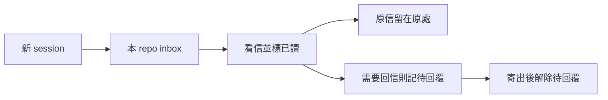

# 普通 repo inbox

> ep_type: implementation
> Owner: AIR-312; baseline: 30057953d522cccc818ec3bf4d013dcd1a85c623
> Status: user authorized implementation; source/integration acceptance pending

## 已決策

一 repo 一信箱，名字就是 repo name。linked worktree 共用 primary repo identity。通常一 repo 一 session，用一陣子換 session，不做 session registry 或協調服務。

User：「一般人類不就 inbox 看一下，之後就自動標成read, 一般也不會特別移動目錄吧，只是要記得要回信就好了。」因此看完即 read，信留原處可重看；只需保留待回覆，寄出後解除；工作另交既有卡。原 handoff 的五態處理與 mandatory handling-result 設計已 superseded，不得沿用。

主動 skill：once（預設）、watch、stop、status。每 repo 一 watcher。不造 daemon/automation 管理層。退役 prompt/start 自動處理、monitor、consume config、exceptions 轉寄與分診排程；底層 holder/epoch/durable queue 沿用。

## Scope / ownership

Full/boundary。Marshal 管計畫、board、裁決和收線；Flash 只有 implementation/evidence。worker 不再委派、不 commit/deploy/send、不碰真 store/其他 repo/memory。

動：scripts/duty_receive.py、mail_waiter.py、必要的小型 repo identity helper、對應 tests；現役 duty receive/monitor hooks 與 registrations；consume config；skills/mail-handle、mail-watch 及直接 consumers/索引；governance/scbus-address-ownership.md、rules/outward-action-consent.md 相關段。supervisor/forwarder 的現役引用核實後退役，歷史 ledger 資料不刪。生成檔走 generator。

不動：bridge/SC/Mosaic/CR repo、真信箱、歷史 archived 卡/EP、memory、其他工作。隔離 WT 修改不等於已部署。

## S1 現在可完成的獨立部分

1. caller Git common-dir 的 primary 根推導 repo basename；primary/linked WT/subdir/symlink 同一身份，非 Git/bare/無法判定 fail-closed。requested address exact-match canonical name，錯址在任何 consuming side effect 前拒絕。刪 per-caller consume TOML 依賴和檔案，無 migration bypass。
2. 退役 SessionStart/UserPromptSubmit duty auto-process 與 mailbox monitor 註冊，其他 hooks 不動。release cleanup 若仍必要保留並說明。保留的 legacy entry 不可默默啟動退役自動流程。相關 tests 改驗退役契約，不以 skip 隱藏回歸。
3. mail_waiter 只 watch caller repo mailbox，state per-repo；A stop 不影響 B。沿用 generation/event cursor 和現有背景等待；新 session 可 start 接續，不加 session 管理。
4. 新 mail-handle skill 簡述普通 inbox 與 once/watch/stop/status。S2 consumer 接線未完成時明示 pending，不捏造命令、不把 digest 分類冒充看信。mail-watch 轉到同一流程。同步直接 consumer 引用；歷史標籤明示歷史。DB-112 producer API 已到位的現況見 S2。

S1 先做不等 producer；完整 once/read/reply 能力尚未可用不得假報完成。

## S2 producer 契約已到位，consumer 接線待實作

初始缺口為 ACK 後一般歷史讀取。現已直接查 installed dutymail help 與 bridge docs/dutymail-output-schemas.md:132-176：DB-112 提供 mail list --address --box all/pending/acked 與 mail get --address --envelope-id，皆唯讀/tokenless；canonicalEnvelope 為雙層 JSON 字串，exported body 可缺。ACK 為 read 邊，read 不等於工作完成。SC 接線仍以 owner 回報為準。各 repo owner 自持修改，本 repo 不直接讀 transport DB、不複製 inbox 補洞。

正式介面到位後：讀信→標 read，原信可重看。最小待回覆紀錄（或 producer 同等能力）先保存再完成讀取確認；send 有成功 receipt 才解除。不要五態 ledger、每信工作結案儀式。送信/承接沿用 user 授權，信件內容不擴權。ACK 非工作完成，AI read 非 human done。活 holder 衝突不搶。

S2 裁定（Muse job-mv4k179q-vsqqs8 completed 後 Marshal 收斂）：在既有 duty_receive CLI 加薄入口，不新建 service。skill 先以 history face 看 pending 全文，LLM 判讀並做已授權處置；需要回覆者保存最小 id/note/target。mark-read **一次一封**，完整輸入／原文在場性驗證後先持久記待回覆，再短暫取 holder，prepare max-count=1，驗唯一 envelope ID 就是這次實際讀過的 ID 才 ACK，finally release。無需跨 session batch 工作流或多信 ACK 計畫。已 ACK 歷史重看不再次消費，unslotted/exported 項不自動 ACK。

待回覆清單 per-repo、atomic、同 repo 短鎖；不複製 incoming 原文。reply 薄入口驗 in_reply_to/target，第一次 send 前固定 outbound envelope ID＋content hash（引用持久 draft 檔）；重試同一實物，失敗或成功後清理前中斷都保留待回覆，重新用相同 envelope 發送由 transport 冪等。成功 receipt 三鍵與 envelope/target 匹配才解除。reply 不取 holder（send 本來不需要）。真實工作歸既有卡，不每封新開卡。stop 不刪待回覆。inbox/history/show 沿用 producer 原文，絕不 digest-only ACK；正文不強制是 JSON（普通文字也須呈現），不編造字數截斷限制。

判讀補正：純新到信附加在尾端，不會自行改變已讀 prefix；其他 consumer 推 cursor 才會使 mark-read prefix不符。Muse 設計報告的 speculative Critical 不作已確認 defect；轉成可執行測試。回信 crash 重試須 pin ID **及內容 hash**，不是只 pin ID。R1 writer 不實作 S2；收線後單 writer 接續。

## S3 遷移

五個 repo-name 信箱已建，不重建；四封通知已寄，user 已轉貼。見 migration.md/outbound-receipts.json。舊址不轉寄重建 envelope、不刪歷史、不搶 holder。sender/reply_address 切換和在飛責任對帳後才退役，不靠 pending=0 宣稱完成。AIR-310/311 歷史不重開，consume 機制 superseded。

## 驗證矩陣

- S1 identity：primary/linked WT/subdir/symlink 正控制，non-Git/bare/跨址負控制；錯址 runner 零 side effects，無 TOML 正常。
- registrations 不再 auto-process/monitor，其他 hooks 保持；config/parser/consumer tests 實跑。
- A/B watcher 隔離，同 repo 新 session start/stop/rearm；event cursor 不代表 read；無宿主喚醒能力須誠實交代。
- RED→GREEN、MIN→SAMPLE→相關 FULL；executable 改後實跑 CLI，真 CLI 測試只用 isolated store。
- S2：read 後原信可重看，新 session 待回覆仍在、send 失敗不清 pending，待 producer 後驗。
- post-build boundary fresh＋intent 獨立 context、跨家族意見、Marshal judge、Flash 修正/followup；docs 引用反掃與部署 probe，source/live 分開。

## Final Summary 預告

User-visible：skill 四模式、inbox read/history、待回覆；後兩項依 producer/SC 接線驗收。

## 進度

建卡 commit 33731634；WT /Users/ctai/Github/ai-guide-air-312。前兩 Flash jobs 因 user steering 明確停止，零 source edits。現在 user「我都轉貼了，你可以開始動工了」授權繼續。S1 先做，S2 不假報；post-build/部署 pending。

**終態結算（ZCode Marshal session sess_789605c0 收線）**：
- S1 實作＝Flash job-mv4hwczo（identity／退役／watcher／skill）；R1 六 finding 修正＝job-mv4jxz9o；S2 普通 inbox＝Muse job-mv4loqfn；R2 十項修正＝Flash job-mv4sktod＋測試快修 job-mv4uhzey。
- R2 整弧審查：muse review face **approve 零 findings**（job-mv4pe6oq）；codex task face 12 findings（job-mv4pgmjv，28K 閘階梯 b 檔案承載）→裁定 10 採納 1 記錄（.review/air-312.md）。
- Marshal 獨立驗證：mail 全套 **290 passed**（271 基準＋19 R2 新測試；RED 18F→GREEN）、相依 189、governance 267、e2e 1、desc FAIL=0、inert probe 零效、single-source 對 baseline 零新增；commit pre-commit 全 repo **3818 passed 2 skipped**。
- 凍結 revisions：實作 ea46a4a4 → R2 修正 a4cb4bd1；fix-delta 複審 muse job-mv4urnha（--base ea46a4a4）。
- S3 遷移（**明示未完、不擋本卡 AC**）：五新址建立＋四通知信寄達；CR-8、Mosaic owner 回報入 migration.md；sender 指引已切 repo basename（F9）；舊址退役待 sender/在飛對帳收線——舊址讀取以 producer 唯讀面（dutymail mail list）對帳，非 S2 CLI。
- 部署：merge 後 main 為 source 權威；live registration prune＝operator `--prune-stale` 維護窗動作（hooks/AGENTS.md），非本弧自動執行。
