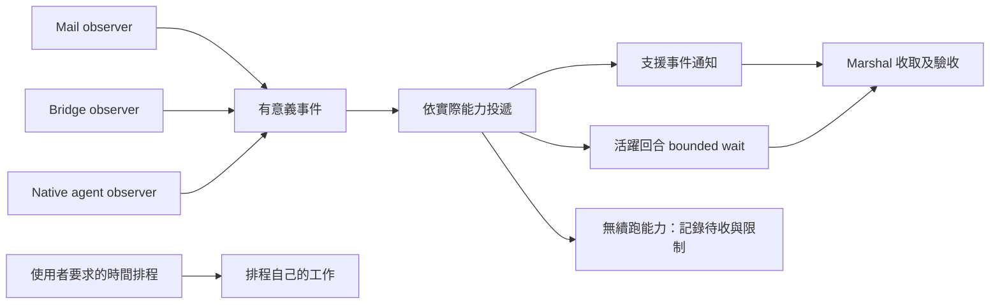

# 監控架構裁決：無事件不增加 session 回合

狀態：架構討論與 Marshal 裁決完成，尚未實作本設計。與 AIR-327 frozen source 分開。使用者要求架構合理優先，不要求最小改動或向後相容；主要問題是 session 洗版，而非通知音量。

## 已核實的問題

- `skills/bridge-dispatch/SKILL.md:46,51` 強制 Codex 長工建立 thread heartbeat；`skills/deep-work/SKILL.md:71-85` 重複要求三層監督並記錄 96 次空喚醒案例。定時插入回合本身違反使用者的目標，靜音不能修復。
- `skills/model-routing/SKILL.md:338-343` 將背景 exit 自動喚醒泛化；`skills/mail-watch/SKILL.md:57` 也把 exit 寫成普遍 push 原語，與 bridge-dispatch 的 Codex 能力列衝突。目前 bridge MCP 工具契約明示沒有 proactive push。
- `hooks/mail_autoarm.py:137-184` 是唯讀 advisory，卻輸出「已為 repo 掛哨」。`tests/test_mail_autoarm.py:158,183,208` 斷言了同一句。這證明訊息契約錯誤，沒有以讀碼冒充 live hook 實驗。
- Flash/Terra 歷史回放的 mail 案例會查狀態，但 missing/stale 分支直接要求再授權 start，未先核對已存在的啟動意圖；且將 per-repo freshness 外推成該 caller 已收到通知。詳另一份歷史回放報告。

## 推薦架構

共通契約放 `skills/_common/waiter-charter.md`（建議名稱，尚未建立）。它是被 workflow 引用的共用單元，不新增 daemon 或通用 watcher service。責任如下：

| 責任 | 擁有者 | 不能推論的事 |
|---|---|---|
| 觀察 domain 狀態、進程內等待 | 各現有 observer | 沒輸出不等於死；觀察不等於 ACK |
| 把事件送到目前 caller | harness 能力對應的接法 | worker 活著不等於 session 可被喚醒 |
| 收取結果、驗收、處置及重試裁決 | Marshal／既有 agent-workflow 與 plugin receipt owner | terminal 不等於 accepted；通知不增權 |
| 按時間啟動工作 | at／usage-ping／明示的 scheduled-work 入口 | 時間排程不能默默替代事件投遞 |

mail 游標、bridge ledger、native registry 保留各自 ownership 與生命週期，不合成一個狀態機。共通的是通知與回收契約，不是來源資料模型。

共通 invariant：閒置與未改變狀態不注入回合；timeout 在 observer 內消化；需要處理的新事件合併、去重後才投遞；失敗不得謊報已監控；收取義務有 caller/owner；停止、hard-death、retry-safe 仍依原有權威。各 domain 的節流上限獨立定義，mail 的每夜十次限制不外推。

## 刪除與重新歸屬

1. 移除一般背景監控必配 thread heartbeat 的規格與模板；不保留相容 fallback。降低頻率或關通知皆不符合目標。
2. 將 mail-watch 的共通 waiter 憲章與 bridge-dispatch 的通知能力描述移入共通契約。域內流程留在原 skill。
3. deep-work／autonomous-execution 消費監控契約，不再自訂固定三層標配。原生通知、observer、advisory 是不同責任，不能當成三個獨立冗餘保障。
4. model-routing 保留模型與供給選擇；共通收取生命週期改引用契約／agent-workflow，provider 特有操作留 plugin，避免模型路由又成為第二套監控 owner。
5. 修正 autoarm advisory 及對應測試，清楚表達需掛哨；只有實際 worker 與通知接法成立才能宣稱可自動處理。既有 watch 意圖、opt-in、stop 必須納入判斷，不把每次狀態追問當成授權失效。
6. 正常的定期工作不是本次刪除對象。保留使用者明示的排程用途，不把這次裁決擴成全域禁止 recurring automation；但一般監控不再依賴它。

改定義後逐一同步所有消費端與 descriptions，刪除舊重複定義；不是在末尾加一句「不要 cron」。既有 watchdog 是否仍服務其他合法排程須逐用途查證，不能僅因本監控用途刪除就整體移除。

## 能力缺口與交付邊界

本 session 實際 bridge_wait 已能有界等待並回傳 terminal，故活躍回合可用 bounded wait；它會產生工具往返，不能宣稱無限等待零 model 成本。這與 cron 不斷建立新的使用者／助理回合不同。

turn 結束後能否自動續跑，必須有真實通知通道證據。背景 shell 在跑、exit0 或 fresh heartbeat 均不足。native subagent 完成通知在工具供給中存在，但以它代理外部工作並跨 turn 自動接續仍需獨立驗證。本次未建立該 adapter，也不以「不存在」永久排除未來 carrier 支援。

能力描述以當前 exposed tool/carrier 與實測為先，harness 對照表作有證據的 fallback；不可把文件表本身當能力證據。若要補 Codex turn 結束後的 event delivery，需由 carrier 整合實作並實測，guide 文字不能提供該通道。沒有此通道時，記錄待收與恢復入口；不能假稱 unattended complete，也不能提前結束仍可在本回合收取的工作。

## 驗收設計

- 多次 observer timeout／無事件：新增 parent session 回合數為零。
- 同一事件重放不重複處理；新事件 batch 有界投遞且保留來源身份。
- 原生 terminal、bridge terminal、新信、stalled advisory 分別回到正確收取 owner；不得把 advisory 當 kill/retry 權威。
- watcher 活著但 delivery 不可用：不能宣稱「會自動處理」。缺哨 advisory 不能宣稱已 arm。
- 已授權 watch＋後续 status 問題：保留啟動意圖；明示 stop 不被自動重啟。
- 真實 future scheduling 仍走自己的入口，不被監控規格誤擋。
- instruction dry-run 只證選擇；零洗版／通知送達須以真實 harness session trace 驗證，文字搜尋或 LLM 共識不能替代。

## 獨立意見及裁決

GLM-5.3 初輪 `job-mv6djzrv-3nlfkl`，架構重評 `job-mv6dvbhz-u3ng2x`（同 reviewer session `sess_ed535086-046d-4d86-af44-da4a9854ef64`）。兩輪 read-only 完成，全文保全在 `/Users/ctai/Github/ai-guide/.agent-tmp/air327-retained/monitoring-glm-result.md` 與同目錄 `monitoring-architecture-glm-result.md`。

採納：共通契約移出 domain skill、觀察/投遞/驗收/排程分離、移除不合理 mandatory heartbeat、能力誠實、修正 advisory。

不採納：把 mail 夜間上限全球化；保留換名三層標配；讓 model-routing 繼續擁有通用收取流程；把無 push 的活躍 caller 一律降為下次認領；把所有未來排程都限制為 one-shot；以靜態 rg 驗收 session 零洗版。以上已納入推薦架構，不依共識直接採用。

本設計未改任何 operational skill、hook 或 live automation。原先本 session 建立的 cron 已刪除，沒有重建。下一個實作弧應以此完整契約遷移為 scope，獨立 worktree、writer/reviewer 分離，並以真實 trace 對照 acceptance；不混入已收斂的 AIR-327 source。
