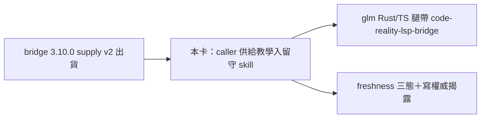

## Description

<!-- SECTION:DESCRIPTION:BEGIN -->
bridge sync 信（arc-close-status-sync-001-1791681000）交付的最後一條教學尾巴：ai-guide 派 glm Rust/TS 結構查詢腿時的 caller 供給教學——`--mcp-supply` 面在 db-108 v2／DB-101（bridge 3.10.0 出貨）後的 caller 契約。落點＝`skills/bridge-dispatch/SKILL.md` 留守面（consumer governance）。教學要點（源＝bridge docs/ep.md db-70/db-108 v2/DB-101 條＋.agent-tmp/db108-supply-v2/ 收斂文件）：①Rust/TS 腿顯式 `--mcp-supply code-reality-lsp-bridge`（graph server `code-reality` 於帶 CR face 的 workspace 預設自動供給、LSP server 恆需顯式）②freshness 三態（fresh 才配裝；stale/no-slot/unknown＝顯式 typed 拒／預設 loud skip；LSP index-free 不受此閘）③`edit_file`＝寫權威面④resume＝exact-supply lineage（換 supply＝新 session）⑤isolated-only（inherit/marshal 帶 supply＝拒）。

<!-- SECTION:DESCRIPTION:END -->

## Acceptance Criteria
<!-- AC:BEGIN -->
- [ ] #1 `skills/bridge-dispatch/SKILL.md` 增 caller 供給教學條（五要點——顯式 supply／預設供給與 opt-out／freshness 三態／edit_file 寫權威／resume lineage＋isolated-only），錨點對照 bridge docs/ep.md 原條
- [ ] #2 單腿獨立 context 審查（ordinary profile）＋merge 後 live chain probe
<!-- AC:END -->

## Implementation Plan

<!-- SECTION:PLAN:BEGIN -->
ephemeral WT → skill 增條（Read→Edit）→單腿 glm 審查→ff merge→probe→ack 信 disposition。
<!-- SECTION:PLAN:END -->

## Definition of Done
<!-- DOD:BEGIN -->
- [ ] #1 單腿審查 approve＋merge
<!-- DOD:END -->

## Implementation Notes

<!-- SECTION:NOTES:BEGIN -->
【來源】arc-close-status-sync-001-1791681000（class sync——bridge 板面清空通知＋過時認知修正＋教學尾巴交辦「歸你方 AIR-294 或後續卡」；AIR-294 已 Done 故開本卡）。
<!-- SECTION:NOTES:END -->
