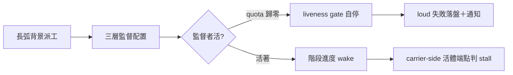
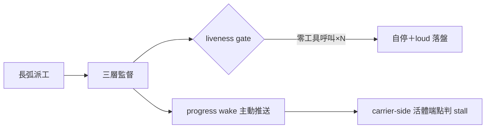

## Description

<!-- SECTION:DESCRIPTION:BEGIN -->
長弧自主執行時，監督機制自己會死：codex 大架構弧實證——主 loop 額度歸零後 heartbeat automation 每 5 分鐘喚醒共 96 次、全部空回應（零工具呼叫、零通知、零失敗紀錄），殭屍 8 小時；同期 user 在兩條 session 共七次問「進度？」——靜默期沒有任何主動進度推送。

**做什麼**
- 三層監督配置（原生完成通知＋heartbeat＋有變化才通知）固化為長弧標配條文（bridge-dispatch／deep-work）
- heartbeat／automation 模板強制帶 liveness gate：連續 N 次零工具呼叫→自停＋loud 失敗落盤；wake 前查 quota
- bridge_waiter.py frozen spec amendment：階段性進度 wake（events delta 活體訊號）＋stall 判別證據源＝carrier-side 權威活體端點（如 daemon healthz）
- bridge-dispatch 補 harness 完成通知對照表（哪個 harness 等得到 waiter 喚醒）
- 獨立 watchdog 為 POC 段：先查各 harness adapter 能否取得 quota／session 事件再定最小 driver（額度歸零時 LLM 自停不可依賴）

**不做什麼**
- 不重疊 AIR-296（spawn 僵屍偵測——不同 surface，引用其判定概念）
- 不改 bridge repo 本體（dispatch 條文與 ai-guide 側 watcher 為限）

<!-- SECTION:DESCRIPTION:END -->

## Acceptance Criteria
<!-- AC:BEGIN -->
- [x] #1 bridge-dispatch／deep-work 條文含三層監督標配＋heartbeat liveness gate 三要素（N 次零工具呼叫自停／loud 落盤／wake 前查 quota）——rg 命中可驗
- [x] #2 bridge_waiter.py frozen spec amendment 落地：階段性進度 wake＋carrier-side 活體端點 stall 判別（實測 wake receipt 移交：隨下次真實長跑驗證——deferred）
- [x] #3 bridge-dispatch 補 harness 完成通知對照表（codex 原生 subagent 有通知、bridge job 無——waiter 喚醒能力逐 harness 記載）
- [x] #4 watchdog POC 報告：各 harness adapter 能力盤點（quota／session 事件可達性），結論＝最小可行 driver 形態或明確不可行
<!-- AC:END -->

## Implementation Plan

<!-- SECTION:PLAN:BEGIN -->
〔baseline：ai-guide 2d9a5203〕〔已決策勿重辯：①dead-man switch 採雙防線——heartbeat 模板條文強制 liveness gate（belt）＋獨立 watchdog POC（suspenders；codex 意見採納：額度歸零時 LLM 連停都停不了，POC 先查 harness adapter 能力）②與 AIR-296 不重疊——不同 surface（spawn artifacts vs thread-level automation），引用判定概念不重做實作③watcher 改動走 bridge_waiter.py docstring frozen spec amendment 管道④素材源＝.agent-tmp/improve-20261011/（7d 窗）：codex-sess-report.md P-1/P-2/G-10、zcode-sess-report.md P2/G3。範圍：skills/bridge-dispatch、skills/deep-work、skills/autonomous-execution 條文＋scripts/bridge_waiter.py amendment＋watchdog POC（選做）。〕

〔SC 收編 2026-10-11：dead-man switch 表態偏 watchdog 載體——條文模板可並存當第一道但不可當唯一道（現有雙防線設計成立）；誤殺防線＝「產物停滯＋心跳凍結」雙訊號，禁單一 CPU 訊號（model-bound 低 CPU 是常態——SC ticker 誤報教訓）〕
<!-- SECTION:PLAN:END -->

## Implementation Notes

<!-- SECTION:NOTES:BEGIN -->
SC 回信已收（reply_type=completed、envelope 41fe234c-4d56-46eb-bd68-85aa7aa6e843；reply raw＝.agent-tmp/improve-20261011/sc-reply-raw.json，7d 窗）——五題全表態＋SC 側 chat 連結設計結論，本信閉環

receipt：worker job-mv3bmfjm 交付四檔＋POC 報告（usage face 逐 harness 實測：codex/glm live、muse/grok unsupported by design）；frozen spec amendment＝--progress-wake-min（預設 off 顯式開啟、exit 3 advisory 帶 lastEventAt 活體訊號、零私有 ledger 接觸）；rebase main 後 ff 收線、全量 gate 綠；AC#2 實測 wake receipt 移交下次真實長跑（deferred 標註於 AC）。

progress wake 實測（2026-10-11 收口）：v1 flash 偷跑秒回；v2 忘帶 --write-mode edit --yolo 落 plan mode；v3 卡點＝bridge 3.10.3 對 write-capable 派發強制 verified card worktree（ephemeral WT identity 綁卡空字串＝`--wt --card` 拒收「card mismatch」）——解法＝persistent card WT（`wt-open.sh AIR-301 --base main`）派發。**v3 實測過**：glm GLM-5.3-Flash 兩顆 job（sleep 180／sleep 100，皆真的執行——finalText 帶 SLOW-DONE-*、runs 面 tool.updated=181、exitCode 0）；watcher `--progress-wake-min 1` 恰 60s exit 3（背景直錄 WATCHER_RC=3）、stdout `state=progress` JSON（armedAt＋elapsedMinutes＋雙軸 silence），wake 時 job 仍在跑。觀察面註記：running 期快照 `lastEventAt=null`（bridge 3.10.3 running 期不帶該欄——活體訊號由雙軸 silence 承擔，終態 show 才帶 lastEventAt；advisory 語義不受損）。合成實測收 AC#2；真實長跑 wake receipt 維持 deferred（不變）。
<!-- SECTION:NOTES:END -->

## Final Summary

<!-- SECTION:FINAL_SUMMARY:BEGIN -->
長弧監督面全數落地：watcher frozen spec amendment（progress wake）＋deep-work 三層監督標配＋liveness gate 條文＋bridge-dispatch harness 通知對照表＋autonomous-execution＋watchdog POC。與 AIR-296 不重疊（spawn artifacts vs thread automation 兩 surface）。終態圖：

<!-- SECTION:FINAL_SUMMARY:END -->
