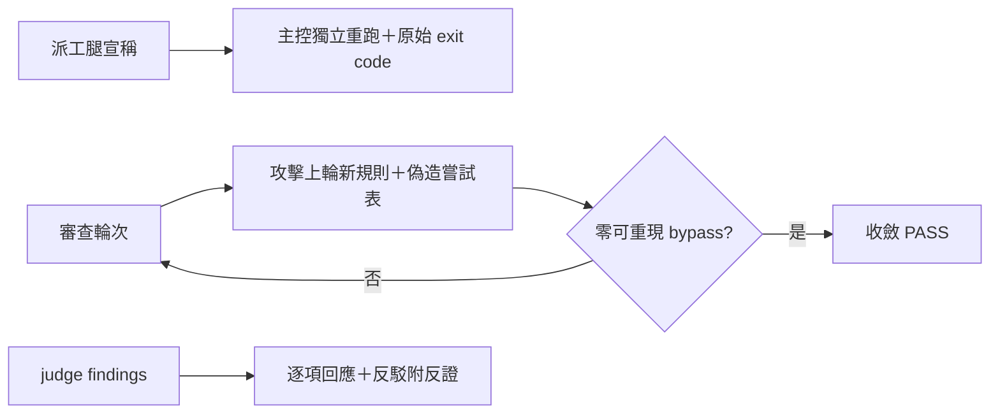
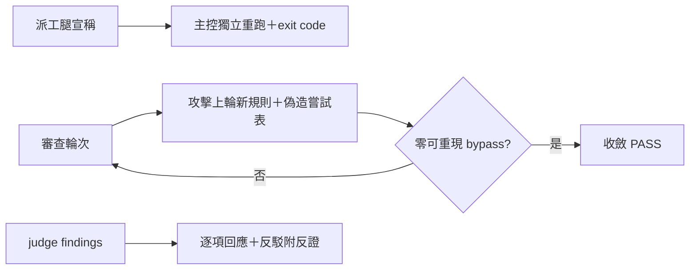

## Description

<!-- SECTION:DESCRIPTION:BEGIN -->
派工腿說「測試全綠」不等於綠：實證 Flash 回報 21 測試全綠、接手腿擴測找到 8 個 RED，writer 連 failure 計數欄位都取錯；bridge DB-100 修復弧四輪對抗審查每輪都抓到真缺陷（三輪全綠後第四輪仍抓到 Important）；judge 裁定被雙向反駁收斂（judge 撤回主張、marshal 以源碼反證否決 judge）。三個「什麼才算數」的實證語義收編成文。

**做什麼**
- acceptance-evidence skill 增「派工腿測試統計不作驗收證據」條：主控獨立重跑＋原始 exit code＋完整 log 覆核，aggregate 數字不作驗收證據
- acceptance-evidence skill 增「對抗審查收斂協議」節：攻擊面＝上輪新規則、偽造嘗試表必交付、reviewer unverified risk 由 marshal 實證收口、收斂判定＝bounded attack set 零可重現 bypass（由攻擊面覆蓋決定、非固定輪數）
- judge-review skill 增「裁定討論」步驟：findings 逐項回應、反駁附反證、judge 可撤回、禁多數決表決

**不做什麼**
- 不動 review-engine 的審查模式判定（既有單一源）

<!-- SECTION:DESCRIPTION:END -->

## Acceptance Criteria
<!-- AC:BEGIN -->
- [x] #1 acceptance-evidence skill 增兩節／條（測試統計＋對抗收斂協議），各帶本弧實證錨點——rg 命中可驗
- [x] #2 judge-review skill 增裁定討論步驟（逐項回應、反駁附反證、可撤回、禁多數決）
- [x] #3 instruction 落地前審查閘依 review-engine profile 完成所需審查腿（receipt 留卡 notes）
- [x] #4 deploy_agents.py bundle 驗證綠（90KiB gate 內）＋受影響引用面 drift 掃描（rg 單一關鍵詞掃引用）
<!-- AC:END -->

## Implementation Plan

<!-- SECTION:PLAN:BEGIN -->
〔baseline：ai-guide 2d9a5203〕〔已決策勿重辯：①writer 測試統計不作驗收證據——主控獨立重跑＋原始 exit code＋完整 log（Flash 21 綠 vs Sol 8 RED 實證）②對抗收斂協議四要素——攻擊面＝上輪新規則／偽造嘗試表必交付／unverified risk 由 marshal 實證收口／收斂判定＝bounded attack set 零可重現 bypass（codex 修正採納：由攻擊面覆蓋決定收斂，非固定輪數；連續乾淨輪≠安全）③judge 裁定討論步驟固化進 judge-review（glm vs codex 分歧裁決：補小節成本低，做——逐項回應、反駁附反證、可撤回、禁多數決）④素材源＝.agent-tmp/improve-20261011/：zcode-sess-report.md G1/L1＋codex-sess-report.md G2/G3/L3。範圍：skills/acceptance-evidence/SKILL.md 新節＋taxonomy 條、skills/judge-review/SKILL.md 裁定討論小節、rules/acceptance-evidence.md 指針（如需）。落地前載 instruction-writing skill＋依 review-engine profile 走落地前審查閘。〕

〔SC 收編 2026-10-11：judge 裁定討論表態偏 codex（暫不開卡、補案例；2:1 vs glm）——本卡 AC#2 修訂：judge-review 不開新小節，改為補案例：先核 skill 結構是否適合收案例（instruction-writing 紀律），不合適則記 memory reference〕
<!-- SECTION:PLAN:END -->

## Implementation Notes

<!-- SECTION:NOTES:BEGIN -->
SC 回信已收（reply_type=completed、envelope 41fe234c-4d56-46eb-bd68-85aa7aa6e843；reply raw＝.agent-tmp/improve-20261011/sc-reply-raw.json，7d 窗）——五題全表態＋SC 側 chat 連結設計結論，本信閉環

boundary receipt：classification=boundary（收斂判定＝acceptance 面語義）／review=cross-family fresh（codex webgpt 主弧審 G1/G2/G3 內容＋修正收斂判準）＋independent context（glm-5.3）＋Writer/Reviewer 分離（WT worker 寫、marshal 審 diff 後收線）；intent 分離腿未派＝顯式記錄降級／session-freshness=fresh／deployment-surfaces=healthy（skills symlink live 即生效，非 bundle 面）。全量 gate 3801 綠（6ffbc3c5）。
<!-- SECTION:NOTES:END -->

## Final Summary

<!-- SECTION:FINAL_SUMMARY:BEGIN -->
三處條文落地 main @ 6ffbc3c5：acceptance-evidence taxonomy 增「派工腿測試統計」條＋新節「對抗審查收斂協議」（四要素＋DB-100 R1→R4 真實案例）、judge-review 增「裁定討論」（四紀律＋雙向反轉真實案例）。終態圖：

<!-- SECTION:FINAL_SUMMARY:END -->
