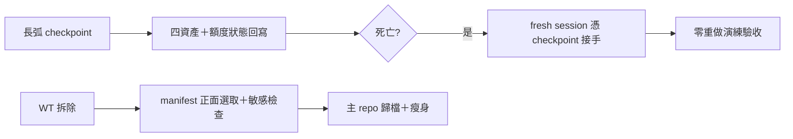
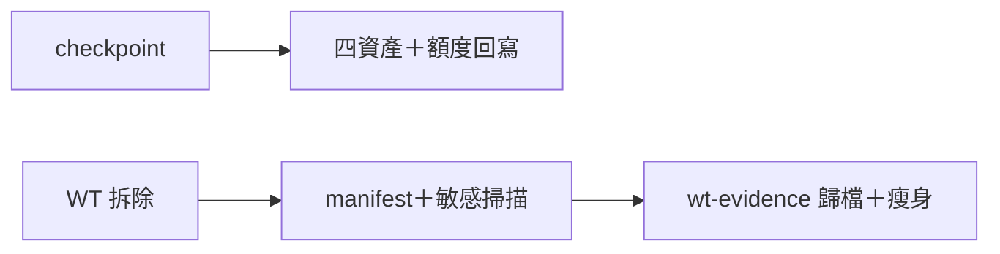

## Description

<!-- SECTION:DESCRIPTION:BEGIN -->
「隨時會死」是長弧的設計預設——bridge 大架構弧同一 session 額度死四次，但 Flash 死後 Sol 靠 checkpoint 零重做接手成功。把實證有效的接手資產格式固化，並把 WT 拆除前的證據保全機制化（含敏感資料檢查，非純副檔名白名單）。

**做什麼**
- task-recovery checkpoint 範本收編四資產：修復報告（BUILD-REPAIR 形）、原始 exit receipts、scope hash 清單、work-order 位置
- checkpoint 段回寫剩餘額度狀態；臨界時主動收斂（落盤＋通知＋停 heartbeat）
- wt-close.sh 補證據保全：evidence manifest 正面選取＋敏感資料檢查後搬主 repo 指定目錄；瘦身（實證 935M→2.6M 誤拷風險）
- 跨模型接手演練一次作驗收：fresh session 僅憑 checkpoint 恢復、零考古

**不做什麼**
- 不做全自動跨 repo 契約 hash 檢查（單事故撐不起工具化，卡面條款先行）

<!-- SECTION:DESCRIPTION:END -->

## Acceptance Criteria
<!-- AC:BEGIN -->
- [x] #1 task-recovery checkpoint 範本含四資產＋額度回寫欄
- [x] #2 wt-close.sh 證據保全＋manifest 正面選取＋敏感掃描落地，瘦身實測一次
- [ ] #3 跨模型接手演練 receipt（移交：隨下次長弧實戰演練驗證——deferred）
- [x] #4 kanban-board skill 補 WT 拆除前保全一行
<!-- AC:END -->

## Implementation Plan

<!-- SECTION:PLAN:BEGIN -->
〔baseline：ai-guide 2d9a5203〕〔已決策勿重辯：①checkpoint 四資產（BUILD-REPAIR 形修復報告／原始 exit receipts／scope hash 清單／work-order 位置）進 skills/_common/task-recovery.md 範本②checkpoint 段回寫額度狀態＋臨界主動收斂③WT 證據保全採 evidence manifest 正面選取＋敏感資料檢查（codex 修正採納：反對純副檔名白名單——.log/.json 可含 credential）落 scripts/wt-close.sh＋kanban-board skill 一行④跨模型接手演練一次作 AC（fresh session 僅憑 checkpoint 零考古）。素材源＝.agent-tmp/improve-20261011/：codex-sess-report.md G1/P8/L5＋zcode-sess-report.md G5。範圍：task-recovery 範本、wt-close.sh、kanban-board skill 一行。〕

〔SC 收編 2026-10-11：優先序表態＝與 AIR-305 並列最高（額度牆是高頻事件——SC 本弧即時碰上 codex native 池 100% 耗盡）〕
<!-- SECTION:PLAN:END -->

## Implementation Notes

<!-- SECTION:NOTES:BEGIN -->
SC 回信已收（reply_type=completed、envelope 41fe234c-4d56-46eb-bd68-85aa7aa6e843；reply raw＝.agent-tmp/improve-20261011/sc-reply-raw.json，7d 窗）——五題全表態＋SC 側 chat 連結設計結論，本信閉環

receipt：worker job-mv3aq5of 交付三檔；live acceptance＝air-303 WT 拆除本身實跑新保全（7 檔＋manifest 歸檔 wt-evidence/air-303、敏感排除 0、瘦身生效）；main @ 0e1ea80e、全量 gate 3801 綠；AC#3 演練移交下次長弧（標註於 AC）。
<!-- SECTION:NOTES:END -->

## Final Summary

<!-- SECTION:FINAL_SUMMARY:BEGIN -->
證據保全＋四資產＋額度回寫落地。終態圖：

<!-- SECTION:FINAL_SUMMARY:END -->
