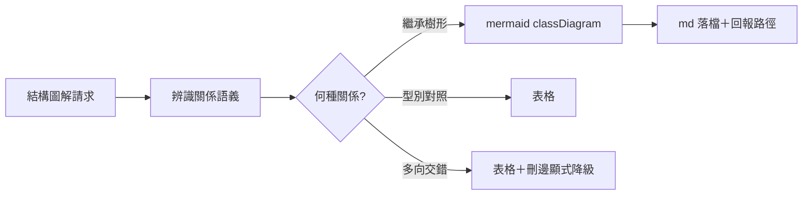
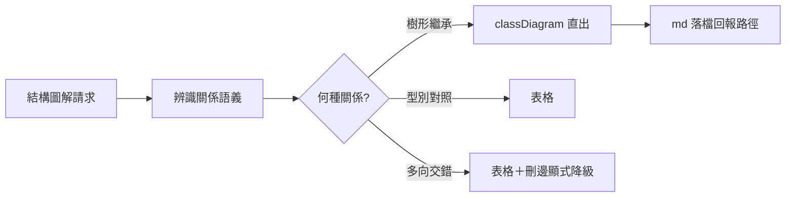

## Description

<!-- SECTION:DESCRIPTION:BEGIN -->
user 請 illustrate 圖解 study area 類別結構，第一輪只出 console ASCII、沒想到 UML classDiagram，被指正後才補。根因有二：diagram-selection 現行條文對 classDiagram 全面負面（實證其實只適用多向交錯），且與 artifact-menu 已定義 Contract Class Slice 用 classDiagram 內部矛盾。

**做什麼**
- class 圖判準兩層→三層：型別對照→表格；樹形／森林繼承（單 parent、約 10 class 內）→mermaid classDiagram 是正答；多向交錯→表格＋刪邊記載（負面實證有效域收窄到此）
- 新原則條：user 請求的結構有 SA/SD 標準圖形時，標準圖語義優先進候選；因載體限制降級須顯式回報 user（禁默默吞掉標準圖）
- artifact type 判斷先於 output carrier（先辨識關係語義再選 console／md／svg／html）
- console 投影＝縮排樹（樹形繼承域）；md＝classDiagram 檔＋回報路徑（durable＝ai-analysis/reports/、ephemeral＝.agent-tmp/illustrate/；svg 預渲染為 opt-in 增益）

**不做什麼**
- 不改「console 禁 mermaid 語法」既有約束（console 給縮排樹非 mermaid 原始碼）
- chat 點連結直達渲染（svg 極限形態）以實測 POC 收，不預先宣稱

<!-- SECTION:DESCRIPTION:END -->

## Acceptance Criteria
<!-- AC:BEGIN -->
- [x] #1 diagram-selection 三層判準落地＋classDiagram 負面條收窄到交錯域
- [x] #2 illustrate＋artifact-menu 連動更新（內部張力消除：兩檔對 classDiagram 立場一致）
- [x] #3 事件重放 receipt：study-area 形態請求第一輪命中標準圖或主動建議 md classDiagram
- [ ] #4 C3 實測記錄（移交：SC atlas S1 交付時隨 F5 人類確認——SC 回信裁定不需新 POC）
<!-- AC:END -->

## Implementation Plan

<!-- SECTION:PLAN:BEGIN -->
〔baseline：ai-guide 2d9a5203〕〔已決策勿重辯：①三層判準取代現行兩層（型別對照→表格／樹形繼承單 parent 約 10 class 內→classDiagram／多向交錯→表格＋刪邊）②「標準圖語義優先進候選、降級須顯式回報 user」原則條——現行條文讓 AI 默默吞掉標準圖是事件真根因③artifact type 判斷先於 output carrier（codex 意見採納）④內部張力一併消除：illustrate-artifact-menu class-slice 已用 classDiagram，與 diagram-selection 負面條對齊⑤console 投影＝縮排樹（保留 console 禁 mermaid 語法約束）；md＝classDiagram 檔回報路徑，durable＝ai-analysis/reports/、ephemeral＝.agent-tmp/illustrate/；svg 預渲染 opt-in⑥chat 點連結（C3）標未查證——AC 以實測收。素材源＝sess_de3fdb12＋user steering 原話＋.agent-tmp/improve-20261011/opinion-*.md Q3 節。範圍：skills/diagram-selection、skills/illustrate、skills/_common/illustrate-artifact-menu.md 三檔連動。落地前載 instruction-writing skill。〕

〔SC 收編 2026-10-11：①「點開直達」AC 直接吃 SC atlas S0（command 回傳 opened/failed，atlas/extension.ts:539-550）＋S1（md/html 走 chariotAtlas.openHtmlReport report viewer 含 mermaid 渲染、零 wire 改動）——SC 既有 L3 機械證據（report-resources.vscode-test.ts R3）已覆蓋相容性假設；②POC 裁決＝不需新寫 POC：實測＝一次 F5 手動確認（http anchor host 級行為）＋S1 交付正式測試；③「inline code 內 path/path:line 轉可點」應提前分期（ZCode DB 14 天 17,554 則統計：backtick 路徑引用 3,643 則 vs 裸路徑 420 則——多數引用現況不可點）；④SC 側設計全文＝southchariot .agent-tmp/sc-chat-openlink-seat-{glm,codex}.md＋sc-chat-openlink-brief.md（7d 窗）；跨 repo 依賴：S0-S3 歸 SC 側弧〕
<!-- SECTION:PLAN:END -->

## Implementation Notes

<!-- SECTION:NOTES:BEGIN -->
SC 回信已收（reply_type=completed、envelope 41fe234c-4d56-46eb-bd68-85aa7aa6e843；reply raw＝.agent-tmp/improve-20261011/sc-reply-raw.json，7d 窗）——五題全表態＋SC 側 chat 連結設計結論，本信閉環

receipt：worker job-mv3bmga0 交付三檔連動（三層判準＋先語義後載體＋標準圖 surface 義務＋console 縮排樹＋md 落點慣例；內部張力消除）；main @ 116446e0、全量 gate 3809 綠；AC#4 C3 實測移交 SC atlas S1（SC 回信裁定不需新 POC——F5 人類確認＋S1 正式測試）。

C3 實測結果（2026-10-11 user 親點）：svg＋絕對路徑＝點開直達渲染 ✓；相對路徑（.agent-tmp/...）跨 workspace 場景＝路徑不存在 ✗——檔案連結對人類 viewport 的適用域確認：chat workspace root 與檔案所在 repo 一致時相對路徑可點、否則須絕對路徑。此發現補強 SC 信的「repo 層涵蓋不到」論點（illustrate 條文的 md 落檔回報路徑宜視情境給絕對路徑）。SC atlas S1 的正式測試仍歸 SC 側交付（本項非取代）。
<!-- SECTION:NOTES:END -->

## Final Summary

<!-- SECTION:FINAL_SUMMARY:BEGIN -->
illustrate 標準圖優先落地：diagram-selection 三層判準（樹形 classDiagram 正答、交錯降表格＋刪邊）＋先語義後載體＋降級顯式回報；illustrate console 縮排樹＋md classDiagram 落點；artifact-menu 連動一致。終態圖：

<!-- SECTION:FINAL_SUMMARY:END -->
