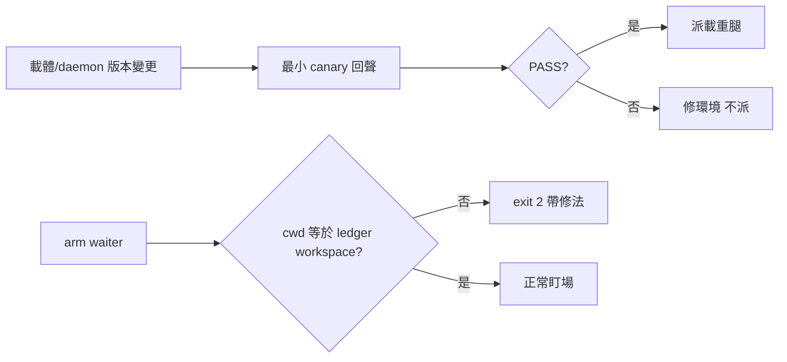

## Description

<!-- SECTION:DESCRIPTION:BEGIN -->
載體／daemon 版本變更後直接派載重腿曾死於 426 websocket（事後 canary 對照組證明可預防）；三個 waiter 全數因 cwd×ledger 錯位 exit 2 繞路重掛。派工前傳輸面預檢機械化＋條文化。

**做什麼**
- bridge_waiter.py 啟動 self-check：cwd vs job 所屬 workspace ledger 比對，不符＝exit 2 帶修法（機械化優先於條文）
- canary 條款：載體／daemon 版本變更後派載重腿前先派最小 canary（單 turn 回聲）——條款本體落 bridge repo plugin skill 源（版本凍結防 drift）；ai-guide 側先 memory reference＋留守 skill 一行
- 留守 skill 補 waiter 腳本解析路徑一行（免每次即場搜尋）

**不做什麼**
- 不在 ai-guide 側重刻 canary 操作細節（plugin skill 版本凍結，重刻必 drift）
- bridge repo 本體改動歸 bridge 維護弧（跨 repo 主權）

<!-- SECTION:DESCRIPTION:END -->

## Acceptance Criteria
<!-- AC:BEGIN -->
- [ ] #1 bridge_waiter.py cwd self-check 落地＋單元測試（不符 exit 2 帶修法）
- [ ] #2 留守 skill 一行＋memory reference 一條（canary 條款 redirect 指針）
- [ ] #3 bridge repo plugin skill 源 canary 條款——落地或明確 deferred 掛 bridge 維護弧
<!-- AC:END -->

## Implementation Plan

<!-- SECTION:PLAN:BEGIN -->
〔baseline：ai-guide 2d9a5203〕〔已決策勿重辯：①waiter cwd self-check 機械化優先（腳本內建 fail-loud——三判準全過：純字串比對／繞路代價高／零判斷空間），條文一行輔助②canary 條款本體落 bridge repo plugin skill 源（版本凍結防 drift——glm 意見採納）；ai-guide 側 memory reference＋留守 skill 一行先行、bridge 出貨後 redirect③跨 repo 寫入走 bridge 維護弧對方主權面。素材源＝.agent-tmp/improve-20261011/：zcode-sess-report.md G2/P1/P6。範圍：scripts/bridge_waiter.py self-check＋單元測試、skills/bridge-dispatch 留守一行、memory reference 一條。bridge repo 面另記 deferred（不阻塞本卡）。〕

〔SC 收編 2026-10-11：優先序表態＝與 AIR-303 並列最高（額度牆高頻）〕
<!-- SECTION:PLAN:END -->

## Implementation Notes

<!-- SECTION:NOTES:BEGIN -->
SC 回信已收（reply_type=completed、envelope 41fe234c-4d56-46eb-bd68-85aa7aa6e843；reply raw＝.agent-tmp/improve-20261011/sc-reply-raw.json，7d 窗）——五題全表態＋SC 側 chat 連結設計結論，本信閉環
<!-- SECTION:NOTES:END -->
