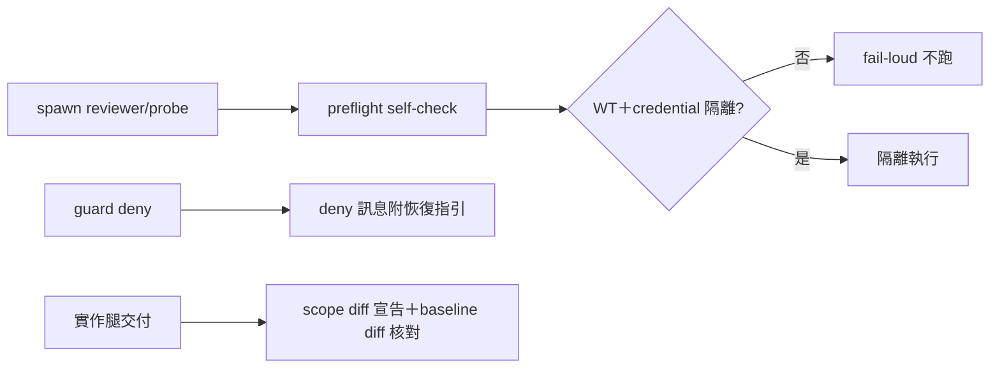

## Description

<!-- SECTION:DESCRIPTION:BEGIN -->
三個派工腿衛生缺口有實證：唯讀 reviewer 的 run 污染主工作區 GLM provision 憑證＋留六個 mock jobs；marshal admission guard 擋人後 main 花三輪 rg 考古才拼出 work-order 發行方式；glm 實作超出授權範圍（user 原話「改了許多，也超出許多範圍」），被迫整弧重審。

**做什麼**
- agent-workflow spawn prompt 範本補隔離 self-check（pwd git toplevel＝自己的 WT；禁觸共享 state 路徑清單：.delegate-bridge/ ledger、provision dir）
- marshal admission guard 的 deny message 附 work-order schema 範例＋定義源路徑（事發現場唯一 surface，成本最低的發現性修復）
- implement／execution-plan 補 scope diff 義務：交付報告必附 out-of-scope 檔案清單；收線以 git diff baseline..HEAD 機械核對宣告（路徑差機械查、語義超範圍歸 marshal 裁決）

**不做什麼**
- 不做 bridge spawn 機械隔離參數（bridge repo 面，緩議）

<!-- SECTION:DESCRIPTION:END -->

## Acceptance Criteria
<!-- AC:BEGIN -->
- [ ] #1 agent-workflow spawn 範本含隔離 self-check＋禁觸清單
- [ ] #2 guard deny 訊息附 work-order schema 範例＋定義源路徑——實測擋一次並照指引恢復
- [ ] #3 implement／execution-plan scope diff 條文落地
- [ ] #4 一次實戰核對 receipt（下次實作弧套用 scope diff 核對）
<!-- AC:END -->

## Implementation Plan

<!-- SECTION:PLAN:BEGIN -->
〔baseline：ai-guide 2d9a5203〕〔已決策勿重辯：①reviewer isolation 以 spawn prompt 範本條文先行（self-check pwd toplevel＋禁觸共享 state 清單：.delegate-bridge/ ledger、provision dir）；bridge spawn 機械參數緩議（bridge repo）②guard deny message 改良落 hooks/ marshal admission guard（附 work-order schema 範例＋定義源路徑；非法 worker 仍不得自取授權）③scope diff 義務：交付報告必附 out-of-scope 清單＋收線 git diff baseline..HEAD 機械核對（路徑差機械查、語義超範圍 marshal 裁決——codex 分工採納）。素材源＝.agent-tmp/improve-20261011/：codex-sess-report.md P5/P3/P6。範圍：skills/agent-workflow、hooks/ guard 訊息、skills/implement＋skills/execution-plan 條文。〕
<!-- SECTION:PLAN:END -->
