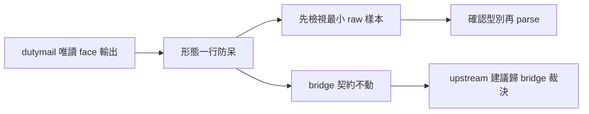

## Description

<!-- SECTION:DESCRIPTION:BEGIN -->
消費 dutymail replies face 時 parse 假設 canonicalEnvelope 是 object，實際是 JSON 字串（雙層編碼）——AttributeError 崩一次。bridge 源碼證實 String 是既定形態（H6 verbatim 紀律），但 faces 表只講語義軸不講機械軸——消費者第一眼入口沒有形態警示。

**做什麼**
- faces 表旁加一行「形態一行」：canonicalEnvelope 是字串（null＝已 export）、body 仍是字串、reply_type 住 body JSON 內不在 item 層；首次消費先檢視最小必要欄位 raw 樣本再 parse，禁 object 假設
- 條文草案經 glm-5.3＋codex webgpt 雙獨立 context 腿審過（含 bridge 源碼補強：三 face 共用輸出核＋contract tests）

**不做什麼**
- 不升全域 rule、不加 hook、不寫 helper 腳本（載體判準：一行防呆夠，重複事故或持久化 consumer 出現再機械化）
- 不改 bridge 契約——bridge 面 upstream 建議已寄 work-order（envelope ca058d9d…，scope 對方主權裁決）

<!-- SECTION:DESCRIPTION:END -->
