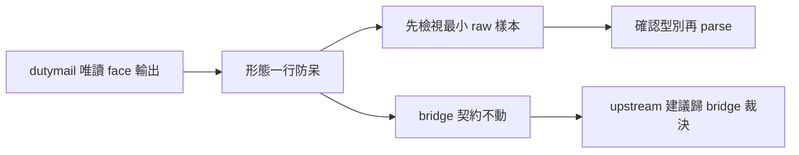
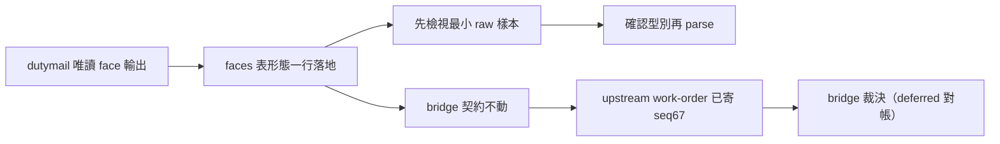

## Description

<!-- SECTION:DESCRIPTION:BEGIN -->
消費 dutymail replies face 時 parse 假設 canonicalEnvelope 是 object，實際是 JSON 字串（雙層編碼）——AttributeError 崩一次。bridge 源碼證實 String 是既定形態（H6 verbatim 紀律），但 faces 表只講語義軸不講機械軸——消費者第一眼入口沒有形態警示。

**做什麼**
- faces 表旁加一行「形態一行」：canonicalEnvelope 是字串（null＝已 export）、body 仍是字串、reply_type 住 body JSON 內不在 item 層；首次消費先檢視最小必要欄位 raw 樣本再 parse，禁 object 假設
- 條文草案經 glm-5.3＋codex webgpt 雙獨立 context 腿審過（含 bridge 源碼補強：三 face 共用輸出核＋contract tests）

**不做什麼**
- 不升全域 rule、不加 hook、不寫 helper 腳本（載體判準：一行防呆夠，重複事故或持久化 consumer 出現再機械化）
- 不改 bridge 契約——bridge 面 upstream 建議已寄 work-order（envelope ca058d9d…，scope 對方主權裁決）

<!-- SECTION:DESCRIPTION:END -->

## Acceptance Criteria
<!-- AC:BEGIN -->
- [x] #1 faces 表形態一行落地（rg 命中 canonicalEnvelope 形態錨）
- [x] #2 五維檢查通過（術語照 bridge 輸出原樣 canonicalEnvelope/reply_type；無元資訊——as-of 屬 state 快照例外）
- [x] #3 drift 掃描通過（rg canonicalEnvelope|reply_type 掃 skills/ rules/ 引用面——handoff 語義引用無衝突）
- [x] #4 bridge 面 upstream work-order 已寄（envelope ca058d9d…）——回信對帳由收信鏈承接，非本卡阻塞
<!-- AC:END -->

## Implementation Notes

<!-- SECTION:NOTES:BEGIN -->
落地 receipt（審查閘四欄）：classification=ordinary（消費方法防呆，非 decision/authority/gate/authorization/acceptance 語義變更）／review=獨立 context×2（glm-5.3 job-mv38jdo8＋codex chatgpt-web/high job-mv38jdra，條文草案 Q4 逐字審——意見落檔 .agent-tmp/improve-20261011/opinion-shape-*.md；超越 ordinary 最低線）／session-freshness=fresh（instruction-writing 本 session 載入後編輯）／deployment-surfaces=healthy（skills 母鏈 symlink live 即生效；bundle 四端不含 _common＝N/A）。bridge 面對帳 deferred：work-order envelope ca058d9d…（seq 67）待 delegate-bridge-marshal 回信——由收信鏈承接，非本卡阻塞。
<!-- SECTION:NOTES:END -->

## Final Summary

<!-- SECTION:FINAL_SUMMARY:BEGIN -->
形態一行已落地 skills/_common/dutymail-roundtrip.md（b77c9fe8，卡 WT 全量 gate 3801 綠、drift 掃描淨、ff-merge 收線、WT/branch 拆除零殘留）。終態圖：

<!-- SECTION:FINAL_SUMMARY:END -->
