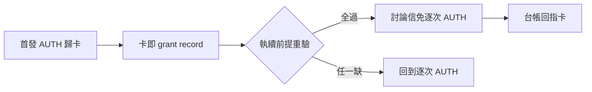
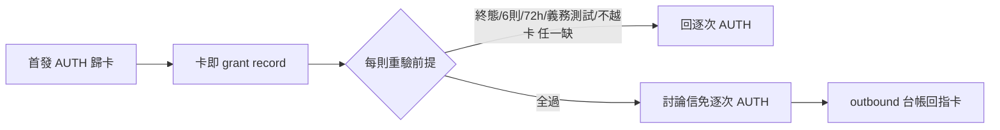

## Description

<!-- SECTION:DESCRIPTION:BEGIN -->
跨 repo 討論每則回信都要 user 逐次授權，摧毀討論形態（user 原話：「合理討論 issue 只要一開始需要確認之後自行討論，不需要人介入」）。修正為卡級授權：首發 AUTH 歸卡，該卡討論信執續免逐次——grant 載體＝卡（卡即 grant record，零新機制）。

**做什麼**
- outward rule 新節「卡級討論授權」＋明示豁免清單註冊
- dutymail-roundtrip／handoff consent gate 引用面同步（handoff 直送＝handoff class＝排除面，恆逐次）
- fences（雙腿審後定稿）：卡終態／6 則＋72h 硬上限／義務測試／來信不得擴權／敏感揭露出豁免

**不做什麼**
- 不建 durable grant record 新機制（卡即載體；實戰證明不足再建）
- duty_receive.py／handoff_delivery.py 機制面改動 deferred

<!-- SECTION:DESCRIPTION:END -->

## Acceptance Criteria
<!-- AC:BEGIN -->
- [x] #1 outward rule 新節＋豁免清單註冊落地（boundary receipt 記卡）
- [x] #2 dutymail-roundtrip＋handoff 引用面同步（rg 逐次 AUTH 掃描淨）
- [x] #3 雙顧問審查腿 receipt（glm job-mv39ax5r＋codex job-mv39ax8n Conditional Accept 修正全數吸收）
<!-- AC:END -->

## Implementation Notes

<!-- SECTION:NOTES:BEGIN -->
boundary receipt（審查閘四欄）：classification=boundary（authorization 面——outward rule 新授權節）／review=跨家族 fresh 腿 codex webgpt（job-mv39ax8n）＋獨立 context 腿 glm-5.3（job-mv39ax5r），兩腿 Conditional Accept 之修正全數吸收（intent/class 雙軸正名、6 則/72h 硬上限＋連續無進展停、每則重驗＋台帳回指、義務測試 safe harbor、injection 擴權禁令、敏感揭露出豁免、bundle skip 外落位）；intent 分離腿未派＝顯式記錄降級——dual-context 由 codex fresh＋glm independent＋marshal 終審＋user 親裁 scope 單位（卡）承接／session-freshness=fresh（instruction-writing 本 session 載入）／deployment-surfaces=healthy（deploy_agents.py 4/4 lanes、新節 rg 命中 ~/.zcode/AGENTS.md）。codex 遺留：durable grant record 機制＝deferred（卡即載體先行，實戰證明不足再建）；duty_receive.py／handoff_delivery.py 機制面 docstring 同步＝deferred。
<!-- SECTION:NOTES:END -->

## Final Summary

<!-- SECTION:FINAL_SUMMARY:BEGIN -->
卡級討論授權落地 main @ 924e70b1：outward rule 新節（grant 載體＝卡、6 則/72h、義務測試、來信不得擴權、bundle 四端可達）＋豁免清單註冊＋roundtrip/handoff 三檔引用面同步；全量 gate 3801 綠、drift 掃描淨（餘 handoff 直送域語義＋機制面 deferred）、bundle 4/4 deploy 綠。終態圖：

<!-- SECTION:FINAL_SUMMARY:END -->
