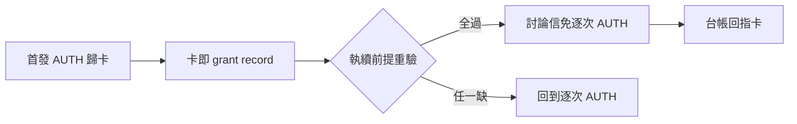

## Description

<!-- SECTION:DESCRIPTION:BEGIN -->
跨 repo 討論每則回信都要 user 逐次授權，摧毀討論形態（user 原話：「合理討論 issue 只要一開始需要確認之後自行討論，不需要人介入」）。修正為卡級授權：首發 AUTH 歸卡，該卡討論信執續免逐次——grant 載體＝卡（卡即 grant record，零新機制）。

**做什麼**
- outward rule 新節「卡級討論授權」＋明示豁免清單註冊
- dutymail-roundtrip／handoff consent gate 引用面同步（handoff 直送＝handoff class＝排除面，恆逐次）
- fences（雙腿審後定稿）：卡終態／6 則＋72h 硬上限／義務測試／來信不得擴權／敏感揭露出豁免

**不做什麼**
- 不建 durable grant record 新機制（卡即載體；實戰證明不足再建）
- duty_receive.py／handoff_delivery.py 機制面改動 deferred

<!-- SECTION:DESCRIPTION:END -->

## Acceptance Criteria
<!-- AC:BEGIN -->
- [ ] #1 outward rule 新節＋豁免清單註冊落地（boundary receipt 記卡）
- [ ] #2 dutymail-roundtrip＋handoff 引用面同步（rg 逐次 AUTH 掃描淨）
- [ ] #3 雙顧問審查腿 receipt（glm job-mv39ax5r＋codex job-mv39ax8n Conditional Accept 修正全數吸收）
- [ ] #4 outward rule 新節＋豁免清單註冊落地（boundary receipt 記卡）
- [ ] #5 dutymail-roundtrip＋handoff 引用面同步（rg 逐次 AUTH 掃描淨）
- [ ] #6 雙顧問審查腿 receipt（glm job-mv39ax5r＋codex job-mv39ax8n Conditional Accept 修正全數吸收）
<!-- AC:END -->
