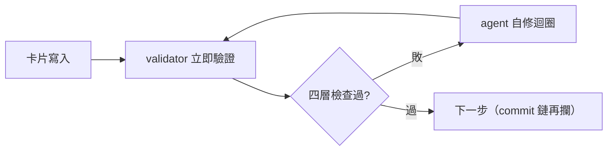
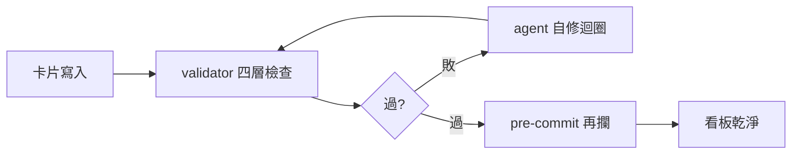

## Description

<!-- SECTION:DESCRIPTION:BEGIN -->
bridge 側 DB-109 malformed frontmatter 事故＋ai-guide 側 card-diagram guard 結案流程多次 FAIL（AC 殘留／To Do 直達 Done／缺圖）同族——建卡寫入缺「寫入後立即驗證、失敗 agent 自修」機械面。採橋側 codex 討論方案 A＋B＋C＋E：共用 validator＋skill 即時驗證＋pre-commit 防線＋按需全板掃描（D 暫緩）。

**做什麼**
- P1：`scripts/card_validate.py`——四層檢查（delimiter／YAML strict／top-level mapping／必填欄位契約），DB-109 樣本＋本日 guard FAIL 案例為 regression
- P2：kanban-board skill 接線——create/edit 後強制跑 validator、失敗 agent 自修迴圈（與 card-diagram guard 並存不重疊）
- C：`.githooks` pre-commit 鏈掛 validator（捕捉繞過 skill 的直寫）

**不做什麼**
- D（board durable notification）暫緩；不 fork 第三方 CLI（F2：CLI 無 YAML validation command，但重寫不值）

<!-- SECTION:DESCRIPTION:END -->

## Acceptance Criteria
<!-- AC:BEGIN -->
- [x] #1 P1 validator 落地（四層檢查）＋DB-109／本日 FAIL 案例 regression 綠
- [x] #2 P2 kanban skill 接線（寫入後強制驗證＋自修迴圈條文）
- [x] #3 pre-commit 鏈掛 validator（直寫捕捉）
- [x] #4 bridge 側 P3 hook 接線＋P4 掃描由對方弧承接（回信裁定）
<!-- AC:END -->

## Implementation Notes

<!-- SECTION:NOTES:BEGIN -->
receipt：worker job-mv3k6dcz（GLM-5.3-Flash）交付 validator 264 行＋211 行測試＋DB-109 原始樣本＋6 類 fixtures；pre-commit 置 card-diagram-guard 前（malformed frontmatter 會讓 guard 靜默跳過——事故形態對位）；pyyaml 自癒 re-exec 實跑成功；main @ c69745b1 全量 gate 3822 綠。橋側 P3+P4 由對方弧動工（accept 回信 seq68）。
<!-- SECTION:NOTES:END -->

## Final Summary

<!-- SECTION:FINAL_SUMMARY:BEGIN -->
三層驗證閘落地：validator（寫入後立即驗＋自修迴圈）＋pre-commit 防線（直寫捕捉）＋按需全板掃描。終態圖：

<!-- SECTION:FINAL_SUMMARY:END -->
