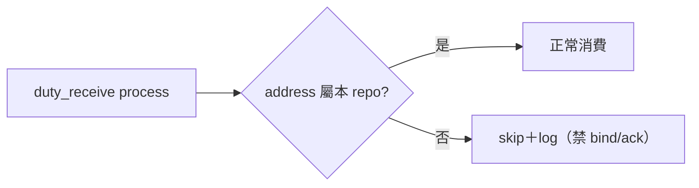
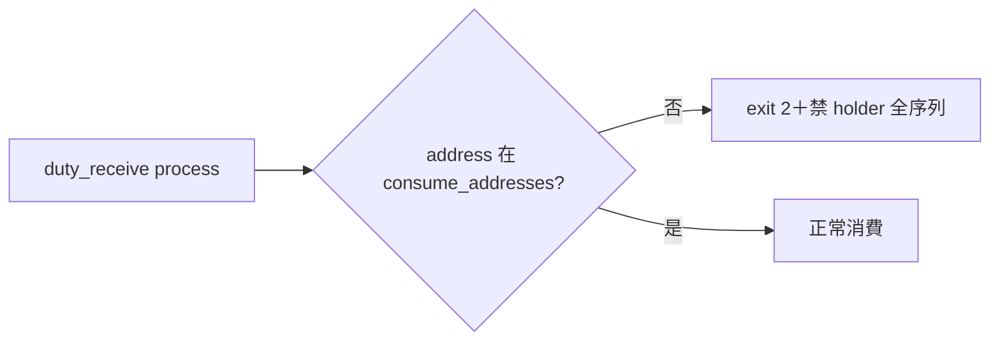

## Description

<!-- SECTION:DESCRIPTION:BEGIN -->
橋側實證定位：另一 ai-guide session 反覆跑 `duty_receive.py process`，其掃描越過 per-repo mailbox 邊界、連 delegate-bridge-marshal（他 repo 信箱）的 pending 也消費（binding epoch 40→43＋seq 68/69/70 搶先 ACK——bridge 回信全案留檔）。duty_receive 設計是 per-repo mailbox（exact alias），實作卻可越界——跨 repo 主權破口。

**做什麼**
- duty_receive.py 加跨址 fence：process 只觸本 repo 信箱（ai-guide-*；address 清單來源＝本 repo 註冊面），他址一律 skip＋一行 log（禁 bind 禁 ack）
- 順手：docstring 指針同步 outward rule「卡級討論授權」（AIR-308 deferred）＋handoff_delivery.py:18 同步
- 回信 bridge：修復交付＋觀察案可結

**不做什麼**
- 不動 holder bind 語義與 epoch fencing 本體（橋側機制）

<!-- SECTION:DESCRIPTION:END -->

## Acceptance Criteria
<!-- AC:BEGIN -->
- [x] #1 duty_receive.py 跨址 fence 落地＋單元測試（他址 skip 實證）
- [x] #2 docstring 指針同步（duty_receive＋handoff_delivery——AIR-308 deferred 清償）
- [x] #3 回信 bridge 修復交付＋觀察案結案（thread 歸卡執續——本項隨本卡結案回信完成）
<!-- AC:END -->

## Implementation Notes

<!-- SECTION:NOTES:BEGIN -->
橋側實證錨點：bridge 回信（epoch 定位案）——兇手 sess_b7e5e2bd 反覆 process 掃過共享 store；他們 P3/P4 已閉環（5ad26c1＋251/251）。

設計審查兩腿到站（2026-10-11）——意見全檔：.agent-tmp/improve-20261011/opinion-310-{codex,glm}.md。**機制修正（glm，裁決前提）**：duty_receive.py --address 是 required 單址參數（:1347）、模組內無多址掃描——越界＝AI session 餵他址當參數，非程式掃 store；fence 判準＝requested address ∈ 本 repo 消費授權集。**codex 主審**：顯式 consume-address allowlist（方案 b）＋核心執行邊界強制檢查（bind 前拒絕越權）——反對前綴判定、反對僅列舉層過濾。實作按此合成：授權集來源與 skip/fail-loud 語義細節讀兩檔意見後裁決。另：bridge 3.10.3 show --json finalText 已移頂層（schema 變更——AIR-307 錨點複查同族觀察）。

marshal 綜合裁決（兩腿合成）：①consume-address allowlist 住 governance/dutymail-processor.toml（consume_addresses=[ai-guide-marshal, ai-guide-exceptions]，與 class×action 表同檔同治理——user 可編編制）②fence 雙層：CLI arg 驗證層＋bind 前核心執行邊界 ③fail-loud（單址 required 參數餵他址＝呼叫端錯誤——glm 證無掃描迴圈，skip 語義無場）。實作 WO＝.agent-tmp/improve-20261011/wo-310-impl.md

receipt：worker job-mv3rx44v 交付 fence（allowlist toml 單一源＋雙層強制＋deny-all）＋79 行測試＋docstring 同步（AIR-308 deferred 清償）；main @ 00b06918 全量 gate 3828 綠。回信橋側 fence 交付＋觀察案結案（seq 71 待確認）。
<!-- SECTION:NOTES:END -->

## Final Summary

<!-- SECTION:FINAL_SUMMARY:BEGIN -->
跨址 custody fence 落地：process 只准消費 consume_addresses 授權集（toml 單一源）、雙層強制（CLI exit 2＋bind 前 fail-closed）、唯讀診斷豁免。終態圖：

<!-- SECTION:FINAL_SUMMARY:END -->
