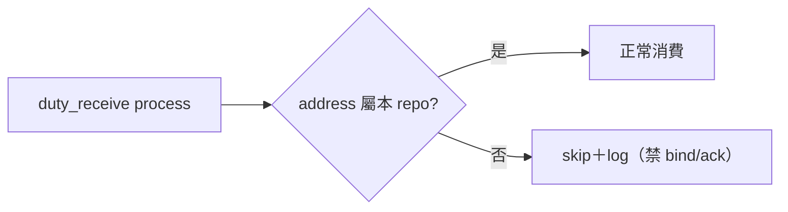

## Description

<!-- SECTION:DESCRIPTION:BEGIN -->
橋側實證定位：另一 ai-guide session 反覆跑 `duty_receive.py process`，其掃描越過 per-repo mailbox 邊界、連 delegate-bridge-marshal（他 repo 信箱）的 pending 也消費（binding epoch 40→43＋seq 68/69/70 搶先 ACK——bridge 回信全案留檔）。duty_receive 設計是 per-repo mailbox（exact alias），實作卻可越界——跨 repo 主權破口。

**做什麼**
- duty_receive.py 加跨址 fence：process 只觸本 repo 信箱（ai-guide-*；address 清單來源＝本 repo 註冊面），他址一律 skip＋一行 log（禁 bind 禁 ack）
- 順手：docstring 指針同步 outward rule「卡級討論授權」（AIR-308 deferred）＋handoff_delivery.py:18 同步
- 回信 bridge：修復交付＋觀察案可結

**不做什麼**
- 不動 holder bind 語義與 epoch fencing 本體（橋側機制）

<!-- SECTION:DESCRIPTION:END -->

## Acceptance Criteria
<!-- AC:BEGIN -->
- [ ] #1 duty_receive.py 跨址 fence 落地＋單元測試（他址 skip 實證）
- [ ] #2 docstring 指針同步（duty_receive＋handoff_delivery——AIR-308 deferred 清償）
- [ ] #3 回信 bridge 修復交付＋觀察案結案（thread 歸卡執續）
<!-- AC:END -->

## Implementation Notes

<!-- SECTION:NOTES:BEGIN -->
橋側實證錨點：bridge 回信（epoch 定位案）——兇手 sess_b7e5e2bd 反覆 process 掃過共享 store；他們 P3/P4 已閉環（5ad26c1＋251/251）。
<!-- SECTION:NOTES:END -->
