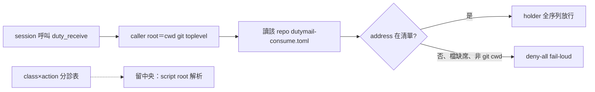
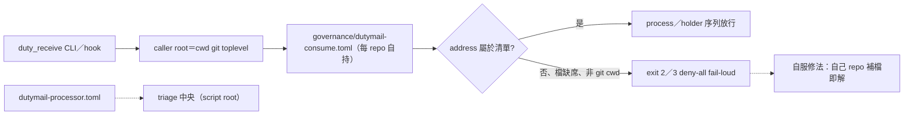

## Description

<!-- SECTION:DESCRIPTION:BEGIN -->
**做什麼**：把 duty_receive 的跨址 custody 授權從 ai-guide 中央清單改成 per-caller——config 解析改呼叫端 repo root（cwd git toplevel），每 repo 帶自己的 governance/dutymail-consume.toml；class×action 分診表留中央（script root）。

**為什麼**：今日實證兩頭落空——掃平後八址清單已含原始事故址 delegate-bridge-marshal（fence 擋不住它為之而生的那起事故），卻持續生產跨 repo 阻塞（code-reality／mosaic 被擋數小時、只能來信請託等裁）。codex＋glm 5.3 雙顧問獨立腿共識（user 授權「討論後開卡老規矩實作去改」）。

**不做什麼**：兄弟 repo 的 consume 檔（他們主權、provision 先行）；store 級 entitlement（bridge repo 弧另卡）；hook process 面退役（codex 單獨立場無共識、另案排程）。

<!-- SECTION:DESCRIPTION:END -->

## Acceptance Criteria
<!-- AC:BEGIN -->
- [x] #1 consume_addresses 鍵自 dutymail-processor.toml 移除（triage-only、re-add 即未知鍵 fail-loud）；新 governance/dutymail-consume.toml 在場（ai-guide 兩址）——rg＋測試釘死
- [x] #2 duty_receive._caller_root() 解析呼叫端 repo root（git toplevel realpath、非 git＝None）；caller 檔缺席／鍵缺席／壞形／非 git cwd 全數 ConfigError deny-all——pytest tests/test_duty_receive.py 全綠（188 passed）
- [x] #3 founding case 重鎖：ai-guide cwd 請求 delegate-bridge-marshal → CustodyFenceError／CLI exit 2（掃平後今日不設防的本案重新上鎖）——測試＋reviewer 實跑雙證
- [x] #4 class×action 分診表仍讀 script root（中央基線不 fork）——兩源釘死測試在場
- [x] #5 文檔三處同步：toml 頭註、duty_receive.py docstring、scbus-address-ownership.md pointer——rg 命中
- [x] #6 review 獨立腿（fresh context code-reviewer）APPROVE-WITH-FIXES 五 findings 全數吸收（F1 Major：exception_forward triage-only 消費端補 caller_root＝script repo；F2 hook 傳 payload cwd；F3 測試去耦合；F4 deny 對稱測試×2；F5 timeout 收斂 3s）；commit pre-commit 全量 gate 綠
<!-- AC:END -->

## Implementation Plan

<!-- SECTION:PLAN:BEGIN -->
〔baseline：ai-guide 1d26ea6d〕〔已決策勿重辯：①雙顧問獨立腿共識（codex job-mv3wqeb0-f06v3u／glm job-mv3wqfnt-cmdl9t，2026-10-11，verdict 檔 /tmp/fence-codex.json／/tmp/fence-glm-verdict.txt）：invariant「跨址不可誤消費」保留、中央八址清單形態否定——掃平後 fence 擋不住原始事故（過濾內容自我清空）②custody 授權解析改 caller repo root（cwd git rev-parse --show-toplevel realpath；非 git cwd＝deny-all fail-loud）、每 repo 自帶 governance/dutymail-consume.toml（ai-guide 份僅 ai-guide-marshal＋ai-guide-exceptions 兩址）③class×action 分診表留中央（script root 解析不變）④雙層閘＋CustodyFenceError＋exit 2 語義不動；caller 檔缺席＝ConfigError deny-all 平移⑤provision 先行一次切換、禁 caller 檔缺席 fallback 中央清單的雙源窗口⑥今日掃平三 commit（c091a1bf／5e85e3de／1d26ea6d）不 revert、被本卡 superseded⑦mosaic 拼寫裁決歸 mosaic provision 時逼出⑧值星退役語義＝B′（頭銜退役、holder＝純 transport mutex）——機械消費週期與 holder faces 保留〕〔範圍：governance/dutymail-processor.toml（移除 consume_addresses 鍵、triage-only）＋新 governance/dutymail-consume.toml＋scripts/duty_receive.py（_caller_root＋load_policy 兩源：triage 讀 script root、custody 讀 caller root）＋tests/test_duty_receive.py（fence 測試重錨：founding case ai-guide cwd 請求 delegate-bridge-marshal→拒、caller root 解析、檔缺席 deny-all、triage 仍 script root）＋文檔三處（toml 頭註、duty_receive.py docstring、governance/scbus-address-ownership.md pointer）。不做：兄弟 repo consume 檔（他們主權）、store 級 entitlement（bridge repo draft）、hook process 面退役（codex 單獨立場、draft 排程）、holder state 檔名 address 分區（codex 提點、本卡登記不實作）〕
<!-- SECTION:PLAN:END -->

## Implementation Notes

<!-- SECTION:NOTES:BEGIN -->
receipt：worker job-mv3xdppw-ls60rp（GLM-5.3-Flash、card WT lane --write-mode edit --yolo）交付 scope 內五檔停在 working tree；獨立 review（fresh context code-reviewer）APPROVE-WITH-FIXES 五 findings 全數吸收（F1 Major：duty_exception_forward triage-only 消費端被強制綁 custody 契約——補 caller_root＝script repo；F2 hook 傳 payload cwd 語義精確化——測試 fake cwd 錨改真 REPO_ROOT；F3 對應測試去耦合；F4 caller 檔 unknown-key／bad-entry deny 對稱測試×2；F5 timeout 10→3s）。pytest 188 passed＋commit pre-commit 全量 gate 綠；main @ 8d8a57b4。deferred：兄弟 repo consume 檔 provision（他們主權、未發通知信）；store 級 entitlement（bridge repo draft 候選）；hook process 面退役（codex 單獨立場）；holder state 檔名 address 分區（codex 提點）。
<!-- SECTION:NOTES:END -->

## Final Summary

<!-- SECTION:FINAL_SUMMARY:BEGIN -->
custody fence per-caller 落地：消費授權跟呼叫端 repo 主權走（cwd git toplevel 自持 dutymail-consume.toml）、分診表留中央（script root）；原始事故重新上鎖、跨 repo provisioning 阻塞類消除（新信箱＝自己 repo 補一行檔自癒）。

<!-- SECTION:FINAL_SUMMARY:END -->
