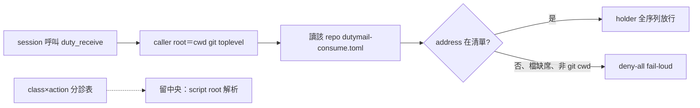

## Description

<!-- SECTION:DESCRIPTION:BEGIN -->
**做什麼**：把 duty_receive 的跨址 custody 授權從 ai-guide 中央清單改成 per-caller——config 解析改呼叫端 repo root（cwd git toplevel），每 repo 帶自己的 governance/dutymail-consume.toml；class×action 分診表留中央（script root）。

**為什麼**：今日實證兩頭落空——掃平後八址清單已含原始事故址 delegate-bridge-marshal（fence 擋不住它為之而生的那起事故），卻持續生產跨 repo 阻塞（code-reality／mosaic 被擋數小時、只能來信請託等裁）。codex＋glm 5.3 雙顧問獨立腿共識（user 授權「討論後開卡老規矩實作去改」）。

**不做什麼**：兄弟 repo 的 consume 檔（他們主權、provision 先行）；store 級 entitlement（bridge repo 弧另卡）；hook process 面退役（codex 單獨立場無共識、另案排程）。

<!-- SECTION:DESCRIPTION:END -->

## Implementation Plan

<!-- SECTION:PLAN:BEGIN -->
〔baseline：ai-guide 1d26ea6d〕〔已決策勿重辯：①雙顧問獨立腿共識（codex job-mv3wqeb0-f06v3u／glm job-mv3wqfnt-cmdl9t，2026-10-11，verdict 檔 /tmp/fence-codex.json／/tmp/fence-glm-verdict.txt）：invariant「跨址不可誤消費」保留、中央八址清單形態否定——掃平後 fence 擋不住原始事故（過濾內容自我清空）②custody 授權解析改 caller repo root（cwd git rev-parse --show-toplevel realpath；非 git cwd＝deny-all fail-loud）、每 repo 自帶 governance/dutymail-consume.toml（ai-guide 份僅 ai-guide-marshal＋ai-guide-exceptions 兩址）③class×action 分診表留中央（script root 解析不變）④雙層閘＋CustodyFenceError＋exit 2 語義不動；caller 檔缺席＝ConfigError deny-all 平移⑤provision 先行一次切換、禁 caller 檔缺席 fallback 中央清單的雙源窗口⑥今日掃平三 commit（c091a1bf／5e85e3de／1d26ea6d）不 revert、被本卡 superseded⑦mosaic 拼寫裁決歸 mosaic provision 時逼出⑧值星退役語義＝B′（頭銜退役、holder＝純 transport mutex）——機械消費週期與 holder faces 保留〕〔範圍：governance/dutymail-processor.toml（移除 consume_addresses 鍵、triage-only）＋新 governance/dutymail-consume.toml＋scripts/duty_receive.py（_caller_root＋load_policy 兩源：triage 讀 script root、custody 讀 caller root）＋tests/test_duty_receive.py（fence 測試重錨：founding case ai-guide cwd 請求 delegate-bridge-marshal→拒、caller root 解析、檔缺席 deny-all、triage 仍 script root）＋文檔三處（toml 頭註、duty_receive.py docstring、governance/scbus-address-ownership.md pointer）。不做：兄弟 repo consume 檔（他們主權）、store 級 entitlement（bridge repo draft）、hook process 面退役（codex 單獨立場、draft 排程）、holder state 檔名 address 分區（codex 提點、本卡登記不實作）〕
<!-- SECTION:PLAN:END -->
