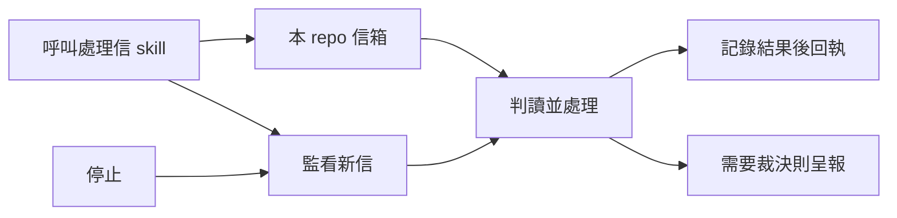

## Description

<!-- SECTION:DESCRIPTION:BEGIN -->
把跨 repo 信件處理收斂為一 repo 一信箱，名稱就是 repo name。呼叫 skill 才看信處理，可持續監看，也可停止；保留防重複處理與不漏信的交易保證。

依已拍板設計實作與審查；舊信箱逐一對帳後退役，其他 repo 的遷移由其 owner 承接。
<!-- SECTION:DESCRIPTION:END -->
