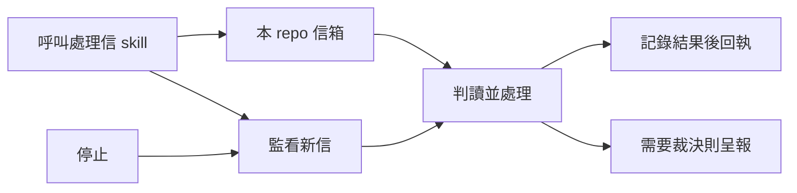

## Description

<!-- SECTION:DESCRIPTION:BEGIN -->
把跨 repo 信件處理收斂為一 repo 一信箱，名稱就是 repo name。呼叫 skill 才看信處理，可持續監看，也可停止；保留防重複處理與不漏信的交易保證。

依已拍板設計實作與審查；舊信箱逐一對帳後退役，其他 repo 的遷移由其 owner 承接。
<!-- SECTION:DESCRIPTION:END -->

## Acceptance Criteria
<!-- AC:BEGIN -->
- [ ] #1 一 repo 一信箱＝repo name；linked worktree 解析到同 repo，跨址不能誤讀消費
- [ ] #2 看完標 read，信留原處可重看；read 不表示工作完成，與現役 CLI/SC 契約一致
- [ ] #3 需要回信保留待回覆，寄出後清除；換新 session 不漏掉待回覆
- [ ] #4 once/watch/stop/status 簡單可用，一 repo 一 watcher；不增加 session 管理或逐信工作狀態機
- [ ] #5 prompt consume/monitor/consume config/exception forwarding 退役，現役引用同步
- [ ] #6 Flash 實作＋實跑驗證＋post-build 獨立審查與 Marshal 裁定；五 repo 遷移有對帳證據
<!-- AC:END -->

## Implementation Plan

<!-- SECTION:PLAN:BEGIN -->
Baseline: 30057953d522cccc818ec3bf4d013dcd1a85c623；boundary，Marshal 裁定/post-build、Flash 實作。最新 user 設計優先：通常一 repo 一 session，隔一段換新 session；普通 inbox 看完自動 read，信留原處，不搬目錄，只保留待回覆；寄信後解除待回覆，工作另交既有卡。這項 user steering supersedes 最初逐信五態處理/結果證明構想。仍維持一 repo 一信箱＝repo name（ai-guide、mosaic_alpha、code-reality、southchariot、delegate-bridge），每 repo 自己看自己的，無 consume config；skill once/watch/stop/status，每 repo 一 watcher，不設 session registry/協調服務。退役 prompt consume/monitor/exceptions forwarding/過時排程；底層 holder/durable queue 不重寫。先核 CLI ACK 後讀信/SC 顯示語義，缺口交 producer owner，不由 skill 複製信箱或多造帳本彌補。五個新址已建立，舊址未退役；四封通知已寄且 user 已轉貼四 repo prompts。原兩 Flash 腿因 steering 停止且零 source edits。具體證據 ai-analysis/_tasks/air-312-mail-handle/migration.md。
<!-- SECTION:PLAN:END -->

## Implementation Notes

<!-- SECTION:NOTES:BEGIN -->
User steering: 通常一 repo 一 session，用一陣子開新 session。設計收窄＝每 repo 一 watcher，不加 session registry/routing/協調層；新 session 續用 durable 信箱與最小結果；holder 沿用底層防撞。舊 Flash job-mv4g0r9l-htj3pr 已由 Marshal 因 scope steering 明確 stop→interrupted，尚無 source edits。EP 已同步。

最新 user 裁決：inbox 看完自動 read，信留原處，只需記得待回覆；不做每信五態工作流程。supersede 原 EP 逐信 handling-result 設計；Flash job-mv4g2hox-kwuzci 因此已 stop→interrupted，尚無 source edits。唯讀核 ACK 後可讀性/SC 列表語義後，按最小 inbox+待回覆模型重派。五個 canonical 地址已建立，但尚未寄通知/切 sender/退役舊址。

四封新設計/遷移協調信已 queued-visible：bridge 030572fe-bc4a-4863-b30a-89268b1099cb；mosaic 78502f82-35c9-4bdc-b800-b609756e3cd3；CR 0f4211ac-8f36-42c6-a263-f055bd1602dd；SC 9a09079e-a7ed-4ea1-bca7-1169f054c93e。acceptance 三鍵在任務家 outbound-receipts.json；outbound 已記帳。查得 bridge 缺 ACK 後一般歷史信 list/get，SC 現只接 escalation。普通 inbox 模型已交兩 owner 評估最小介面；不得重造 consumer 信箱補缺口。尚無 source changes、post-build 未啟動、不宣稱完成。

中間檢查點：user 已轉貼四 repo prompts 並授權開始。S1 Flash job-mv4hwczo-zmc1c5 running，owning WT ai-guide-air-312，waiter 已 arm。先完成 caller identity、hook/consume config 退役、單 repo watcher、skill 入口；S2 history/read 與待回覆接線待 producer 契約。四封通知已寄（Plan 通知未寄為過時描述），見 outbound-receipts.json；尚未宣稱實作或 post-build 完成。

Owner report received via user manual paste: code-reality CR-8 已核對舊址22信，六 inbound及六 outbound threads已閉；唯一 pending seq22 AIR-312 solicit，cursor21/22，epoch4 bound未動。sender尚未切換；consume.toml僅註記待退役。三閘＝sender切換＋共用skill落地＋bridge歷史入口。此為owner回報，不冒充本session live複驗；manual paste無message_id，免semantic ACK，不重複寄通知或重盤歷史。

Mosaic owner report via user paste: MOS-189 commit ae9eaee27、MOS-190 responsibility ledger。連字號舊址cursor2 pending3（CR landing、AIR-312、CR-7 receipt）；底線cursor0 pending1（draft46已閉）。僅AIR-312需回，manual paste已提供實質答覆，非transport ACK。自持holder release bound=false，協調方活holder未動；watcher stopped。canonical在場，sender/watch慣例已記卡，實際read/watch切換待skill+bridge歷史契約；詳migration.md。

post-build R1：Muse fresh job-mv4jkl53-9zecoi completed＋native intent Bacon completed，Franklin fake/isolated重現三項。採納I1 once舊五態/ACK、I2相對worker命令與quoting、I3state碰撞、M1退役入口與live prune程序，M2/M3僅文件；ledger discovery lint PASS。修正Flash job-mv4jxz9o-6ioelq running。Marshal独立驗證mail510 pass；governance/identity267 pass（primary baseline同267），不採writer截尾基線完整等價宣稱。新發現DB-112 installed mail list/get已供給；S2最小設計Muse job-mv4k179q-vsqqs8 review中；未完成或部署。

中間檢查點：S1 writer job-mv4hwczo-zmc1c5 completed；Marshal 獨立 mail 510 tests、governance 267 tests PASS（詳細 verification.md）。Muse fresh review job-mv4jkl53-9zecoi 與 S2 design review job-mv4k179q-vsqqs8 均 completed，已逐項裁定；R1 六項修正由 job-mv4jxz9o-6ioelq 單 writer 執行，尚未驗收。DB-112 installed mail list/get 已查證，ACK 後原文可讀，S2 已非 producer 缺口；consumer 工單 .agent-tmp/air312-s2-implementation.md 已備，R1 收線後再派。仍未部署、未宣稱舊址退役。

中間檢查點：R1 job-mv4jxz9o-6ioelq 已 completed，worker 回報500 tests PASS（尚非Marshal獨立重跑）；Bacon 針對 frozen .agent-tmp/air312-r1-followup/source 做六finding followup。S2 已派 fresh Muse implementer job-mv4loqfn-kct6dv（muse-spark-1.3 xhigh，既定EP重實作升級），waiter已掛；範圍普通 inbox/history/mark-read/pending-replies/reply，真store與其他repo禁寫。user提供 bridge mail list/get 正式命令與既有DB-112契約一致，無producer阻塞。
<!-- SECTION:NOTES:END -->
