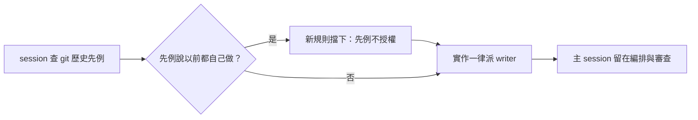
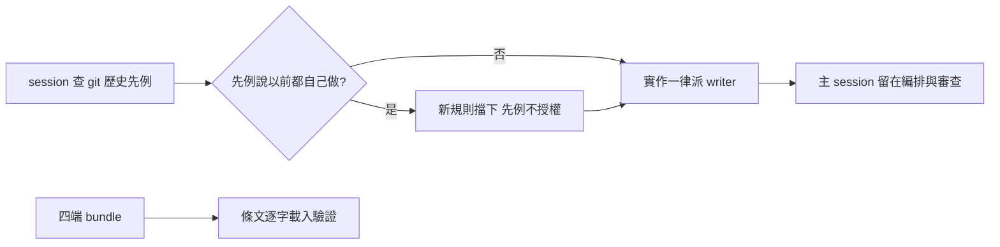

## Description

<!-- SECTION:DESCRIPTION:BEGIN -->
一個 session 在別的 repo 做卡時，查了 git 歷史發現以前類似的小卡都是「session 自己改」，就照做自己在 worktree 裡改了 code——繞過了「實作一律派 writer」的規則，自寫自審還把手改作廢重做。

**這卡做什麼**
- 把全域指南 Marshal 姿勢節的派工條款改成自帶判準（改到會影響行為的產物＝實作，一行也算；主 session 只做本職與零行為文書）
- 補一句「歷史先例只回答怎麼做、不回答誰來做」——先例不得當授權依據

**不做什麼**
- 不搬完整派工表進指南（bundle 有尺寸預算；細則留 agent-workflow skill）
- 不新建機械閘（既有 work-order 憑證閘推廣是另卡的事）
- 不處理漏收信問題（歸 AIR-312 信箱採用面）

<!-- SECTION:DESCRIPTION:END -->

## Acceptance Criteria
<!-- AC:BEGIN -->
- [x] #1 Marshal 姿勢節 spawn 條款自帶判準（behavior-bearing 或其驗證物、一行也算；豁免＝Marshal 本職與可證零行為 editorial；失派禁代寫；細則指 agent-workflow skill）
- [x] #2 先例句落地：小卡「直行」只簡化規劃流程不授權自做；git 歷史先例不作角色分工或授權依據
- [x] #3 單一源紀律：rg 掃 spawn／直行／先例 引用面零漂移；skills desc gate FAIL=0；card_validate PASS
- [x] #4 部署投影更新：merge 後 main 重跑 deploy，四端 bundle 含新條文（規範載入驗證非僅 source 存在）
- [x] #5 落地前審查閘回執四欄齊（classification=boundary／review 腿＋evidence／session-freshness／deployment-surfaces）
<!-- AC:END -->

## Implementation Plan

<!-- SECTION:PLAN:BEGIN -->
〔baseline：ai-guide 33731634d522cccc818ec3bf4d013dcd1a85c623〕
〔已決策勿重辯：①設計討論 muse job-mv4tpdid-8bj8un＋codex job-mv4tpdlo-o8fjl4 雙腿審議、Marshal 裁定收斂（.agent-tmp/air313-adjudication.md）②判準復用 agents/AGENTS.md 注 b 既有詞彙（behavior-bearing／一行也算）不造第二定義源 ③豁免＝原則式「Marshal 本職與可證零行為 editorial」，不用列舉 ④P2 只落 Marshal 姿勢節單一源 ⑤「直行」術語須消歧（UC 規模段流程直行≠姿態授權）⑥指針給 skill 名（agent-workflow——部署面可達）不寫外 repo 路徑 ⑦不新建機械閘（hook 三判準缺二；marshal_admission_guard 推廣另卡）⑧效力範圍限縮——不寫成跨層級全序〕
範圍：ai-development-guide.md Marshal 姿勢節兩句條文（定稿見 .agent-tmp/air313-adjudication.md）＋bundle 再生驗證；落地前審查閘 boundary（fresh＋intent＋跨家族腿＋四欄回執）。Follow-up 不入本卡：implement Apply Changes vs 注 b 矛盾、collaboration-constraints:32 消歧、guard marker 推廣、漏收信 admission。
<!-- SECTION:PLAN:END -->

## Implementation Notes

<!-- SECTION:NOTES:BEGIN -->
落地前審查閘回執（Marshal——ZCode session sess_789605c0）：
classification=boundary（姿態/授權面條文變更）
review=設計腿 muse job-mv4tpdid-8bj8un＋codex job-mv4tpdlo-o8fjl4（凍結草案、findings-only，措辭要素由此二腿產出）；落地確認腿 muse job-mv4unk1l-uizhh8（凍結 diff 76c04b4a vs 裁定——verdict accept、9 要素勾稽全過、G1-G3 殘餘 gaming 面屬「細則住 skill」既定取捨列 follow-up）；Marshal 機械驗證：rg 新句在場舊句零殘留、spawn/直行/先例 反掃零漂移、deploy --dry-run exit 0（bundle 30,197B＝muse/grok 30KiB 治理預算 98%——WARN 非 FAIL，proximity 註記）、scan_skills_desc FAIL=0、check_single_source 對 baseline 零新增（路徑更正：skills/scan-project/scripts/）
session-freshness=fresh（author session 開場載 instruction-writing skill 後才 authoring；裁定與措辭皆本 session 內鏈）
deployment-surfaces=pending（merge 後 main 跑 deploy_agents.py＋四端 bundle 含新條文驗證——AC#4）
writer：glm Flash job-mv4u1rkc-oxltw5（定稿逐字落地；V3/V4/V5 因環境無 Bash 由 Marshal 補跑——.agent-tmp/air313-fix-result.md 誠實申報）

部署收線：main @ 8048cb21 跑 deploy_agents.py（四端 OK；muse/grok 30,304B＝98% 治理預算 WARN 非 FAIL——proximity 已註記，slimming 另行）；AC#4 驗證＝四端 bundle 逐字含兩句新條文（rg 各 1 命中）。deployment-surfaces=healthy。審查閘回執收斂：classification=boundary／review=設計雙腿＋確認腿 accept＋Marshal 機械驗證／session-freshness=fresh／deployment-surfaces=healthy。
<!-- SECTION:NOTES:END -->

## Final Summary

<!-- SECTION:FINAL_SUMMARY:BEGIN -->
Marshal 姿勢節兩句條文落地並部署四端：spawn 判準自帶（behavior-bearing／驗證物／一行也算；豁免＝本職＋可證零行為 editorial；失派禁代寫）＋歷史先例不作姿態授權（「直行」消歧）。設計＝muse＋codex 雙腿審議收斂、確認腿 accept、審查閘四欄回執齊。

<!-- SECTION:FINAL_SUMMARY:END -->
