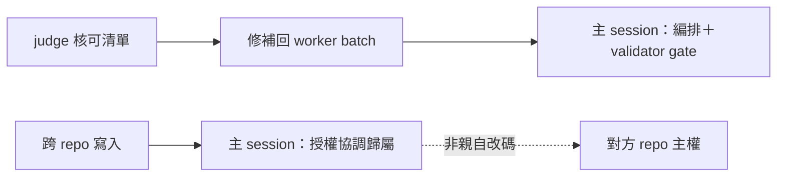

## Description

<!-- SECTION:DESCRIPTION:BEGIN -->
AIR-313 設計審議時發現兩處現行條文互相矛盾或可誤讀，等於新規則有後門：

**這卡做什麼**
- skills/implement 的「主 LLM—Apply Changes：根據 judge ✅ 清單修改 code」與「review 後補刀回 worker」正典矛盾——修成 judge ✅ 修補一律回 worker batch，主 session 只做純機械套用與 validator gate 的明文例外
- rules/collaboration-constraints「跨 repo 寫入由主 session 負責」可誤讀成 marshal 親自改別的 repo——澄清為授權／協調／歸屬責任

**不做什麼**
- 不重開 AIR-313 已裁定事項（spawn 判準、先例句措辭不動）
- 不動 agents/AGENTS.md 注 b 正典（implement skill 對齊它，不改它）

<!-- SECTION:DESCRIPTION:END -->

## Acceptance Criteria
<!-- AC:BEGIN -->
- [ ] #1 1. implement skill 與注 b 零矛盾：judge ✅ 修補回 worker batch、主 session 例外明文（純機械套用＋validator gate）
2. collaboration-constraints 跨 repo 寫入句＝授權協調歸屬語義（無親改歧義）
3. 單一源反掃零漂移；desc gate FAIL=0；card_validate PASS
4. 四端 bundle 逐字載入驗證（collaboration rule 入 bundle）
5. 審查閘四欄回執齊
<!-- AC:END -->

## Implementation Plan

<!-- SECTION:PLAN:BEGIN -->
〔baseline：ai-guide b0b9c2f4〕〔已決策勿重辯：①修補方向＝AIR-313 設計腿裁定（muse Q4-4＋codex Q4）——judge ✅ 修補回 worker batch（對齊 agent-workflow:47 repair batch），主 session 只做純機械套用＋validator gate 的明文例外；②collaboration:32 澄清為「授權／協調／歸屬」非親改；③注 b 正典不動——implement skill 對齊它〕範圍：skills/implement/SKILL.md Apply Changes 段改寫＋rules/collaboration-constraints.md:32 一句澄清；boundary 審查閘（fresh＋intent＋跨家族）＋四欄回執；merge 後 deploy。
<!-- SECTION:PLAN:END -->

## Implementation Notes

<!-- SECTION:NOTES:BEGIN -->
確認腿（muse job-mv4w5nv9）：accept-with-fixes——四項裁定逐條在場語義無損、deep-work pointer 單一源成立、與指南/5c/注 b 零矛盾。F1（AIR-316 卡出現在 diff）經 Marshal 機械驗證＝rebase 假影（branch 自身僅觸 3 檔、merge-base 演練零衝突——wt-close 標準 rebase 即消解，非真回歸）。F2（本節內 scope 限定）＋F3（loop 殘留 apply 泛稱）＋術語同步（可證→過閘證，對齊 AIR-315）→微修腿 job-mv4wf8em 執行中。
<!-- SECTION:NOTES:END -->
