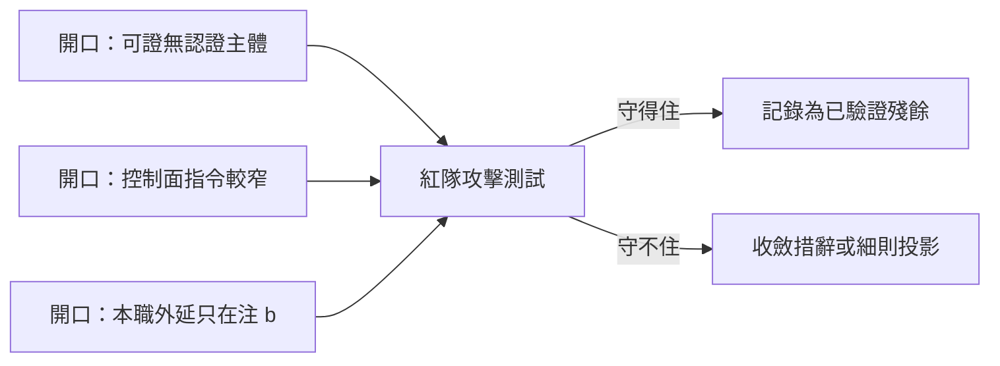

## Description

<!-- SECTION:DESCRIPTION:BEGIN -->
AIR-313 落地的兩句新條文有三個已知 gaming 開口（muse 確認腿標記，屬「細則住 skill」取捨的殘餘面）：「可證」沒錨定認證主體、「控制面指令」比注 b 的「控制面行為」窄半步、「Marshal 本職」外延只在注 b。

**這卡做什麼**
- 以紅隊視角對新條文做攻擊測試：設法用三個開口把實作包裝成可自做，逐一驗證是否真的守得住
- 守不住的開口收斂（guide 措辭或 agent-workflow 判據細則投影），守得住的記錄為已驗證殘餘

**不做什麼**
- 不重辯「細則住 skill」架構本身
- 不新建機械閘

<!-- SECTION:DESCRIPTION:END -->

## Acceptance Criteria
<!-- AC:BEGIN -->
- [ ] #1 1. 三開口各有明確攻擊測試結論（守住＝已驗證殘餘；守不住→收斂項）
2. 守不住者的收斂落地且單一源零漂移
3. desc gate FAIL=0；card_validate PASS
4. 觸及 guide/細則者過審查閘四欄回執
<!-- AC:END -->

## Implementation Plan

<!-- SECTION:PLAN:BEGIN -->
〔baseline：ai-guide b0b9c2f4〕〔已決策勿重辯：①G1-G3 開口清單＝AIR-313 muse 確認腿 job-mv4unk1l 標記（.agent-tmp 已歸檔 wt-evidence/air-312 前的 primary 側 air313-confirm-muse.md）；②架構「細則住 skill」不重辯；③禁新建閘〕範圍：紅隊腿（muse——攻擊測試三開口）→裁定→守不住者收斂（guide 措辭或 agent-workflow 細則投影，Flash 實作）→確認腿→審查閘。
<!-- SECTION:PLAN:END -->
