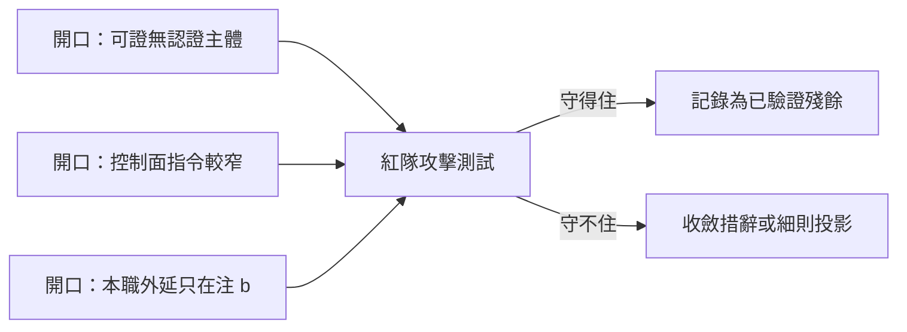
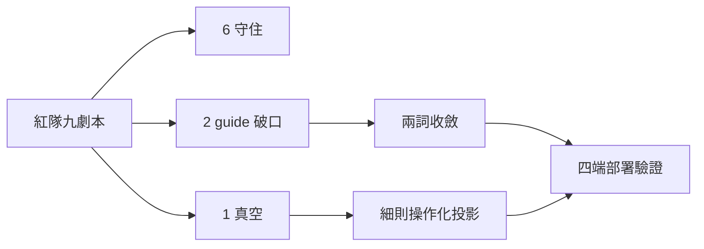

## Description

<!-- SECTION:DESCRIPTION:BEGIN -->
AIR-313 落地的兩句新條文有三個已知 gaming 開口（muse 確認腿標記，屬「細則住 skill」取捨的殘餘面）：「可證」沒錨定認證主體、「控制面指令」比注 b 的「控制面行為」窄半步、「Marshal 本職」外延只在注 b。

**這卡做什麼**
- 以紅隊視角對新條文做攻擊測試：設法用三個開口把實作包裝成可自做，逐一驗證是否真的守得住
- 守不住的開口收斂（guide 措辭或 agent-workflow 判據細則投影），守得住的記錄為已驗證殘餘

**不做什麼**
- 不重辯「細則住 skill」架構本身
- 不新建機械閘

<!-- SECTION:DESCRIPTION:END -->

## Acceptance Criteria
<!-- AC:BEGIN -->
- [x] #1 三開口各有明確攻擊測試結論（守住＝已驗證殘餘；守不住→收斂項）
- [x] #2 守不住者的收斂落地且單一源零漂移
- [x] #3 desc gate FAIL=0；card_validate PASS
- [x] #4 觸及 guide/細則者過審查閘四欄回執
<!-- AC:END -->

## Implementation Plan

<!-- SECTION:PLAN:BEGIN -->
〔baseline：ai-guide b0b9c2f4〕〔已決策勿重辯：①G1-G3 開口清單＝AIR-313 muse 確認腿 job-mv4unk1l 標記（.agent-tmp 已歸檔 wt-evidence/air-312 前的 primary 側 air313-confirm-muse.md）；②架構「細則住 skill」不重辯；③禁新建閘〕範圍：紅隊腿（muse——攻擊測試三開口）→裁定→守不住者收斂（guide 措辭或 agent-workflow 細則投影，Flash 實作）→確認腿→審查閘。
<!-- SECTION:PLAN:END -->

## Implementation Notes

<!-- SECTION:NOTES:BEGIN -->
紅隊腿完成（muse job-mv4vj13t-wftccn，.agent-tmp/air315-redteam-muse.md）：9 劇本攻擊測試——鏈層守住 6（judge 清單套用/ruff 自證/驗收修改/EP 順手改/collection 夾帶/G2-B 載體面）、guide 層破口 2（G1-A 自證零行為、G2-A prose 改寫——常駐層用詞比定義源窄）、真空 1（G2-C config 註解行）。裁定：全採納三則最小修——①guide「控制面指令」→「控制面行為」（一詞）②guide「可證」→「過閘證」（一詞）③agent-workflow §1 判據操作化投影（可證＝閘綠＋註解行 behavior-bearing＋本職封閉列舉）。已驗證可接受殘餘三項記錄（typo+閘+熔斷、LLM 語義判定無機械閘、卡 WT 控制面自做無機械擋——紀律面覆蓋）。

Flash 收斂腿（job-mv4vqhmk）交付＋Marshal 補跑閘 3/4（dry-run exit0 98%、desc FAIL=0）＋commit f28e9eb2（guide 兩詞淨零位元組＋agent-workflow 判據操作化段逐字）。確認腿 job-mv4wda9x 執行中。
<!-- SECTION:NOTES:END -->

## Final Summary

<!-- SECTION:FINAL_SUMMARY:BEGIN -->
九劇本紅隊：6 守住、2 guide 層破口、1 真空。三則收斂落地——guide「控制面行為」（對齊注 b）＋「過閘證」（認證主體＝機械閘）＋agent-workflow 判據操作化段（閘綠定義/註解行 behavior-bearing/本職封閉列舉）。確認腿 accept。已驗證可接受殘餘三項記錄於紅隊報告（typo+閘+熔斷、LLM 語義判定無機械閘、卡 WT 自做無機械擋）。

<!-- SECTION:FINAL_SUMMARY:END -->
