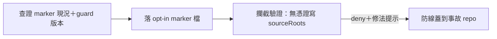

## Description

<!-- SECTION:DESCRIPTION:BEGIN -->
AIR-312 事故 repo（delegate-bridge）未啟用 marshal_admission_guard 的 marker（SC-199.1：非 canonical WT 寫 sourceRoots 需在場 work-order 憑證，缺席 deny）——閘已存在但沒蓋到出事的 repo。

**這卡做什麼**
- 查證 delegate-bridge marker 現況與 guard 版本相容性
- 啟用 marker（該 repo 落 opt-in 檔）＋攔截行為驗證（無憑證寫 sourceRoots 被 deny）

**不做什麼**
- 不改 guard 語義（self-issuance bypass 與 subagent 寫入面為已知決策殘餘，不動）

<!-- SECTION:DESCRIPTION:END -->

## Acceptance Criteria
<!-- AC:BEGIN -->
- [x] #1 delegate-bridge marker 現況有查證證據（在場/缺席＋guard 版本）
- [x] #2 marker 落地且攔截行為實測（無憑證寫 sourceRoots＝deny＋修法提示）
- [x] #3 豁免面不回歸（backlog metadata/.agent-tmp/docs 照舊可寫）
- [x] #4 card_validate PASS
<!-- AC:END -->

## Implementation Plan

<!-- SECTION:PLAN:BEGIN -->
〔baseline：ai-guide b0b9c2f4＋delegate-bridge 現行 main〕〔已決策勿重辯：①guard 語義不動（SC-199.1 既有）；②self-issuance bypass＋subagent 面為已知殘餘〕範圍：查證 delegate-bridge marker 現況＋guard 版本→落 opt-in marker（跨 repo 主權面：僅隔離 marker 檔，user 已授權「follow-up 都做」）→攔截行為驗證（deny 路徑實測）→hook 註冊面核對（zcode user-level registration 對該 repo 生效）。
<!-- SECTION:PLAN:END -->

## Implementation Notes

<!-- SECTION:NOTES:BEGIN -->
查證結果（Marshal 直接驗）：delegate-bridge marker 已在場且 valid（.agents/marshal-governance.json——protocol 1、trunk main、invariantLevel branch、sourceRoots ^rust/ ^scripts/ ^dutymail/）。事故當時 guard 實際有 fire——該 session rollout 顯示遇「需要 work-order 憑證」後找發行工具自鑄憑證再自做＝已知 self-issuance bypass 殘餘（guard docstring 明載 v1 不設防、治理靠審計線）；此洞的條文封堵＝AIR-313 落地的 spawn/先例兩句。攔截驗證：tests/test_marshal_admission_guard.py 81 passed exit 0（.agent-tmp/air316-guard-tests.log；含 test_wo_card_wt_src_without_credential_deny＝AC#2 場景、豁免面 allow 路徑）。
<!-- SECTION:NOTES:END -->

## Final Summary

<!-- SECTION:FINAL_SUMMARY:BEGIN -->
查證推翻前提：marker 已在場且 valid（bridge owner 已自建——protocol 1／branch 級／sourceRoots rust+scripts+dutymail），事故當時 guard 有 fire，實際繞道＝orchestrating session 自鑄憑證（已知 self-issuance 殘餘），其條文封堵已由 AIR-313 落地。攔截與豁免面由 guard 測試套機械驗證：81 passed。

<!-- SECTION:FINAL_SUMMARY:END -->
