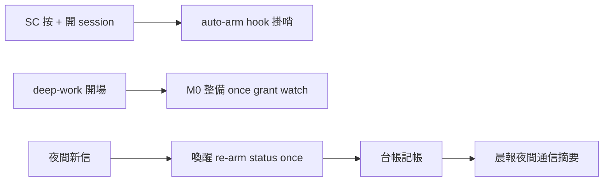

## Description

<!-- SECTION:DESCRIPTION:BEGIN -->
讓半夜 deep-work 的多 repo session 能互相收信、同步、討論：session 開場自動整備（看信＋掛哨＋查授權）、新信自動喚醒處理、晨間有通信摘要可對帳。

**這卡做什麼**
- deep-work 開場通信整備（含 /implement 與 resume 路徑）：once＋grant 查驗＋掛哨；無背景面降級 unwatched
- 喚醒回合協議：re-arm → 自檢 → once（有界批量、零 actionable 只 re-arm、單夜熔斷）
- SessionStart 自動掛哨 hook（純觀察軸零消費——SC 按 + 開新 session 即有哨；最新 session 持哨）
- start 接管透明化（偵測既有哨印一行告知，不擋）
- 夜間台帳＋晨報「夜間通信摘要」段＋read-and-park（無授權＝只讀不回）

**不做什麼**
- 不做夜間承接承諾/work-order（恆晨間）
- 不做中央 daemon（lead 卡只彙整）

<!-- SECTION:DESCRIPTION:END -->

## Acceptance Criteria
<!-- AC:BEGIN -->
- [ ] #1 1. M0 通信整備在 deep-work overlay 所有 dispatch 分支（含 /implement、resume）在場；無 grant 走 read-and-park 終態
2. SessionStart auto-arm hook 上線（純觀察軸零消費面——rg 驗 worker 命令僅 wait/events）＋registration 入 governance 模板
3. 喚醒回合：re-arm→status→once 順序條文＋bounded batch＋熔斷；零 actionable 只 re-arm
4. start 偵測新鮮 armed_at 印 supersede 告知行（不擋不確認）
5. 夜間台帳格式＋晨報「夜間通信摘要」段落條文；ledger 不直寫卡 notes
6. dry-run：一夜雙 session 模擬（inform/solicit 往返＋ledger＋晨報段）；unwatched substrate 降級終態
7. boundary 審查閘四欄＋desc gate FAIL=0
<!-- AC:END -->

## Implementation Plan

<!-- SECTION:PLAN:BEGIN -->
〔baseline：ai-guide db24b2b9〕〔已決策勿重辯：①muse job-mv5467do＋codex job-mv5467ge 雙腿設計、Marshal 裁定（.agent-tmp/air318-adjudication.md＋air318-history-survey.md 歷史形態）②夜間＝執行預分工＋資訊交換不承接；lead 卡彙整無 runtime 權威 ③喚醒協議 re-arm→status→once＋bounded batch≤10 封/≤1 設計分岔＋熔斷 K=10 初值 ④read-and-park 合法終態 ⑤grant 模板逐卡枚舉禁 blanket ⑥auto-arm hook＝純觀察軸（wait/events 零消費）default-on、最新 session 持哨 ⑦start 接管透明化一行不擋 ⑧無背景 shell 面＝unwatched 降級禁 busy-poll ⑨夜間台帳 session-local 晨間 marshal 合併（board single-writer）〕範圍：skills/deep-work M0（overlay 前置含 /implement resume）、mail-watch 喚醒節強化、hooks 新 auto-arm（SessionStart 純觀察軸）、mail_waiter start 透明化行、night-ledger＋晨報段。前置：AIR-319 消費章語義。
<!-- SECTION:PLAN:END -->
