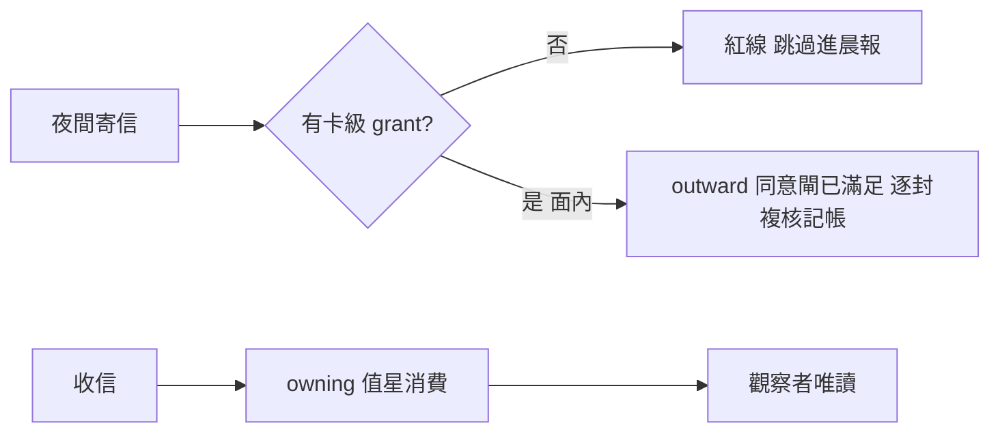

## Description

<!-- SECTION:DESCRIPTION:BEGIN -->
夜間協作的授權語義一次修齊：unattended 下寄信/回信的分級、誰可以消費（mark-read）、與 handoff 既有禁令的交叉澄清。

**這卡做什麼**
- autonomous-execution 紅線表補 dutymail send/reply 列（未具名授權首發＝紅線；卡級討論授權面內執續＝已滿足的 outward 同意閘，非黃線推翻紅線；承接承諾恆紅線）＋預設拒絕子句（表是快查子集非許可清單）
- handoff:193 澄清：禁的是 handoff 信件內容交付處置指示，非禁 autonomous session 依自家卡自主消費
- per-repo consuming-owner 條款：同 repo 多 session 只有 owning 值星 mark-read，觀察者不消費不搶哨

**不做什麼**
- 不改 outward rule 本體（卡級討論授權定義不動）
- 不做承接語義修正案（deferred 待 user）

<!-- SECTION:DESCRIPTION:END -->

## Acceptance Criteria
<!-- AC:BEGIN -->
- [ ] #1 1. 紅線表 dutymail send/reply 列落地（codex 條文）＋預設拒絕子句
2. handoff:193 語義澄清（澄清後與 M0 once 無矛盾——交叉引用）
3. per-repo consuming-owner 條款入 mail-handle（owning 值星 mark-read；觀察者唯讀不搶哨）
4. rg 反掃交叉引用一致；desc gate FAIL=0；boundary 審查閘四欄
<!-- AC:END -->

## Implementation Plan

<!-- SECTION:PLAN:BEGIN -->
〔baseline：ai-guide db24b2b9〕〔已決策勿重辯：①裁定筆記同上 ②grant 面內＝「已滿足的 outward 同意閘」非黃線推翻紅線（codex 措辭框架）③handoff:193＝禁 handoff 信件內容交付處置指示，非禁自主消費——澄清非放寬 ④consuming-owner＝同 repo 唯一 owning 值星消費，機械面恆由 _s2_bind_no_takeover 兜底 ⑤outward rule 本體零改〕範圍：skills/autonomous-execution 紅線表 send/reply 列＋預設拒絕子句、skills/handoff:193 澄清、skills/mail-handle consuming-owner 段。
<!-- SECTION:PLAN:END -->
