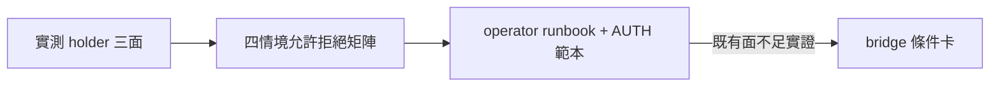
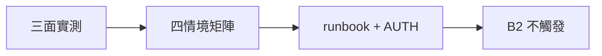

## Description

<!-- SECTION:DESCRIPTION:BEGIN -->
信箱消費章硬殘留（如 epoch 110）的恢復：先實測既有 CLI 面能否處理三種真卡死情境，補 operator runbook；缺口的 bridge 側修正另開條件卡。

**這卡做什麼**
- 實測 dutymail holder status/release/takeover 三面的 help 與契約
- 四情境允許/拒絕矩陣（自家 token／跨機 token 遺失／檔損壞／外活 holder——最後者恆拒）
- operator runbook＋AUTH 範本（指名門牌/epoch；token 只印 fingerprint）

**不做什麼**
- 不新增無 token force-release CLI（muse 版 spec 存為 bridge 側條件卡輸入）
- 不做夜間自動 release（恆紅線）

<!-- SECTION:DESCRIPTION:END -->

## Acceptance Criteria
<!-- AC:BEGIN -->
- [x] #1 holder 三面 help/契約實測證據（Marshal 親跑＋源碼級契約）
- [x] #2 四情境允許/拒絕矩陣文檔（含證據等級表：A 權威/B 輔助/C user 指認＝authority 非 evidence）
- [x] #3 operator runbook＋AUTH 範本落地（指名門牌/epoch；token fingerprint）
- [x] #4 既有面不足的案例實證才觸發 B2 條件卡（實測覆蓋完整——不觸發）
<!-- AC:END -->

## Implementation Plan

<!-- SECTION:PLAN:BEGIN -->
〔baseline：ai-guide db24b2b9〕〔已決策勿重辯：①裁定筆記同上 ②先實測既有面（holder status/release/takeover help）不急造新 CLI ③四情境矩陣（自家 token/跨機/檔損壞/外活——外活恆拒）④token 只印 fingerprint ⑤夜間無 token release 恆紅線 ⑥B2 bridge 條件卡僅缺口實證後開（muse CLI spec 為其輸入）〕範圍：實測腳本＋診斷矩陣文檔＋operator runbook＋AUTH 範本。跨 repo 面唯讀。
<!-- SECTION:PLAN:END -->

## Implementation Notes

<!-- SECTION:NOTES:BEGIN -->
收線：holder 三面實測在場（takeover=operator-invoked epoch-CAS）；B2 條件卡不觸發；merge 48555186。
<!-- SECTION:NOTES:END -->

## Final Summary

<!-- SECTION:FINAL_SUMMARY:BEGIN -->
holder 恢復 runbook：三面實測在場（status/release/takeover=operator-invoked epoch-CAS）；四情境矩陣＋證據等級＋operator runbook＋AUTH 範本；B2 bridge 條件卡不觸發。

<!-- SECTION:FINAL_SUMMARY:END -->
