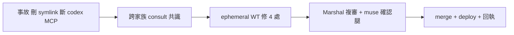

## Description

<!-- SECTION:DESCRIPTION:BEGIN -->
真實事故：agent 依「禁第二 pin」字面刪掉 runbook sanctioned 的 registry-derived symlink（~/.local/bin/delegate-bridge）→ codex MCP 全斷。bridge session 已跨家族 consult（muse+codex 共識）並在 ephemeral WT 修好 ai-guide 側 4 處，本卡承載驗收與落地。

**這卡做什麼**
- 驗收 ephemeral WT（pin-carveout）的 4 處 carve-out（「禁第二 pin＝禁新增獨立指標；sanctioned derived locators 禁刪」）並 merge＋deploy
- 回執 delegate-bridge

**不做什麼**
- 不把「新增 symlink」合法化（只保護 sanctioned 既有項）

<!-- SECTION:DESCRIPTION:END -->

## Acceptance Criteria
<!-- AC:BEGIN -->
- [ ] #1 1. 4 處 carve-out 語義一致且零擴權（muse 確認腿 verdict）
2. merge 上 main＋四端 bundle 重投影（規範載入驗證）
3. 回執 delegate-bridge（envelope 三鍵留痕）
4. card_validate PASS
<!-- AC:END -->

## Implementation Plan

<!-- SECTION:PLAN:BEGIN -->
〔baseline：ai-guide 5837b6a4＋ephemeral WT 工作樹〕〔已決策勿重辯：①carve-out 方向＝consult 共識（derived locator≠獨立權威；刪除雙雙否決）②bridge 側修復歸 bridge release round（非本卡）〕範圍：驗收 WT 4 處→確認腿→merge（ephemeral fast-path）→deploy→回執。
<!-- SECTION:PLAN:END -->
