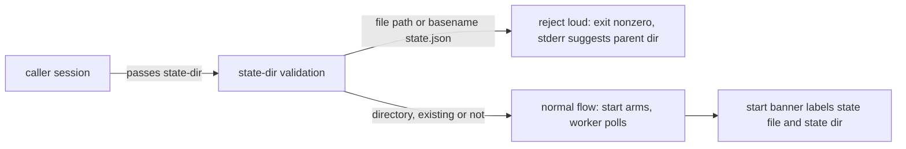

## Description

<!-- SECTION:DESCRIPTION:BEGIN -->
外部實測回報：掛哨指令看起來成功（start 印出 armed），但背景 worker 從未啟動——若 `--state-dir` 參數被餵成 state 檔案路徑（而非其父目錄），worker 會在背景靜默崩潰（FileExistsError），且先前的啟動診斷誤導為「state 損壞，視同冷啟」。

**做什麼**：四個子指令（start/stop/status/worker）在動任何狀態讀寫前，先驗證 `--state-dir` 的目錄語義——已存在但非目錄、或路徑尾名是 state.json，一律大聲拒絕（非零退出＋stderr 給正確父目錄建議）；start 輸出同時標明 state 檔與 state 目錄兩個路徑，降低抄錯面。

**不做什麼**：不自動把檔案路徑改寫成父目錄續跑（拒絕而非猜測意圖）；不動 duty_receive 共用讀取面（core.load_state）；不改 arm_command 預設行為（HEAD 已正確印目錄）。

<!-- SECTION:DESCRIPTION:END -->

## Acceptance Criteria
<!-- AC:BEGIN -->
- [ ] #1 1. start --state-dir <已存在檔案>：exit≠0、stderr 含父目錄建議、零 state 寫入（無新 state.json/state.lock）
2. worker --state-dir <已存在檔案>：exit≠0、不讀 state、不建 lock、不觸發冷啟路徑
3. stop/status --state-dir <已存在檔案>：exit≠0、不誤判 state 缺席/未啟動
4. --state-dir <dir>/state.json（尾名 state.json、路徑不存在）：四 subcommand 皆拒、不建立同名目錄或檔案
5. 合法既存目錄與尚不存在的合法目錄：既有行為不變（start 可 arm、status 正常報）
6. 預設 start banner：含 state file 與 state dir 標示；arm 命令仍為最後一行
7. symlink 指向檔案、路徑尾端斜線形：辨識結果與語義一致（指向檔案→拒）
8. 新增回歸測試含真實 subprocess CLI 形態（非僅 mock validator）；既有測試全綠
9. mail_autoarm hook（state_file_path 直讀、不帶 flag）行為不變
<!-- AC:END -->

## Implementation Plan

<!-- SECTION:PLAN:BEGIN -->
〔baseline：ai-guide 8067b142〕

〔已決策勿重辯：①回報宣稱「預設 start banner 印檔案路徑」在 HEAD 不成立（live 實測＋muse/codex 雙腿讀碼一致：arm_command 預設經 repo_state_dir 印目錄）；實際進入面＝顯式 --state-dir 覆寫傳檔案路徑（回報者 argv 未取得，歸因保持「已知最可能」非確認事實）。②F1＝四 subcommand 共用 choke-point 驗證（新 _resolve_state_dir：非 repo_state_dir 內——worker :569 走 state_file_path(base_dir) 繞過它；非 argparse type——路徑來源含預設組裝）：已存在且非目錄→拒；basename==state.json 含不存在路徑→拒（防首次建錯）；尾斜線/symlink-to-file 正確辨識；不存在的合法目錄放行；status/stop 驗證不建目錄；拒絕訊息帶父目錄建議。③F2 reject：不自動正規化（crash-only——錯輸入須拒非猜測）。④F3：start banner 首行標 state file＋增印 state dir；arm 命令保持最後一行（行解析相容）。⑤F4：不動 core.load_state／duty_receive 面；「路徑錯誤不進冷啟→FileExistsError 序列」由 F1 前置拒絕＋回歸測試保證。⑥範圍排除：core.load_state 一般損壞復原、bindingEpoch、worker 輪詢生命週期重構皆不在本卡。〕

範圍：scripts/mail_waiter.py（_resolve_state_dir 驗證＋cmd_start banner）＋tests/ 新增回歸測試（含真實 subprocess CLI 形態——codex 裁定：僅 mock validator 會漏 CLI dispatch 接線）。

證據：bug 回報信 db-mailwaiter-startbug-20261012（duty inbox）；muse/codex 諮詢 verdict＝.agent-tmp/consult-{muse,codex}-statedir-20261012.txt（job-mv5awg1j / job-mv5awg4x）。

Mockup（banner 樣張——MOCKUP，非實作輸出）：
[mail-waiter] armed：generation N、address <repo>
[mail-waiter] state file：<...>/mail-waiter/<repo>/state.json
[mail-waiter] state dir：<...>/mail-waiter/<repo>
uv run python .../mail_waiter.py worker --address <repo> --generation N --state-dir <...>/mail-waiter/<repo>
<!-- SECTION:PLAN:END -->
