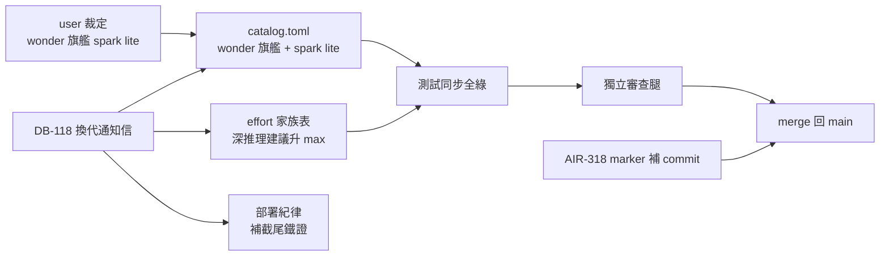

## Description

<!-- SECTION:DESCRIPTION:BEGIN -->
Muse（跨家族審查與備援用的 AI 服務）換代：供應商 2026-10-12 把預設旗艦換成 muse-wonder-1.0（context 與舊旗艦同值、effort 新增 max 檔位），委派工具 bridge 3.14.0 已跟進。user 裁定：**wonder 從此是旗艦、spark-1.3 降為 lite 省成本款**。

**做什麼**
- 同步「模型供給事實」：model-routing catalog、effort 家族表、agents 對照表、相關測試——wonder 旗艦（深推理建議升 max）、spark lite 留用（顯式指名才派）
- 工作資格誠實處理：spark 上實測的資格留在 spark；wonder 新列「待首次實測」
- 補記供應商逆向新證據到部署紀律：rules 檔超過啟動限制會被截尾（共享池）——裁決＝維持 bundle 瘦身不變
- 補 commit 上一卡（AIR-318）漏掉的 mail-autoarm marker 檔

**不做什麼**
- 不改路由政策骨架（muse 仍是跨家族第二意見＋額度備援腿）
- 不重驗 spark 既有資格、不動歷史報告／歸檔／官方文檔鏡像

**現在到哪**：剛建卡，等開工。

<!-- SECTION:DESCRIPTION:END -->

## Acceptance Criteria
<!-- AC:BEGIN -->
- [ ] #1 catalog.toml：muse-wonder-1.0 identity＋bridge-muse-wonder-1.0 binding 在場（token/provider_native/effort_values 含 max/image_transport）；spark identity/binding 原樣保留；wonder 五 workload conditional/pending_first_use 播種＋drift 註記齊（is_default 翻轉、context_limit 同值、bridge 3.14.0 pin＋L4 job id）
- [ ] #2 SKILL.md：dispatch 預設段＋family 表 muse 列改 wonder 旗艦＋spark lite（含 bridge 裸委派落 wonder、spark 需顯式 --model 註記）；深推理建議 max＋CLI 值域列明；容量欄 context_limit 1,007,997＋payload 天花板 460,800 tokens
- [ ] #3 agents/AGENTS.md muse code 行同步（wonder 全棧、spark lite）
- [ ] #4 全量測試綠：uv run pytest（含同步後 availability_snapshot/sync_agents/parity_lint 及受影響 fixtures）
- [ ] #5 sync_agents.py --check 綠＋card_validate 綠＋live 源（skills/agents/rules/tests/root AGENTS.md）muse 引用語義一致（wonder＝旗艦／spark＝lite，無過時「spark 全棧」殘留）
- [ ] #6 rules/AGENTS.md 尺寸 gate 節補 muse 1.4.6 截尾鐵證（共享池／截尾通知模板／skills catalog 32KB 壓縮三事實）；瘦身裁決不變
- [ ] #7 .agents/mail-autoarm.json 入版控（AIR-318 補件）
- [ ] #8 落地前審查閘回執四欄入卡 notes（classification/review evidence ref/session-freshness/deployment-surfaces）
- [ ] #9 收 Done 時 Final Summary 帶 as-built 終態圖（mermaid）
<!-- AC:END -->

## Implementation Plan

<!-- SECTION:PLAN:BEGIN -->
〔baseline：ai-guide 57716863〕
〔已決策勿重辯：①wonder＝旗艦、spark＝lite（user 2026-10-13 對話原話「另外要開始將wonder 列為旗艦 spark當成lite」）——雙 identity 並存，非 drift rename，比照 GLM 旗艦+flash lite 模式；②深推理建議檔位升 max（DB-118 信：CLI 值域 none|minimal|low|medium|high|xhigh|max|ultra）；③spark 既有 workload qualification 原樣保留（證據＝spark 實測）；wonder 播 conditional/pending_first_use 種子（比照 bridge-glm-5.3-flash implement 播種先例 catalog.toml 359-367），首次實測 PASS 後升 qualified；④effort_values：wonder＝[low,medium,high,xhigh,max,ultra]（max 歸因 wonder 檔位表）；spark 維持 [low,medium,high,xhigh,ultra]；⑤控制面弧（觸 skills/agents/rules/root AGENTS.md）→ persistent card WT authoring（scripts/wt-open.sh），canonical 主樹留 main；⑥不動白名單：ai-analysis/（歷史報告與任務凍結材料）、ref-docs/harness/（官方鏡像，更新走 crawl.py 另案）、backlog/ 歷史卡、測試凍結樣本 fixture 中屬歷史 snapshot 者（僅同步會隨 catalog 語義變動的斷言）〕

範圍：
A. skills/model-routing/catalog.toml——新增 [[model_identity]] id=muse-wonder-1.0（label Muse Wonder 1.0；native_vision capability 沿 family --image transport 事實 repo_observed）＋[[dispatch_binding]] id=bridge-muse-wonder-1.0（model_identity/token=muse-wonder-1.0、carrier=bridge、surface=muse-family、provider_native、family=muse、effort_encoding=param、effort_values 含 max、transport=[image_transport]）；spark identity/binding 原樣保留；wonder 五 workload 播種（ep_synthesis/adjudication/implement_from_accepted_ep/evidence_retrieval/review_findings，status=conditional、evidence_source=pending_first_use、binding_scope=[bridge-muse-wonder-1.3 對應新 id]）；條目旁 drift 註記（2026-10-12 meta catalog is_default 翻轉、context_limit 1,007,997 與 spark 同值、bridge 3.14.0 DEFAULT_MODEL pin＝wonder＋VALID_EFFORTS 補 max、L4 探針 job-mv5rv84c-xijkim）。
B. skills/model-routing/SKILL.md——dispatch 預設段 muse code 行：wonder 全棧旗艦、spark lite（顯式指名）；family→(model,effort,容量) 表 muse 列：model=muse-wonder-1.0（備註 spark lite：bridge 裸委派落 wonder〔DEFAULT_MODEL pin〕、spark 需顯式 --model）；effort 欄：預設 xhigh 不變、深推理可升 max（附 CLI 值域；舊 ultra alias 註記隨代換作廢）；容量欄：context_limit 1,007,997＋task payload 天花板 460,800 tokens（hard compaction threshold，caller 預算參考）。
C. agents/AGENTS.md——muse code 雙身分行同步（wonder 全棧＋spark lite）。
D. rules/AGENTS.md 尺寸 gate 節——Muse delegation startup 條補 1.4.6 逆向鐵證三事實：startup 共享池（rules＋skills catalog＋developer prompts 同鍋、fit_skill_catalog_rows_reserving）、超限截尾＋插一行通知（verbatim 模板事實，非僅警告）、skills catalog 32KB 即壓縮；「1M 對話 context 可放寬 bundle」前提不成立——裁決維持瘦身。
E. 測試同步——tests/test_availability_snapshot.py、tests/test_sync_agents.py、tests/test_parity_lint.py（CATALOG_TOKENS 補 muse-wonder-1.0）＋受影響 fixtures；全量 uv run pytest 綠。
F. .agents/mail-autoarm.json 入版控（AIR-318 補件——比照 .agents/marshal-governance.json／memory-governance.json tracked 慣例）。
G. 機械閘——scripts/sync_agents.py --check（parity）、scripts/card_validate.py、live 源 muse 引用語義掃描（wonder＝旗艦／spark＝lite 一致，無「spark 全棧」過時殘留）。
<!-- SECTION:PLAN:END -->
