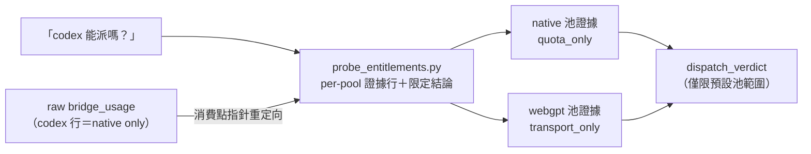

## Description

<!-- SECTION:DESCRIPTION:BEGIN -->
實例：被問「codex 現在能派嗎」，查額度的工具回「codex 週窗 100% 用滿」就直接答「撞牆」——但那個數字只代表 native 訂閱池，實際派工預設走 webgpt（另一個池、沒有額度閘）。正確知識都寫在 memory spine 和 model-routing 裡，當下沒查。

**做什麼**
- 把既有的額度探針腳本（probe_entitlements.py——它早就分好兩池，只是被繞過）升級：輸出**每池一行證據**＋一行**範圍限定的派工結論**（例：「codex：native 池滿（僅影響指名派工）；webgpt 健康 → 預設可派」）——讓跑它成為取得答案最省力的路
- 在兩個 skill 的消費點補**重定向指針**（不是重複知識）：raw 額度工具的 codex 行＝native 池 only
- 核心規則入文檔：**任何池的負面觀測只能限制該池**，沒證據不得升級成整家族不可派

**不做什麼**
- 不加 PreToolUse hook（muse＋codex 跨家族共識：三入口攔不全＋假確定性風險；A+B 落地後若復發再議）
- 不改 delegate-bridge 輸出（跨 repo，另域）、不重構 AvailabilitySnapshot、不造第二套判定權威

**現在到哪**：跨家族討論收斂（muse job-mv5xt31f／codex job-mv5xt35e），卡已建、等 user 點卡確認後開工。

<!-- SECTION:DESCRIPTION:END -->

## Acceptance Criteria
<!-- AC:BEGIN -->
- [ ] #1 probe_entitlements.py verdict 投影落地：per-pool evidence 行（含 dispatch_role 欄）＋範圍限定 dispatch_verdict 行＋unknown 時 WARN 行；latest-*.json schema v1 欄位不變（diff 驗）
- [ ] #2 證據層 fail-closed：error/缺席/stale→該池 unknown＋WARN、全文無該池 available 字樣；healthz 綠僅 healthy/transport_only/quota_visibility=none
- [ ] #3 池隔離 invariant：負面觀測/retryable_at 不跨池、無 family 級 available/unavailable 宣稱、default 池 unknown→verdict=unknown
- [ ] #4 文檔指針×3（model-routing 兩節＋bridge-dispatch 模組定位）＋script docstring：rg 可掃、pointer-only 無兩池語義複本
- [ ] #5 測試全綠：新 fixture 四組＋既有 test_probe_entitlements/test_availability_snapshot＋全量 pytest
- [ ] #6 落地前審查閘回執四欄入卡 notes；收 Done 時 Final Summary 帶 as-built 終態圖
<!-- AC:END -->

## Implementation Plan

<!-- SECTION:PLAN:BEGIN -->
〔baseline：ai-guide f9f9b41f〕
〔已決策勿重辯：①方案＝A（probe 投影正典化，主）＋B（消費點重定向指針，漏斗）——跨家族討論共識（muse job-mv5xt31f-7qsq56／codex job-mv5xt35e-mneyt，全文＝bridge ledger jsonl）；C（PreToolUse hook）出局：三判準「單一入口」不成立（MCP/CLI/Bash 三入口）＋假確定性風險——A+B 後若復發且歸因繞過正典入口再議（兩家 advisory 草稿存卡 notes 備用）；D（bridge 輸出加 pool 欄）跨域註記不依賴。②verdict 形態＝兩層：per-pool evidence 行（fail-closed tri-state）＋範圍限定 dispatch_verdict 行（僅由 default 池推導、明示 via-default-pool、帶 outcome-unverified 註記）——禁止無範圍 family 級 available/unavailable 宣稱。③核心 invariant：任何池的負面觀測只能限制該池；retryable_at 不跨池；永不合併兩池。④dispatch_role 欄（default｜named-only）＝消滅誤讀關鍵欄——codex/webgpt=default、codex/native=named-only（AIR-221 RoutingPolicy）、其餘單池 family=default。⑤不造第二權威：AvailabilitySnapshot（availability_snapshot.py）保持既有 per-family 權威，probe verdict＝evidence adapter；文檔 pointer-only 禁重抄兩池語義。⑥不重構 AvailabilitySnapshot 為 per-pool resolver（另案）、不改 latest-*.json schema（verdict＝stdout 投影）。⑦證據層 fail-closed（error/缺席/stale→unknown＋WARN 行、healthz 綠＝healthy/transport_only/quota_visibility=none 禁升格宣稱額度）；派工層有限 fail-open（政策允許＋transport 健康→受控試派、job receipt 定案）。⑧控制面弧（觸 skills/）→ persistent card WT authoring。〕

範圍：
A. scripts/probe_entitlements.py——既有 ProbeRecord 加 verdict printer（stdout 投影）：per-pool 行欄位＝family/pool/dispatch_role/signal(exhausted|not_exhausted|healthy|degraded|unreachable|unknown)/evidence_scope(quota_only|transport_only)/quota_visibility(structured|none)/source/observed_at/retryable_at(無則省略)＋dispatch_verdict 行＋WARN 行（任一 default 池 unknown 時）；exit 契約沿用 aggregate_exit 不改。
B. tests/test_probe_entitlements.py——新 fixture 測試組：①池隔離（native exhausted+webgpt healthy→verdict=available-via-default-pool、無 family 級 unavailable、retryable_at 不跨池）②unknown 邊界（healthz error/parse error/缺席/stale→unknown＋WARN、該池無 available 字樣）③不合併守衛（雙向）④default 池 unknown→verdict=unknown。
C. skills/model-routing/SKILL.md——AvailabilitySnapshot 節＋dispatch 預設節首：probe verdict＝availability 檢查正典入口、spine＝probe 不可跑時 as-of fallback、raw bridge_usage codex 行證據用途限制（native only）——pointer-only。
D. skills/bridge-dispatch/SKILL.md——模組定位節一行重定向指針（不重定義 pool/quota/health 判準）。
E. scripts/probe_entitlements.py docstring——verdict 輸出用法說明。
F. 機械閘——card_validate、全量 pytest、rg 指針掃描（C/D 落點在場且無兩池語義複本）。
G. 非目標白名單：不改 availability_snapshot.py、不改 delegate-bridge、不加 hook、不新增持久化 state。
<!-- SECTION:PLAN:END -->

## Implementation Notes

<!-- SECTION:NOTES:BEGIN -->
〔C 重議備用（兩家 advisory 草稿，A+B 後復發且歸因繞過正典入口時啟用）〕muse 版：「[availability] bridge_usage 的 codex 行＝native 訂閱池 only；預設派工池 webgpt（chatgpt-web/*）不在此輸出——下結論前跑 probe_entitlements verdict 或查 spine model-runtime-entitlements。」codex 版：「[availability advisory] bridge_usage 的 codex 用量僅代表 codex-native 訂閱池；chatgpt-web/* 為獨立池且無結構化 usage 資料。禁止由 native 耗盡推定 webgpt 不可派；請依 model-routing 核對目標 pool 與派工證據。」前置條件（兩家共識）：先機械實測四 harness 的 MCP tool-name 命中率（覆蓋矩陣），未測不得上線。
<!-- SECTION:NOTES:END -->
