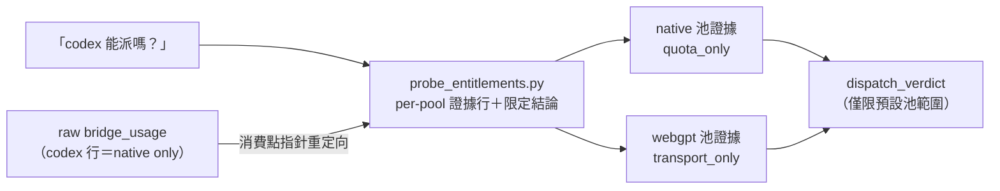

## Description

<!-- SECTION:DESCRIPTION:BEGIN -->
實例：被問「codex 現在能派嗎」，查額度的工具回「codex 週窗 100% 用滿」就直接答「撞牆」——但那個數字只代表 native 訂閱池，實際派工預設走 webgpt（另一個池、沒有額度閘）。正確知識都寫在 memory spine 和 model-routing 裡，當下沒查。

**做什麼**
- 把既有的額度探針腳本（probe_entitlements.py——它早就分好兩池，只是被繞過）升級：輸出**每池一行證據**＋一行**範圍限定的派工結論**（例：「codex：native 池滿（僅影響指名派工）；webgpt 健康 → 預設可派」）——讓跑它成為取得答案最省力的路
- 在兩個 skill 的消費點補**重定向指針**（不是重複知識）：raw 額度工具的 codex 行＝native 池 only
- 核心規則入文檔：**任何池的負面觀測只能限制該池**，沒證據不得升級成整家族不可派

**不做什麼**
- 不加 PreToolUse hook（muse＋codex 跨家族共識：三入口攔不全＋假確定性風險；A+B 落地後若復發再議）
- 不改 delegate-bridge 輸出（跨 repo，另域）、不重構 AvailabilitySnapshot、不造第二套判定權威

**現在到哪**：跨家族討論收斂（muse job-mv5xt31f／codex job-mv5xt35e），卡已建、等 user 點卡確認後開工。

<!-- SECTION:DESCRIPTION:END -->
