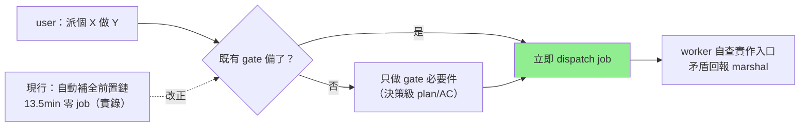

## Description

<!-- SECTION:DESCRIPTION:BEGIN -->
取證實錘：3 週內第 10 次 session 忘記自己是 marshal（兩次真的自己改了源碼）。行為模式很固定：user 說「派個 X 做 Y」之後，session 不去派工，反而自動把前置工作全做完（讀源碼、建卡、把實作細節寫進卡面），十幾分鐘過去一個 job 都沒派出。口頭提醒已經無效（user 每次開工都提醒、照樣復發）——所以這卡不改提醒，改**流程預設**。

**做什麼**
- 「原子派工」判準寫進派工流程檔：指示之後第一個里程碑＝派出 job；該停的 gate 照停，但 gate 內只做 gate 要求的事
- 卡面粒度判準寫進 kanban 檔：寫進卡面的細節以「worker 換一種做法也能滿足」為界——能換做法的細節下沉工單
- 工單檔補下沉承接：已知事實 marshal 給、實作入口 worker 自己找、有矛盾回報
- 派工 readiness 自檢句＋離線量測指標（效果驗證用）

**不做什麼**
- 不加 hook（雙家共識：語義判定過不了機械三判準）、不擴 admission guard（擋不到這種零編輯變體）、不加 always-on rule（同義提醒已鈍化）
- 不跳既有 gate（Description 確認/Plan-AC/Plan Preview 照走——codex 校正：先派後補會讓實作倒過來定義需求）

**現在到哪**：討論收斂完畢（取證＋muse＋codex 雙家共識），user 已點頭，準備開工。

<!-- SECTION:DESCRIPTION:END -->

## Acceptance Criteria
<!-- AC:BEGIN -->
- [ ] #1 agent-workflow 5d 原子派工條文在場：第一個合法 dispatch 里程碑、gate 不跳但 gate 內最小化、唯讀研究腿不冒充 implementation、readiness 自檢句（rg 可掃）
- [ ] #2 kanban-board 欄位分工節粒度判準在場：換做法測試＋下沉 work-order 指針＋真實案例 marker
- [ ] #3 work-order.md：下沉分工判準＋Minimum Dispatch Packet 五欄模板節（目標/範圍邊界/已知決策/禁止事項/首個回報點）
- [ ] #4 single-source drift 掃描乾淨：三檔各守 owner 面無互相重複、引用點已核（rg 證據）
- [ ] #5 全量 pytest 綠＋card_validate --all 綠
- [ ] #6 post-build bi panel（muse＋codex diff 審查）＋fresh-eyes 腿 findings 全處置、bridge GLM-5.3 judge 裁決、回執四欄入卡 notes（boundary 分類）
- [ ] #7 決策④量測承接：結案時以離線 DB 量測一條派工弧的 intent→first valid job 間隔（防 gaming 佐證；無可量測弧時如實記錄），結果記卡 Notes；advisory 非 gate、不入三檔條文（judge R4）
<!-- AC:END -->

## Implementation Plan

<!-- SECTION:PLAN:BEGIN -->
〔baseline：ai-guide 508d2cd7〕
〔已決策勿重辯：①P1 採 codex 保守版「合法原子派工」——既有 gate（Description 確認/Plan-AC spec gate/ArcPlan Plan Preview/風險分類）不跳過、gate 內只做 gate 要求內容、gate 備後立即派；muse 嚴格版「先派後補 spec」否決（實作倒法定義需求）。②P2 粒度判準＝「worker 換一種實作方法仍能滿足相同已決策與 AC 的細節，下沉 work-order 不進卡面」——不禁函式名（構成契約者保留）。③P3 下沉承接：已知事實/契約/邊界 marshal 給、實作入口/呼叫鏈/測試配置 worker 授權範圍內自查、影響上游決策的矛盾回報。④P4＝dispatch readiness 自檢句（LLM advisory 非 hook）＋離線 DB 量測指標 intent→first valid job（防 gaming）。⑤三家一致否決：延遲偵測 hook／admission guard 擴級／新 always-on rule——本卡不含。⑥P1 條文落點 agent-workflow 消費側清單（沿 5b/5c 編號模式插 5d）；P2 落點 kanban-board 欄位分工節；P3 落點 work-order.md 判準節＋模板首節 Minimum Dispatch Packet（五欄：目標/範圍邊界/已知決策/禁止事項/首個回報點）。⑦控制面弧（觸 skills/ 條文語義＝decision/gate 面）→ 分類 boundary、persistent card WT authoring、落地前審查閘：fresh＋intent 分離 baseline＋跨家族腿＝bi panel（muse＋codex，user 指定 post-build 面）。⑧討論雙腿（muse job-mv604lcx／codex job-mv604lgk）＋取證腿＝設計 input 已在場，落地審查不重辯方案、只審 diff 執行品質。〕

範圍：
A. skills/agent-workflow/SKILL.md——execution contract 消費側清單插 5d「原子派工」條文（AIR-325）。
B. skills/kanban-board/SKILL.md——欄位分工節補 Plan/AC 粒度判準＋mos-192 真實案例引用。
C. skills/_common/work-order.md——Marshal 工單供給/worker 調查分工判準（§4-§6 適位）＋模板首節 Minimum Dispatch Packet 五欄。
D. 機械驗證——rg 三檔條文在場且無跨檔重複定義（各 owner 面單一源）、引用點 drift 掃描（改定義源掃引用慣例）、card_validate、全量 pytest。
非目標：hooks/、rules/、governance/、任何 runtime 機制、model-routing。
<!-- SECTION:PLAN:END -->
