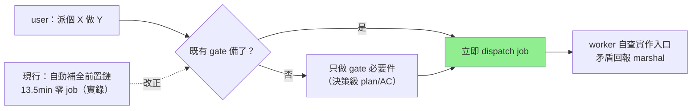

## Description

<!-- SECTION:DESCRIPTION:BEGIN -->
取證實錘：3 週內第 10 次 session 忘記自己是 marshal（兩次真的自己改了源碼）。行為模式很固定：user 說「派個 X 做 Y」之後，session 不去派工，反而自動把前置工作全做完（讀源碼、建卡、把實作細節寫進卡面），十幾分鐘過去一個 job 都沒派出。口頭提醒已經無效（user 每次開工都提醒、照樣復發）——所以這卡不改提醒，改**流程預設**。

**做什麼**
- 「原子派工」判準寫進派工流程檔：指示之後第一個里程碑＝派出 job；該停的 gate 照停，但 gate 內只做 gate 要求的事
- 卡面粒度判準寫進 kanban 檔：寫進卡面的細節以「worker 換一種做法也能滿足」為界——能換做法的細節下沉工單
- 工單檔補下沉承接：已知事實 marshal 給、實作入口 worker 自己找、有矛盾回報
- 派工 readiness 自檢句＋離線量測指標（效果驗證用）

**不做什麼**
- 不加 hook（雙家共識：語義判定過不了機械三判準）、不擴 admission guard（擋不到這種零編輯變體）、不加 always-on rule（同義提醒已鈍化）
- 不跳既有 gate（Description 確認/Plan-AC/Plan Preview 照走——codex 校正：先派後補會讓實作倒過來定義需求）

**現在到哪**：討論收斂完畢（取證＋muse＋codex 雙家共識），user 已點頭，準備開工。

<!-- SECTION:DESCRIPTION:END -->
