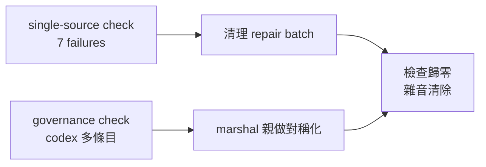

## Description

<!-- SECTION:DESCRIPTION:BEGIN -->
single-source 檢查和 governance 檢查長期帶著七項既有失敗（都不是新問題，是歷史遺留）——每天跑檢查都看見它們，等於狼來了：真的新問題會被雜音淹沒。這卡把雜音清零。

**做什麼**
- 刪兩支從來沒接上線的孤兒 hook 腳本（code 在、註冊面從未存在＝假防線）
- guide 補回 execution-plan 規模句的投影錨（逐字對齊）
- 四個 skill 檔的中文形術語殘留改回 canonical ASCII 形
- codex 端 hooks 接線多出的一條歷史條目移除（marshal 親做，機器本地配置）

**不做什麼**
- 不動歸檔面（ai-analysis/ref-docs/tests fixtures——檢查本來就不掃）
- 不新增任何接線（孤兒 hook 是刪不是接——沒有消費者需求）

**現在到哪**：建卡，馬上開工。

<!-- SECTION:DESCRIPTION:END -->
