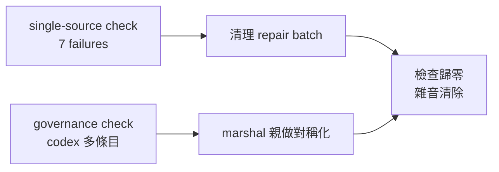

## Description

<!-- SECTION:DESCRIPTION:BEGIN -->
single-source 檢查和 governance 檢查長期帶著七項既有失敗（都不是新問題，是歷史遺留）——每天跑檢查都看見它們，等於狼來了：真的新問題會被雜音淹沒。這卡把雜音清零。

**做什麼**
- 刪兩支從來沒接上線的孤兒 hook 腳本（code 在、註冊面從未存在＝假防線）
- guide 補回 execution-plan 規模句的投影錨（逐字對齊）
- 四個 skill 檔的中文形術語殘留改回 canonical ASCII 形
- codex 端 hooks 接線多出的一條歷史條目移除（marshal 親做，機器本地配置）

**不做什麼**
- 不動歸檔面（ai-analysis/ref-docs/tests fixtures——檢查本來就不掃）
- 不新增任何接線（孤兒 hook 是刪不是接——沒有消費者需求）

**現在到哪**：建卡，馬上開工。

<!-- SECTION:DESCRIPTION:END -->

## Acceptance Criteria
<!-- AC:BEGIN -->
- [ ] #1 孤兒 hooks×2 刪除且刪前查證留痕（rg 零活引用證據在回報）
- [ ] #2 guide 含投影錨逐字串（rg 驗）且只動規模句不重寫段落
- [ ] #3 「卡 Planning Contract」零殘留（rg skills/ rules/ 零命中）且 canonical ASCII 形四檔到位
- [ ] #4 check_single_source 相關 failures 全消（hook_registration×2＋classifier_guide_projection＋classifier_source_anchors×4）
- [ ] #5 全量 pytest 綠＋card_validate 綠
<!-- AC:END -->

## Implementation Plan

<!-- SECTION:PLAN:BEGIN -->
〔baseline：ai-guide ead4d471〕
〔已決策勿重辯：①孤兒 hooks×2（hooks/hook_payload_compat.py、hooks/memory-guard-injection.py）＝刪除非接線——check 判定「接線從未存在」、無消費者需求；刪前須查證（rg 全 repo 引用／README/Capabilities 指名／git log 誕生緣由），查到任何活引用即停手回報不刪。②guide 投影錨＝逐字補回「state ownership、public contract、跨 context invariant、控制面 authority」（整串單錨 ALL 語義——REGISTRY classifier_guide_projection 判準；canonical 源＝execution-plan SKILL.md 規模句，先讀該句再改 guide，只對齊錨不重寫 guide 段）。③「卡 Planning Contract」→canonical ASCII 形×4（skills/acceptance-evidence/SKILL.md:222、skills/fix-test/SKILL.md:145、skills/implement/SKILL.md:369、skills/model-routing/SKILL.md:52）——canonical 形以 repo 內既有 ASCII 用法為準（rg "Card Planning Contract" 查多數形），逐檔 min-edit。④codex SessionEnd 多條目（stop-notification.sh 現身非模板 group）＝marshal 親做（機器本地 ~/.codex/config.toml，spawned worker 禁觸）——本次 commit 後由 marshal 手工移除＋governance check 複驗。⑤guide 變更→bundle 面變動：merge 後 marshal 跑 deploy_agents.py＋驗證（部署紀律），非 worker 範圍。⑥歸檔面（ai-analysis/ref-docs/tests/fixtures）不掃不動。〕

範圍：
A. 刪 hooks/hook_payload_compat.py＋hooks/memory-guard-injection.py（刪前查證零活引用；若 tests 有引用一併評估——引用測試本身是否測已死機制）。
B. ai-development-guide.md 規模句補投影錨（逐字串）。
C. 四 skill 檔術語 min-edit。
D. 機械驗證：uv run python skills/scan-project/scripts/check_single_source.py → hook_registration×2 與 classifier_guide_projection、classifier_source_anchors×4 全消（僅餘零 failure）；rg "卡 Planning Contract" skills/ rules/ → 零命中。
非目標：governance/registrations 內容、machine-local config（marshal 面）、任何新接線。
<!-- SECTION:PLAN:END -->
