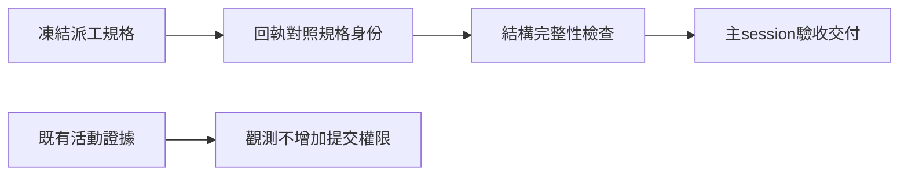

## Description

<!-- SECTION:DESCRIPTION:BEGIN -->
十月架構檢查已與 Muse 兩輪討論。本卡讓回收者能識別過時交付，消除工作者為證明存活而被迫提交的權限矛盾，並更新過時部署描述。

**本次完成**
- 回執對照派工時凍結的規格，規格變動不能沿用舊回執。
- 活動觀測尊重工作者既有權限。
- 架構文件回到現行定義源。

**範圍邊界**
模型資格新政策與派工引擎另待證據；本卡不統一 watcher、不新增排程。

<!-- SECTION:DESCRIPTION:END -->

## Acceptance Criteria
<!-- AC:BEGIN -->
- [x] #1 回執綁定派工時 assigned manifest；改變 contract、驗收條件或 unit 分派後舊回執被拒，缺失或錯誤 digest fail-closed
- [x] #2 有效回執可通過結構檢查，FAIL 或 NOT-DONE 不被解讀為完成，既有 AC 覆蓋診斷保留
- [x] #3 活動證據不要求無權 worker commit；terminal 與判死權威不降低，相關引用同步
- [x] #4 blueprint 與治理導航符合現行定義源；觸及投影 freshness 收斂或明示 stale
- [x] #5 Sol 交付經獨立 review、Muse 第二意見、Flash 機驗與 Marshal 裁決，post-build 回執與剩餘部署狀態可追溯
<!-- AC:END -->

## Implementation Plan

<!-- SECTION:PLAN:BEGIN -->
Baseline: 7dbfd020fec402ca3c0eabb2c55a5752ae6e2057（9007350e 為前期分析基線）。Full tier / boundary。已決策與 scope 以 ai-analysis/_tasks/air-327-delivery-identity/ep.md 為準：dispatch 凍結 assigned manifest，結構與語義分離；活動觀測不新增 commit 權限；blueprint 為合成視角。Sol 實作，Flash 機验，Muse 獨立審查，主 session 裁決。排除資格自動晉升、統一 watcher、排程、跨 repo 修改。
<!-- SECTION:PLAN:END -->

## Implementation Notes

<!-- SECTION:NOTES:BEGIN -->
AUTH: user said "ＯＫ就開卡實作吧，你可以sol 實作, flash, msue"。本次同意承接已呈報分析；Description 與 AC 限已核實 A/B/C。classification=boundary。

EP review：Muse job-mv6b3a53-9r9lnd completed，七項建議逐項採纳；Sol 01a133fa-5e07-7a00-b06a-53d8b1fd159c 補 expected-only oracle。原 producer 無條件 write_text 支持 no-clobber 修訂；新 contract 定義明確後接受 EP。唯一 writer Ohm 01a133fd-9d10-7481-8115-ae4e0d5aa468 原生 Sol6.1/high 已派。主 session 持續回收；不新增 cron。

AUTH: user said "Muse撞五小時，Resets at 3:56 PM 你可以派glm 5.3 審查"（兩則 steering，2026-10-13 台北15:56）。後續 Muse second-opinion 改 GLM-5.3；先前 Muse EP completed 保留。fresh Sol context＋intent GLM-5.3＋Flash 機驗，Marshal 裁決。

實作凍結：Sol Ohm 交付14檔，diff sha256 f712089b2b671db3cb599237f0056ceeb0abb6c0ef63792ecf5461862969404a；Marshal 全量 pytest 3925 passed/1 skipped（WT .agent-tmp/air327-full-suite.log）。projection5源fresh、single-source15項零異常、diff-check與證活殘留掃描通過。Flash job-mv6cb834-o4ypjp 完成靜態oracle1-11 mapping；plan-mode擋執行，未計實跑PASS。原fresh Sol reviewer因capacity失敗，替換GLM-5.3 job-mv6cb8sn-54qrlk；intent GLM job-mv6c2p98-n5olo0仍審查中。待裁決，未收線／commit／merge／部署。其後另做user指定Flash+Terra歷史dry-run；收信gen8在崗，兩封已讀待回覆保留。

GLM fresh/intent已回收並裁決四項採納：surrogate digest、非字串AC ID、NUL檔名三CLI現為exit1，parent實測；另恢復一個既存測試class provenance。NUL經baseline否證屬既存，不採新回歸歸因。證據WT .agent-tmp/air327-adjudication-repro.json、air327-f3-baseline.txt；帳本.review/air-327.md。Sol同一writer進repair R1，待followup。GLM審查plan-mode無實跑權，未虛報PASS；parent驗證獨立承載。

Post-build source acceptance：Sol R1 source frozen diff05c33e2b1fbec7b97f3af6229141300443442a98d936b295eb160e9fc6a170f8。GLM fresh＋intent＋closure四finding verified；依 user「你可以派glm 5.3 審查」覆蓋原AC5 Muse名額；Flash僅靜態oracle對照，plan-mode禁止執行，Marshal實跑補足機驗，未把blocked當PASS。最終全repo3929passed/1skipped，四malformed CLI皆exit2無traceback，review ledger converged。回執：/Users/ctai/Github/ai-guide-air-327/.agent-tmp/post-build-receipts/air-327.json；報告：同WT ai-analysis/_tasks/air-327-delivery-identity/post-build.md。classification=boundary；review=fresh+intent+closure+S2；session-freshness=canonical未改且按凍結WT審查；deployment-surfaces=healthy canonical symlink，新source啟用待merge。HEAD仍7dbfd020；source未commit/merge，card仍In Progress。Flash/Terra歷史dry-run與新增監控洗版討論分開追蹤，不擴AIR327 scope。

AUTH: user said "就merge main啊"。提交前增量僅測試helper annotation dict→object；Marshal逆換hash核對，96 tests通過，四變更檔scoped mypy通過。未變tests/conftest.py三既有optional loader型別錯誤列範圍外；不擴本卡。post-build四欄與R1審查保持，metadata及三份研究報告同批保全。
<!-- SECTION:NOTES:END -->

## Final Summary

<!-- SECTION:FINAL_SUMMARY:BEGIN -->
完成交付規格身份檢查、活動觀測權限修正與架構文件同步。Sol實作，GLM-5.3依使用者授權取代Muse額度腿，獨立審查四finding已修正並驗收。全repo3929passed/1skipped，提交前annotation-only修正定向96passed。使用者已批准提交並merge main；整合結果見git與landing回執。監控架構新設計與歷史dry-run另留報告，不包含新監控實作。

<!-- SECTION:FINAL_SUMMARY:END -->
