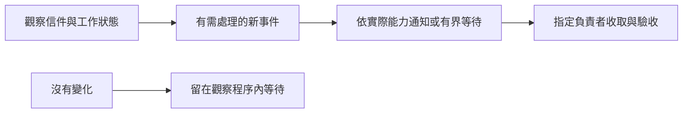
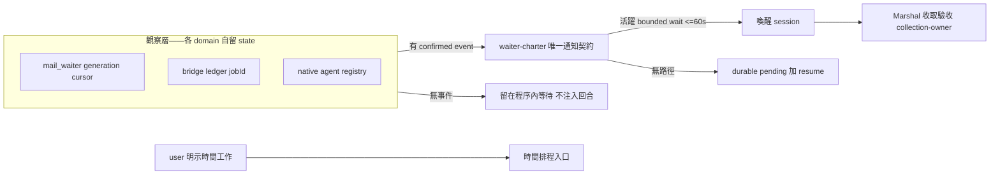

## Description

<!-- SECTION:DESCRIPTION:BEGIN -->
目前 mail、bridge 與 agent 的監控指引分散且互相矛盾，會把定時喚醒當成補救，造成 session 洗版。本卡統一通知能力的判讀，保留各工具自己的觀察與狀態，明確指定收取責任，並修正尚未掛哨卻宣稱已掛哨的提示。GLM 5.3 與 Muse 已審查初稿，正在收斂修訂；通過後 Flash 實作，Sol／Muse 審查，Marshal 裁決。

<!-- SECTION:DESCRIPTION:END -->

## Acceptance Criteria
<!-- AC:BEGIN -->
- [x] #1 活動監控指引及引用改由唯一通知契約承接；沒有mandatory recurring監控或無條件exit-push宣稱。
- [x] #2 已授權watch延續與stop優先序清楚，status不授權也不撤銷；缺哨提示不宣稱已掛哨且hook維持唯讀。
- [x] #3 既有observer timeout/rearm/身份與收取fence保留；真實時間排程仍可用，未驗證carrier能力誠實揭露。
- [x] #4 新舊instruction情境及runtime測試有證據，Sol與Muse審查並經Marshal裁決收斂。
<!-- AC:END -->

## Implementation Plan

<!-- SECTION:PLAN:BEGIN -->
Full boundary arc；以 ai-analysis/_tasks/air-328-event-monitoring/ep.md 為實作規劃單一源。已決策：通知契約獨立，collection-owner歸agent-workflow，域內state分開，移除mandatory監控排程；不新增carrier push/reaper。Flash依accepted EP實作、Sol與Muse獨立審查、Marshal judge。
<!-- SECTION:PLAN:END -->

## Final Summary

<!-- SECTION:FINAL_SUMMARY:BEGIN -->
**終態：監控契約遷移已落地（main 7772c822，deploy 4/4，四端錨點驗證通過）。**

skills/_common/waiter-charter.md 為唯一通知契約：責任四分（觀察各域自留 state／通知歸 charter／收取驗收歸 agent-workflow collection-owner／時間排程僅服務 user 明示時間工作）、watch intent priority 五條、bounded wait <=60s per call、at-least-once、mail cursor 非 dedupe key。7 skill 刪 mandatory heartbeat／通用 exit-push；model-routing 決策樹導航化；hooks/mail_autoarm 缺哨改誠實 advisory（TDD negative predicate）。不做清單零違反。

證據：EP review 兩腿 READY_FOR_FLASH→writer（TDD RED/GREEN，全套 3928+2 同 baseline）→三腿實作審查（Sol fresh NEEDS-FIX 抓 2 important 已修／primed ACCEPT／GLM-5.3 ACCEPT）→微修腿 CONTRACT_OK→dry-run TC1/2/3/6/7 新舊 arm 10 腿（新 5/5 PASS，舊 arm 重現 cron heartbeat 與反覆請示兩個歷史失敗模式）；TC8 由本弧實際 bridge 收線作第一 consumer。降級記錄：Muse intent 腿 failed-usage 由 GLM-5.3 接續（user 裁決），面板全 GLM 家族。

ep：ai-analysis/_tasks/air-328-event-monitoring/ep.md（收線全記錄＋jobId）
<!-- SECTION:FINAL_SUMMARY:END -->
