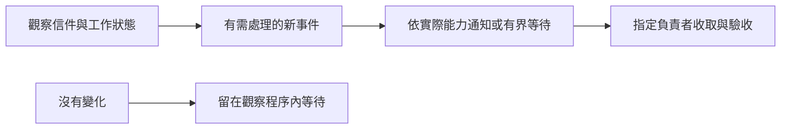

## Description

<!-- SECTION:DESCRIPTION:BEGIN -->
目前 mail、bridge 與 agent 的監控指引分散且互相矛盾，會把定時喚醒當成補救，造成 session 洗版。本卡統一通知能力的判讀，保留各工具自己的觀察與狀態，明確指定收取責任，並修正尚未掛哨卻宣稱已掛哨的提示。GLM 5.3 與 Muse 已審查初稿，正在收斂修訂；通過後 Flash 實作，Sol／Muse 審查，Marshal 裁決。

<!-- SECTION:DESCRIPTION:END -->
