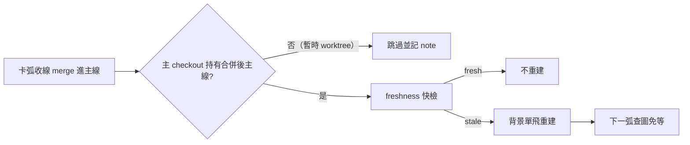

## Description

<!-- SECTION:DESCRIPTION:BEGIN -->
每張卡的程式碼 merge 進主線（main）時，code-reality 結構圖（查 callers／影響範圍用的知識圖）就過期了——下一張卡開工查圖會吃到過期資料、或現場等分鐘級重建。這張卡讓收線流程在 merge 落地後自動把圖在背景重建好，下一弧查圖免等。

**做什麼**
- wt-close.sh（收線腳本）：merge 後跑 freshness 快檢（約 1 秒內），結果寫進收線回執；過期時訊息附上確切的重建命令
- 收尾流程（commit skill）：看到「確認過期」就踢背景重建——不擋收線、失敗無所謂
- cr-query skill：新增一節定義這個「收線後保溫」契約（含與既有 AIR-228 借用規則的範圍切分）

**不做什麼**
- 不在 session 開場做事（兩輪跨家族討論都否決了開場檢查）
- 不阻塞收線——重建是機會性的，失敗就交給消費時的既有檢查兜底
- 卡 worktree 借用圖的既有規則（AIR-228 demand-trigger）不動

**規矩**
- 只在主 checkout 本身完成 merge 時才做（merge 發生在暫時 worktree 時跳過——避免對錯誤狀態重建）
- 與既有的需求觸發重建共用「單飛」（不同時跑兩個 build）
- 量測先行：回執細化記結果，命中率高才考慮升級全自動

<!-- SECTION:DESCRIPTION:END -->

## Acceptance Criteria
<!-- AC:BEGIN -->
- [ ] #1 - [ ] wt-close.sh：full 收斂且 trunk 實際前進＋MERGE_WT==primary 時，對 primary 跑 `code-reality freshness --repo <primary> --json`，輸出三態（confirmed-stale 附確切 rebuild 命令／fresh／unavailable fail-open——binary 缺席或 exit 2 不擋收線）；MERGE_WT≠primary 時輸出 skip note 不判 build
- [ ] receipt token 細化：graph-stale-reminded 換為 graph-stale=confirmed／graph-fresh／freshness-unavailable／graph-warmup-skipped 四值（舊 token 引用面 rg 全掃零殘留或標退役）
- [ ] skills/cr-query/SKILL.md 新節「primary post-merge warm-up」＝契約單一源：AIR-228 amendment 條文（codex 擬句原文在場）、single-flight 共用、build 後重驗 identity、非阻塞與 session 背景壽命邊界、量測欄位
- [ ] skills/commit/SKILL.md 收尾段：merge --ff-only 成功後新增一步（freshness→confirmed-stale 踢背景 single-flight build），引用 cr-query 節不重抄
- [ ] `bash -n scripts/wt-close.sh` 過；修改段以暫時 fixture repo＋stub code-reality 演練三態；實際 full 收線為 live 驗證點
- [ ] `uv run python scripts/card_validate.py` exit 0；instruction 條文變更走落地前審查閘（muse＋codex review＋GLM-5.3 judge）
<!-- AC:END -->

## Implementation Plan

<!-- SECTION:PLAN:BEGIN -->
〔baseline：ai-guide 005b99f4〕
〔已決策勿重辯：①執行形態＝C hybrid（codex 二輪裁決 job-mv7a8u7c-z9iqng；一輪 job-mv7a8u7c-z9iqng 前作 job-mv799q9j-zdzwoo 已否決 SessionStart/Stop hook）——wt-close.sh 只升級 freshness 快檢＋receipt token＋stderr 附重建命令，腳本不自動 build；重建的決策與執行歸收尾 instruction（定義單一源＝cr-query skill 新節）②時點＝merge 落地後；身份防護＝僅 primary 持有合併後 trunk 時才判 build（MERGE_WT≠primary 的暫時/trunk WT merge→skip＋note，防 identity 錯配——codex 盲點③）③無條件跑 freshness、信任 verdict：trunk 前進不必然 stale（content-addressed identity 才是判準，cr-query:89）；docs-only 也不保證 fresh（doc-set-drift 實例，AIR-206）④非阻塞 best-effort：失敗不影響 merge 收線；session 級背景 shell 隨 session 死屬良性（demand-trigger 兜底）；與 demand build 共用 single-flight；build 完成後重驗 identity，stale-on-arrival 交 demand-trigger 再收⑤AIR-228 scope amendment（codex 擬句）：「AIR-228 維持 card-WT evidence-demand single-flight。新增 primary post-merge opportunistic warm-up，僅改善 graph availability，不提供 freshness acceptance」——禁改造成 review 阻塞式前置⑥量測先行：receipt token 細化（graph-stale=confirmed／graph-fresh／freshness-unavailable）＋卡 notes 記 warm-up kick；核心指標＝warm-up reuse rate（下一弧實際消費該 build identity 的弧數／成功 warm-up 弧數）；命中率高才評估 A 形（腳本自動 build）⑦消費前 freshness gate（AIR-135 條2）不動——本機制非正確性依賴〕
範圍：skills/cr-query/SKILL.md（新節 primary post-merge warm-up＋AIR-228 amendment）、skills/commit/SKILL.md（收尾 merge 後一步，引用 cr-query 節不重抄）、scripts/wt-close.sh（AIR-164 提醒升級為 freshness 快檢三態＋receipt token＋MERGE_WT==primary 防護）、舊 token「graph-stale-reminded」引用面 rg 全掃同步；禁碰 backlog/ 卡 metadata（board single-writer——writer 唯讀卡面）
<!-- SECTION:PLAN:END -->
