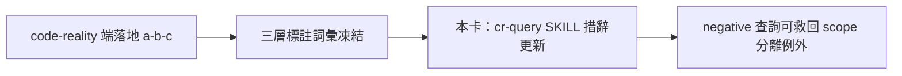
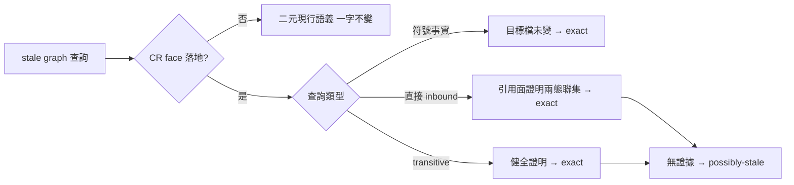

## Description

<!-- SECTION:DESCRIPTION:BEGIN -->
delegate-bridge 端提案把 code-reality 的 freshness 從二元 verdict 升級成可計算的 stale 集合（三層標註：exact／possibly-stale／no-coverage），讓「過期的圖」在查詢範圍與變更集可證分離時仍可精確消費（例如純文檔變更後，未動檔的 Rust 結構查詢其實是 exact）。工具端（(a) index slot 存 base commit、(b) freshness 加 delta 輸出、(c) 查詢面逐筆標註＋MCP face）歸 code-reality repo 值星；本卡承接 ai-guide 這側的 (d)：cr-query 紀律措辭跟著更新——negative 查詢加 scope-分離例外、degraded 詞彙增 stale-delta 類值。**依賴：等 code-reality 端 (a)-(c) 落地、三層標註詞彙凍結後才動工**（提案全文：delegate-bridge repo `.agent-tmp/cr-delta-freshness-proposal.md`；原信已歸檔 wt-evidence）。

<!-- SECTION:DESCRIPTION:END -->

## Acceptance Criteria
<!-- AC:BEGIN -->
- [x] #1 - [x] 三層語義按查詢類型分治：符號事實／直接 inbound（引用面證明）／transitive 可達集（排除引用面證明適格——F-1 修復）
- [x] 🔴 生效 gate：CR face 落地前現行二元 verdict 消費語義一字不變
- [x] producer version 硬綁定：缺版或跨版標註＝unavailable 不得消費
- [x] negative scope-分離例外機械條件：direct inbound＝引用面證明兩態聯集比對（judge J-1）；transitive＝健全證明未定義前禁令維持
- [x] degraded reason 三值擴充（stale-delta-exact／stale-delta-possibly-stale／stale-delta-no-coverage）直對層名；workflow-review-pattern 凍結 grammar 不動
- [x] 落地前審查閘完成：codex×2＋in-harness（muse failed-usage 額度降級承接）＋GLM-5.3 judge×2——ledger .review/air-330.md 收斂（✅7 verified／❌2 假影 closed／未決 0）
<!-- AC:END -->

## Implementation Plan

<!-- SECTION:PLAN:BEGIN -->
〔baseline：ai-guide 91ecfcf1〕
〔已決策勿重辯：契約先行——CR 端 (a)(b)(c) 未落地（催辦信 aiguide-cr-delta-nudge-20261014 已寄），本卡產出為契約宣告，生效 gate 綁 CR face 落地；三層語義按查詢類型分治＝兩輪對抗審查收斂結果（codex F-High：exact 對 negative 關係查詢不健全；in-harness F-1：同一缺陷類 transitive 重現）——引用面證明僅適格直接 inbound，transitive 須健全證明未定義前一律 possibly-stale；「完整 outbound 符號引用清單」釘義一切非本檔定義符號；兩態聯集相位（judge #1）〕
範圍：skills/cr-query/SKILL.md 單檔（新節「stale-delta 三層標註」＋AIR-228 節尾一行指針）
<!-- SECTION:PLAN:END -->

## Implementation Notes

<!-- SECTION:NOTES:BEGIN -->
outbound 台帳：code-reality 催辦信已寄（envelope aiguide-cr-delta-nudge-20261014，acceptanceSeq=6；AUTH user 原話「沒有的話就寄信催一下」）；歸屬裁決記錄同日回信 delegate-bridge（aiguide-crdelta-reply-20261014，acceptanceSeq=9，AUTH「這是誰該作就誰作啊」）
<!-- SECTION:NOTES:END -->

## Final Summary

<!-- SECTION:FINAL_SUMMARY:BEGIN -->
cr-query 新節「stale-delta 三層標註（契約宣告）」上線（main 87f6303d）——三層語義按查詢類型分治（符號事實／直接 inbound／transitive 可達集三檔判準）＋🔴 生效 gate（CR face 落地前消費語義一字不變）＋producer version 硬綁定＋negative 例外機械條件（引用面證明／兩態聯集相位）。三個 review context 兩輪對抗（codex F-High→in-harness F-1→judge 終裁＋相位釘）把「可證分離」修成健全版本；契約同時是 code-reality 端 (b) 的對齊源（催辦信已寄，等重開機後值星）。as-built：

<!-- SECTION:FINAL_SUMMARY:END -->
