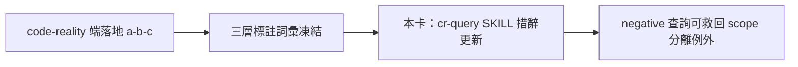

## Description

<!-- SECTION:DESCRIPTION:BEGIN -->
delegate-bridge 端提案把 code-reality 的 freshness 從二元 verdict 升級成可計算的 stale 集合（三層標註：exact／possibly-stale／no-coverage），讓「過期的圖」在查詢範圍與變更集可證分離時仍可精確消費（例如純文檔變更後，未動檔的 Rust 結構查詢其實是 exact）。工具端（(a) index slot 存 base commit、(b) freshness 加 delta 輸出、(c) 查詢面逐筆標註＋MCP face）歸 code-reality repo 值星；本卡承接 ai-guide 這側的 (d)：cr-query 紀律措辭跟著更新——negative 查詢加 scope-分離例外、degraded 詞彙增 stale-delta 類值。**依賴：等 code-reality 端 (a)-(c) 落地、三層標註詞彙凍結後才動工**（提案全文：delegate-bridge repo `.agent-tmp/cr-delta-freshness-proposal.md`；原信已歸檔 wt-evidence）。

<!-- SECTION:DESCRIPTION:END -->

## Implementation Notes

<!-- SECTION:NOTES:BEGIN -->
outbound 台帳：code-reality 催辦信已寄（envelope aiguide-cr-delta-nudge-20261014，acceptanceSeq=6；AUTH user 原話「沒有的話就寄信催一下」）；歸屬裁決記錄同日回信 delegate-bridge（aiguide-crdelta-reply-20261014，acceptanceSeq=9，AUTH「這是誰該作就誰作啊」）
<!-- SECTION:NOTES:END -->
