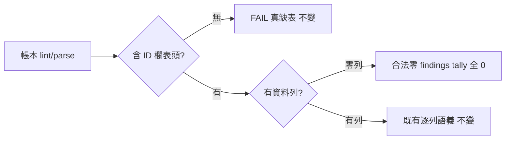

## Description

<!-- SECTION:DESCRIPTION:BEGIN -->
mosaic 端透過 dutymail 回報的修復請求（D-009）：review_ledger.py 把「合法零 findings 帳本」誤報為 FAIL——兩處 `if len(t) > 1` 表格過濾在 ID 欄偵測前就把 header-only 表丟掉，導致 `table.missing` 誤報。雙家族討論（codex job-mv7dioh7＋GLM-5.3 job-mv7dips7）收斂修法②：interpreter 層修正讀取語義（header-only 表＝合法零 findings），格式不動、凍結 grammar 不動、fail-closed 底線不動。

<!-- SECTION:DESCRIPTION:END -->
