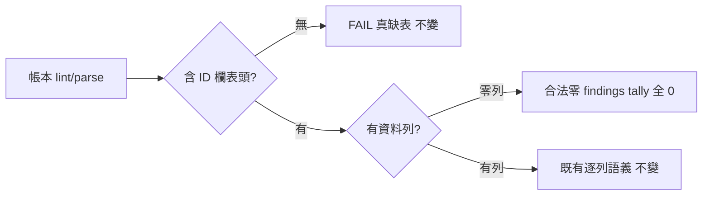

## Description

<!-- SECTION:DESCRIPTION:BEGIN -->
mosaic 端透過 dutymail 回報的修復請求（D-009）：review_ledger.py 把「合法零 findings 帳本」誤報為 FAIL——兩處 `if len(t) > 1` 表格過濾在 ID 欄偵測前就把 header-only 表丟掉，導致 `table.missing` 誤報。雙家族討論（codex job-mv7dioh7＋GLM-5.3 job-mv7dips7）收斂修法②：interpreter 層修正讀取語義（header-only 表＝合法零 findings），格式不動、凍結 grammar 不動、fail-closed 底線不動。

<!-- SECTION:DESCRIPTION:END -->

## Acceptance Criteria
<!-- AC:BEGIN -->
- [x] #1 - [x] 兩處表格過濾保留 header-only 表：零資料列＝零 findings，parse tally 全 0、lint EXIT_OK（discovery＋converged）——〔證據：tests 66 passed，案例釘住〕
- [x] 真缺表（全文無含 ID 欄表頭）維持 FAIL——〔證據：既有 air-86 純 prose 案例照綠未改寫〕
- [x] header-only 表缺 canonical 欄照 `columns.missing` FAIL；garbage 資料列照 `row.malformed`/unparsed——〔證據：新增案例 3/5〕
- [x] header-only 表＋資料表並存：findings 只計資料表——〔證據：新增案例 4〕
- [x] converged 面零 findings 帳本 legs 名冊／CR receipt 檢查照查不豁免——〔證據：新增案例 6〕
- [x] `uv run pytest tests/test_review_ledger.py -x -q` 全綠——〔證據：orchestrator 獨立重跑 66 passed＋pre-commit 全 repo 3944 passed @66f5566b〕
<!-- AC:END -->

## Implementation Plan

<!-- SECTION:PLAN:BEGIN -->
〔baseline：ai-guide 256273ac〕
〔已決策勿重辯：修法②（雙家族討論收斂——codex job-mv7dioh7＋GLM-5.3 job-mv7dips7）：interpreter 層 header-only 表豁免（含 ID 欄表頭＋零資料列＝合法零 findings）；帳本格式與 workflow-review-pattern 凍結 grammar 零變更；真缺表 fail-closed 底線不動；①pseudo-row 否決（虛構 finding 污染 tally/join，實質違反凍結 grammar）〕
範圍：skills/post-build/scripts/review_ledger.py（兩處表格過濾條件）、tests/test_review_ledger.py（六條邊界案例）
<!-- SECTION:PLAN:END -->

## Final Summary

<!-- SECTION:FINAL_SUMMARY:BEGIN -->
review_ledger 零 findings 誤報修復上線（main c026c19f）——header-only 表（含 ID 欄表頭＋零資料列）＝合法零 findings（tally 全 0），真缺表 fail-closed 不變；格式與凍結 grammar 零變更。雙家族討論收斂修法②、TDD 6 案例釘住、suite 66 passed／全 repo 3944 passed；回信 mosaic_alpha 已送達（aiguide-d009-reply-20261014，acceptanceSeq=5）。as-built：

<!-- SECTION:FINAL_SUMMARY:END -->
