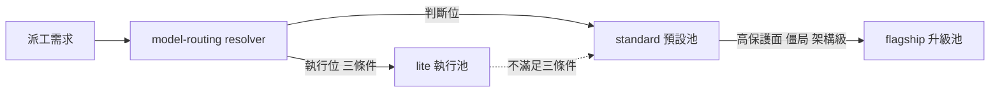

## Description

<!-- SECTION:DESCRIPTION:BEGIN -->
把四個 AI 家族（muse／codex／GLM／CC）的可用 model 分成 **flagship／standard／lite** 三級，日常派工預設用 standard，特殊狀況才升 flagship。user 已裁決分級表與政策（經 muse＋codex＋GLM-5.3 三家族顧問討論收斂）。

**做什麼**
- catalog.toml 登記三級 tier 標註＋新 model muse-wonder-full-1.0（Power/Max plan 解鎖；qualification=pending_first_use）
- model-routing SKILL 派工預設段改寫：判斷位預設 standard／執行位維持 lite 三條件／flagship 三觸發（高保護面、兩輪僵局、架構級）＋no-candidate 顯式降級
- codex 家族簡化：派工面＝webgpt（standard）＋astra（flagship，僅 app 手動）；sol／terra／luna 退出分級表
- judge 條文與 tier 詞彙脫鉤：judge＝主 session 座位模型；全 repo「旗艦」字樣對帳（single-source drift 防護）
- spine model-runtime-entitlements 現值更新（muse 方案升級＋wonder-full 可用）

**不做什麼**
- 不改 registry pins（presets.toml 角色綁定不動）
- 不改 bridge 行為與窗口語義正典
- 不做 wonder-full 的資格實測（留下一個真實弧取樣）

**規矩**
- 審查閘＝boundary 類：落地文本 fresh＋intent 分離審＋muse 跨家族外審；回執四欄入卡

<!-- SECTION:DESCRIPTION:END -->

## Acceptance Criteria
<!-- AC:BEGIN -->
- [ ] #1 1. catalog.toml：dispatch-relevant model_identity 全帶 tier 欄（flagship/standard/lite）；muse-wonder-full-1.0 row 在場（qualification=pending_first_use）；uv run python scripts/sync_agents.py --check 綠（loader schema 驗證過；擴 loader 須附測試）
2. model-routing SKILL.md dispatch 預設段：三級政策全文在場（判斷位/執行位分治＋三觸發＋no-candidate 顯式降級＋judge＝主 session 座位模型）；family 表 muse 行含 wonder-full、codex 行標 webgpt=standard 預設＋astra=flagship app-only＋sol/terra/luna 退表
3. 旗艦 sweep 零 live drift：rg -n 旗艦 rules/ skills/ agents/ AGENTS.md 逐檔 triage 表在卡 notes——live 條文已更新、provenance（真實案例 marker）保留；每處與新定義一致
4. spine entitlements as-of 更新在場（muse Power/Max 方案＋wonder-full 可用＋10-14 事件行）
5. 審查腿收斂：fresh-eyes＋intent（in-harness）＋muse 跨家族外審 findings 經 judge 裁決；回執四欄（classification/review/session-freshness/deployment-surfaces）寫入卡 notes
6. card branch commit 過 commit gate；trunk ff-only merge 綠
<!-- AC:END -->

## Implementation Plan

<!-- SECTION:PLAN:BEGIN -->
〔baseline：ai-guide main @ 7803b79e〕

〔已決策勿重辯：
①三級表成員——flagship：wonder-full-1.0（muse；qualification=pending_first_use）、astra（codex native；僅 app 手動）、fable（帳號面未解鎖、不計容量）；standard：wonder-1.0、webgpt chatgpt-web/high（codex bridge 派工預設）、opus（CC；上緣標註）、GLM-5.3（ZCode 主軸座位）；lite：spark-1.3、GLM-5.3-Flash（唯一 vision）、sonnet（user 裁決降級——CC 非主力 coding）、haiku
②codex 派工面＝webgpt＋astra 兩個；sol／terra／luna 退出分級表——catalog 供給事實保留、native 預設不派政策不變
③判斷位（judge／EP 規劃／adjudication）預設 standard；執行位維持 lite 三條件（既有實證不動）
④flagship 升級三觸發＝高保護面裁決／兩輪僵局／架構級 blueprint；觸發後無可派 flagship＝no-candidate 顯式記錄後降級（no-silent-downgrade 不變）
⑤judge 條文＝「judge＝主 session 座位模型」——與 tier 詞彙脫鉤；升級外派條件不變
⑥分級判準＝純能力證據制：flagship 資格線＝既有旗艦資格條款五項；standard＝過 decision floor；lite＝execution floor＋降級安全實證；成本／訂閱／可達面不入 tier 標籤（正交軸獨立標註）
⑦registry pins（presets.toml）不動；bridge 行為不動；窗口語義正典不動
⑧wonder-full-1.0 qualification=pending_first_use——首次實派取樣後轉正（先例＝wonder-1.0 換代播種）〕

〔風險分類：boundary（routing policy／authority 面）——落地前 fresh＋intent 分離審＋跨家族 muse 外審；回執四欄結算入卡 notes〕

〔範圍：skills/model-routing/SKILL.md（dispatch 預設段三級政策＋family 表 muse/codex 行）；skills/model-routing/catalog.toml（tier 欄＋wonder-full row；loader schema 擴充若需附測試）；旗艦字樣 sweep（rg 實測 12 檔）逐檔 triage——live 條文更新、真實案例／user 裁決 provenance 保留；~/.agents/memory-spine/reference_model-runtime-entitlements.md as-of 更新〕
<!-- SECTION:PLAN:END -->
