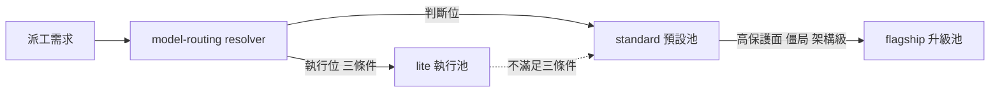
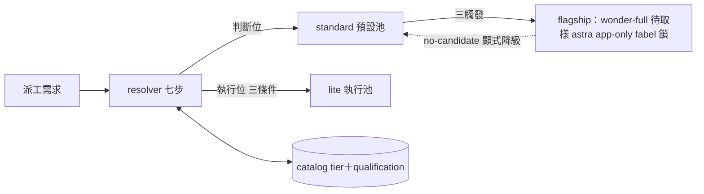

## Description

<!-- SECTION:DESCRIPTION:BEGIN -->
把四個 AI 家族（muse／codex／GLM／CC）的可用 model 分成 **flagship／standard／lite** 三級，日常派工預設用 standard，特殊狀況才升 flagship。user 已裁決分級表與政策（經 muse＋codex＋GLM-5.3 三家族顧問討論收斂）。

**做什麼**
- catalog.toml 登記三級 tier 標註＋新 model muse-wonder-full-1.0（Power/Max plan 解鎖；qualification=pending_first_use）
- model-routing SKILL 派工預設段改寫：判斷位預設 standard／執行位維持 lite 三條件／flagship 三觸發（高保護面、兩輪僵局、架構級）＋no-candidate 顯式降級
- codex 家族簡化：派工面＝webgpt（standard）＋astra（flagship，僅 app 手動）；sol／terra／luna 退出分級表
- judge 條文與 tier 詞彙脫鉤：judge＝主 session 座位模型；全 repo「旗艦」字樣對帳（single-source drift 防護）
- spine model-runtime-entitlements 現值更新（muse 方案升級＋wonder-full 可用）

**不做什麼**
- 不改 registry pins（presets.toml 角色綁定不動）
- 不改 bridge 行為與窗口語義正典
- 不做 wonder-full 的資格實測（留下一個真實弧取樣）

**規矩**
- 審查閘＝boundary 類：落地文本 fresh＋intent 分離審＋muse 跨家族外審；回執四欄入卡

<!-- SECTION:DESCRIPTION:END -->

## Acceptance Criteria
<!-- AC:BEGIN -->
- [x] #1 1. catalog.toml：dispatch-relevant model_identity 全帶 tier 欄（flagship/standard/lite）；muse-wonder-full-1.0 row 在場（qualification=pending_first_use）；uv run python scripts/sync_agents.py --check 綠（loader schema 驗證過；擴 loader 須附測試）
- [x] 2. model-routing SKILL.md dispatch 預設段：三級政策全文在場（判斷位/執行位分治＋三觸發＋no-candidate 顯式降級＋judge＝主 session 座位模型）；family 表 muse 行含 wonder-full、codex 行標 webgpt=standard 預設＋astra=flagship app-only＋sol/terra/luna 退表
- [x] 3. 旗艦 sweep 零 live drift：rg -n 旗艦 rules/ skills/ agents/ AGENTS.md 逐檔 triage 表在卡 notes——live 條文已更新、provenance（真實案例 marker）保留；每處與新定義一致
- [x] 4. spine entitlements as-of 更新在場（muse Power/Max 方案＋wonder-full 可用＋10-14 事件行）
- [x] 5. 審查腿收斂：fresh-eyes＋intent（in-harness）＋muse 跨家族外審 findings 經 judge 裁決；回執四欄（classification/review/session-freshness/deployment-surfaces）寫入卡 notes
- [x] 6. card branch commit 過 commit gate；trunk ff-only merge 綠
<!-- AC:END -->

## Implementation Plan

<!-- SECTION:PLAN:BEGIN -->
〔baseline：ai-guide main @ 7803b79e〕

〔已決策勿重辯：
①三級表成員——flagship：wonder-full-1.0（muse；qualification=pending_first_use）、astra（codex native；僅 app 手動）、fable（帳號面未解鎖、不計容量）；standard：wonder-1.0、webgpt chatgpt-web/high（codex bridge 派工預設）、opus（CC；上緣標註）、GLM-5.3（ZCode 主軸座位）；lite：spark-1.3、GLM-5.3-Flash（唯一 vision）、sonnet（user 裁決降級——CC 非主力 coding）、haiku
②codex 派工面＝webgpt＋astra 兩個；sol／terra／luna 退出分級表——catalog 供給事實保留、native 預設不派政策不變
③判斷位（judge／EP 規劃／adjudication）預設 standard；執行位維持 lite 三條件（既有實證不動）
④flagship 升級三觸發＝高保護面裁決／兩輪僵局／架構級 blueprint；觸發後無可派 flagship＝no-candidate 顯式記錄後降級（no-silent-downgrade 不變）
⑤judge 條文＝「judge＝主 session 座位模型」——與 tier 詞彙脫鉤；升級外派條件不變
⑥分級判準＝純能力證據制：flagship 資格線＝既有旗艦資格條款五項；standard＝過 decision floor；lite＝execution floor＋降級安全實證；成本／訂閱／可達面不入 tier 標籤（正交軸獨立標註）
⑦registry pins（presets.toml）不動；bridge 行為不動；窗口語義正典不動
⑧wonder-full-1.0 qualification=pending_first_use——首次實派取樣後轉正（先例＝wonder-1.0 換代播種）〕

〔風險分類：boundary（routing policy／authority 面）——落地前 fresh＋intent 分離審＋跨家族 muse 外審；回執四欄結算入卡 notes〕

〔範圍：skills/model-routing/SKILL.md（dispatch 預設段三級政策＋family 表 muse/codex 行）；skills/model-routing/catalog.toml（tier 欄＋wonder-full row；loader schema 擴充若需附測試）；旗艦字樣 sweep（rg 實測 12 檔）逐檔 triage——live 條文更新、真實案例／user 裁決 provenance 保留；~/.agents/memory-spine/reference_model-runtime-entitlements.md as-of 更新〕
<!-- SECTION:PLAN:END -->

## Implementation Notes

<!-- SECTION:NOTES:BEGIN -->
〔審查腿收斂——AIR-332 落地前審查閘回執〕classification=boundary（routing policy／authority 面）。review=三腿：fresh-eyes（in-harness，PASS-with-findings：fable/fabel＋4 suggestion）＋intent-primed（CHANGES-REQUIRED：F1 judge/verdict 四檔未對帳＋F2/F3 intent-drift）＋跨家族 muse 外審（CHANGES-REQUIRED 12 findings，job-mv7k0pve-p2ii76）——findings 經 judge 裁決 14 項：12 項修復（修復批 a332-fix 全綠：pytest 107 passed／--check exit 0／殘留掃描僅 user 引句）；1 項改判——「旗艦裁決」機制名改名「judge 裁決」（推翻 worker 階段保留裁定：gloss 跨檔無效、outward rule 為 always-on bundle；user 引句逐字保留）；2 項 intent-drift（觸發②③擴張讀法）裁採納——user 核可之綜合文本本含此措辭，卡 Plan ④ 為簡寫。session-freshness=fresh（authoring 全程本 session；改動條文即時在 context）。deployment-surfaces=見次行。〔AC#3 旗艦 sweep triage 總結〕live 條文改寫 8 檔（model-routing SKILL×10 處／agent-workflow×3＋能力下限／conversation-dispatch／kanban-board 主體修正＋commit/autonomous-execution/deep-work/outward rule 機制名改名）；provenance 保留（AIR-50/AIR-24 案例 marker、webgpt user 原話×2、10-13 wonder 裁定＋當時詞彙註、deep-work user 引句）；個別：fabel 正名（卡 Plan ① 書 fable＝誤植，catalog identity 為 fabel——Plan 凍結不改，以本行為準）；sonnet/haiku 無 catalog identity row＝設計內（harness_alias_tokens 詞彙面，tier 由三級表 lite 行承載）；wonder-full qualification binding_scope=["*"]（AIR-218 先例形——binding 落地同 commit 收窄＋斷言，屬 wonder-full 轉正弧義務）；full/vision/lite requirement token 與 tier 三級正交（glossary 消歧行已落）。〔跟催〕CR 端 CR-10 承接 (a)(b)(c)，對齊信 aiguide-cr-align-cr10-20261014 已確認（K2 成立、逐段回報走本址）；S4 交付即開 gate 翻轉小卡（機械判準＝delta 欄位在場）。
<!-- SECTION:NOTES:END -->

## Final Summary

<!-- SECTION:FINAL_SUMMARY:BEGIN -->
三級分級落地收線：catalog tier 欄（10 identity＋wonder-full 播種）＋loader enum（測試釘住）＋model-routing 三級政策（判斷位 standard／執行位 lite 三條件／flagship 三觸發＋no-candidate 顯式降級）＋judge＝主 session 座位模型；跨檔「旗艦→座位模型」＋「旗艦裁決→judge 裁決」對帳（user 引句保留）。審查＝三腿＋bi-panel 兩輪全 terminal（r2 muse job-mv7m5ybf／codex job-mv7m5yd4 同意收線）；跟催＝AIR-333（lint 嚴格度）、wonder-full 轉正弧（首派取樣＋binding 收窄）。main @ 4d1b4320；deploy 4/4＋live symlink 錨驗證綠。

<!-- SECTION:FINAL_SUMMARY:END -->
