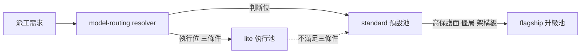

## Description

<!-- SECTION:DESCRIPTION:BEGIN -->
把四個 AI 家族（muse／codex／GLM／CC）的可用 model 分成 **flagship／standard／lite** 三級，日常派工預設用 standard，特殊狀況才升 flagship。user 已裁決分級表與政策（經 muse＋codex＋GLM-5.3 三家族顧問討論收斂）。

**做什麼**
- catalog.toml 登記三級 tier 標註＋新 model muse-wonder-full-1.0（Power/Max plan 解鎖；qualification=pending_first_use）
- model-routing SKILL 派工預設段改寫：判斷位預設 standard／執行位維持 lite 三條件／flagship 三觸發（高保護面、兩輪僵局、架構級）＋no-candidate 顯式降級
- codex 家族簡化：派工面＝webgpt（standard）＋astra（flagship，僅 app 手動）；sol／terra／luna 退出分級表
- judge 條文與 tier 詞彙脫鉤：judge＝主 session 座位模型；全 repo「旗艦」字樣對帳（single-source drift 防護）
- spine model-runtime-entitlements 現值更新（muse 方案升級＋wonder-full 可用）

**不做什麼**
- 不改 registry pins（presets.toml 角色綁定不動）
- 不改 bridge 行為與窗口語義正典
- 不做 wonder-full 的資格實測（留下一個真實弧取樣）

**規矩**
- 審查閘＝boundary 類：落地文本 fresh＋intent 分離審＋muse 跨家族外審；回執四欄入卡

<!-- SECTION:DESCRIPTION:END -->
