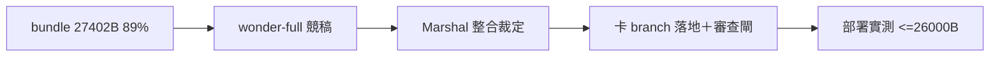

## Description

<!-- SECTION:DESCRIPTION:BEGIN -->
治理 bundle（全域 guide＋rules/ neutral rules，部署成 muse/grok 面 AGENTS.md）又漲回 30KiB 預算的 89%（27,402B）——第二波瘦身。這卡由 muse-wonder-full-1.0 出一版瘦身方案稿（flagship 首派取樣），Marshal 整合後走控制面流程落地。

**做什麼**
- wonder-full 唯讀競稿：讀 rules/＋guide＋deploy 組裝面，產出逐檔處置表＋壓縮稿（只寫 .agent-tmp/slim-wave/）
- Marshal 整合裁定表 → 卡 branch 落地 → boundary 審查閘 → 四端部署驗證

**不做什麼**
- 不砍 always-on 核心（首個有後果決策前必須在場的規則面）
- worker 不碰 rules/／skills/（唯讀）；不用行數/字數當判準

**規矩（AIR-317 拍板沿用）**
- 瘦身槓桿限三形：reference 分層下沉／per-lane scope 差異化／prose 收緊
- 核心紀律語義零損失；禁元資訊

<!-- SECTION:DESCRIPTION:END -->

## Acceptance Criteria
<!-- AC:BEGIN -->
- [x] #1 wonder-full 競稿回收（.agent-tmp/slim-wave/ 檔案承載＋逐檔處置表＋before/after bytes 估計）
- [x] #2 Marshal 整合終版有逐項裁定表（採納/否決＋理由）
- [x] #3 落地後 muse/grok 面 bundle ≤26,000B 部署實測；zcode/codex 面 90KiB gate 不變綠
- [x] #4 核心紀律語義零損失：逐 rule 勾稽表（sink）
- [x] #5 落地前審查閘回執（四欄）＋四端部署驗證
<!-- AC:END -->

## Implementation Plan

<!-- SECTION:PLAN:BEGIN -->
〔baseline：ai-guide b549dd07〕〔已決策勿重辯：①瘦身槓桿限三形——AIR-317 拍板：reference 分層下沉／per-lane scope 差異化（上波對 muse exclude 否決——重新採用須正面處理「muse 可為派工端」反例）／prose 收緊；②always-on 核心語義零損失；③禁元資訊；④wonder-full 執行腿首派取樣——user 2026-10-14 原話「瘦身波讓 wonder full去跑看看」，判斷/整合/judge 歸主 session，取樣結果回寫 catalog qualification＋binding 評估；⑤muse 額度 user 確認在場（2026-10-14 原話「Muse有額度啦，我有看」）〕範圍：wonder-full 唯讀競稿（產出僅 .agent-tmp/slim-wave/）→Marshal 整合裁定表→卡 branch air-334 落地（控制面 authoring 走非 canonical WT＋boundary 審查閘）→trunk 收斂→deploy 四端驗證。目標：muse/grok bundle ≤26,000B；zcode/codex 90KiB gate 不變。
<!-- SECTION:PLAN:END -->

## Implementation Notes

<!-- SECTION:NOTES:BEGIN -->
wonder-full 首派取樣（2026-10-14）：job-mv7uyu4b-mrpz6l（session 01a13990-9752-76e1-8c7c-fcb4ec77e54a，effort high，--sandbox-autonomy 寫入面）exit 0——bridge VALID_MODELS 接受 --model muse-wonder-full-1.0，catalog「binding 未開（VALID_MODELS 未實測）」取得首筆 live 證據。產出：.agent-tmp/slim-wave/wonder-full-draft.md（37.9KB）＋candidates/ 8 候補實檔＋_assemble/_measure/_verify 腳本；宣稱 27,402B→25,374B（deploy_agents.build_bundle 實函數量測；逐檔 Δ 加總−2,028 與合計一致）；exclude 不採用（引 AIR-317 反例）；寫入面守約（repo 受保護路徑 git 零變更）；風險自報三條（bridge 操作面承載 repo 外須落地前核現版、guide 列舉下沉 activation 風險、outward 壓縮須跑 pressure scenario）。取樣判讀＝PASS 形（execution 腿交付＋機械量測＋scope 自守＋honest risk reporting）。整合裁定表＝marshal 下段工作（候補檔過独立重測後落地卡 branch air-334）。

雙腿審查評分（2026-10-14，user 指定 GLM-5.3＋codex 同準據）：GLM-5.3 腿 8.1/10 needs-fix（修後即 accept）、codex 腿 7.8/10 needs-fix；數字管線兩腿獨立復現一致（27,402→25,374B；GLM 進一步驗 _verify.py 與 deploy_agents.py:548-566 等價）。findings 互補少重疊（cross-hit 形態）：codex 獨抓 context manual-paste 豁免丟失（高）＋symbol fallback 限定詞壓縮（中）；GLM 獨抓 Spine 承載宣稱不實（高——稿宣稱「已逐項 grep 驗證」實測 memory-audit SKILL 對 spine 路徑 0 命中）＋collaboration「workspace 相對」等三小條；共識＝guide 下沉 activation probe 落地前須真跑。取樣評估更新：機械管線（量測/組裝/腳本等價性）可信；承載自證抽查有過報（「已驗證」宣稱不實一例）——implement 轉正維持，但 wonder-full 自報驗證面不可信，judge 補審必要（與 lite 分工律「lite 模型測試僅規格陳述」同形）。修復清單入 marshal 整合裁定表。報告：review-{glm53,codex}.md。

post-build 收斂落卡（AIR-121）：review_ledger converged parse＝findings 1／✅ 1／verified 1／未決 0。bi-panel 外審：muse job-mv7yxy9i-ic55ux approve（全 hunk 掃描）；codex job-mv7yyl97-46f64x needs-attention 1 finding（F-01 outward 卡級 6 則計數失「執續 outbound」限定）——judge ✅ 採納、還原修復驗證（rg=1＋dotfile 四端 grep=1＋25,856B 部署）。consistency 閘 pass-with-notes（回歸 STATE.md 節＋語義外損已修）；tour corpus 本 WT 零 .tour 無 FAIL；coverage/rename/政策翻轉 detect 全空（據）；correction mining 1 候選已收編 D-011（closed，重演防抓地交 user）。
<!-- SECTION:NOTES:END -->

## Final Summary

<!-- SECTION:FINAL_SUMMARY:BEGIN -->
治理 bundle 瘦身第二波收線：27,402→25,856B（30KiB gate 89%→84%），zcode/codex 90KiB gate 不變綠。wonder-full 首派取樣 PASS（execution workload 轉正＋bridge binding 開啟）；雙腿審查（GLM-5.3 8.1／codex 7.8）findings 全數修復；post-build bi-panel（muse approve／codex F-01 採納還原）收斂未決=0；四端部署驗證 25,856B。

<!-- SECTION:FINAL_SUMMARY:END -->
