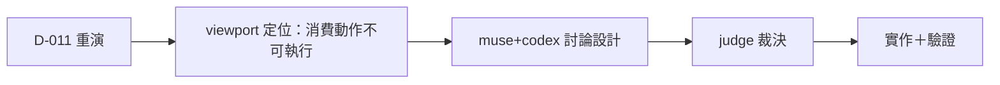
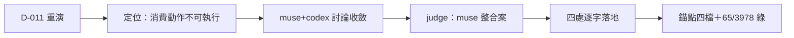

## Description

<!-- SECTION:DESCRIPTION:BEGIN -->
D-011 correction 重演：「codex webgpt／muse 額度」兩個 model 事實政策已三層編碼（always-on 指針／on-demand skill/catalog／機械 probe+bridge），他 session 仍誤讀——洞定位為「unknown/exhausted 的消費動作在判讀現場不可執行」（probe 說「禁推定」但沒說「該做什麼」）。本卡讓 muse＋codex 討論出具體抓地設計，judge 裁決後落地。

**做什麼**
- bi-panel 討論：probe_entitlements.py 輸出訊息可執行化＋spine muse/codex 行消費語義補強（＋第三案評估）
- judge 裁決→實作→部署驗證

**不做什麼**
- 不做 hook/閘強制（AIR-135 條 3：startup 只 advisory、gate 在 consumer boundary；muse 無機械探測面可擋）
- 不改 catalog 三級表／routing 政策本身

**規矩**
- 事實三層現狀是對的，只修「判讀現場訊息的可執行性」；訊息措辭禁元資訊

<!-- SECTION:DESCRIPTION:END -->

## Acceptance Criteria
<!-- AC:BEGIN -->
- [x] #1 probe WARN muse family 分支（unknown≠不可派＋消費動作）＋新全文逐字釘；codex/glm 原句與 token 面零變動
- [x] #2 spine 兩行（line 8 例外指針＋line 14 消費句除「待探測」種子）；as-of 不刷新
- [x] #3 SKILL:80 muse 例外句（政策正典）；錨點「實派即探測」四檔對帳
- [x] #4 scoped 65／全量 3978 passed＋live probe 新 WARN 可見＋marshal 獨立複核
<!-- AC:END -->

## Implementation Plan

<!-- SECTION:PLAN:BEGIN -->
〔baseline：ai-guide 49f9eb19〕〔已決策勿重辯：①bi-panel 討論收斂案（muse 測試釘面分析為準）：probe WARN muse family 分支（verdict 行不動——endswith 多點逐字釘；codex exhaustion 行不加——單池作用域；availability_snapshot:222 記債不動）②spine 兩行（line 8 例外指針＋line 14 消費句，除「待探測」種子，as-of 不刷新）③SKILL:80 muse 例外句＝政策正典④錨點片語「實派即探測」四檔對帳⑤不做 hook/閘〕範圍：probe_entitlements.py＋tests＋SKILL.md＋spine 外部檔；驗收＝scoped 65 passed＋錨點四檔＋probe 實跑新句可見。
<!-- SECTION:PLAN:END -->

## Final Summary

<!-- SECTION:FINAL_SUMMARY:BEGIN -->
D-011 抓地收線：probe unknown 的消費動作從「禁推定」（不可執行）改為可執行三段句（勿以此停派→查 spine/user 實證→未記耗盡即實派）；SKILL:80 補 muse 例外句（政策正典——probe unsupported≠耗盡證據）；spine 兩行同步。三面分層單一源＋錨點片語對帳。重演防線落在判讀現場的那一行輸出。

<!-- SECTION:FINAL_SUMMARY:END -->
